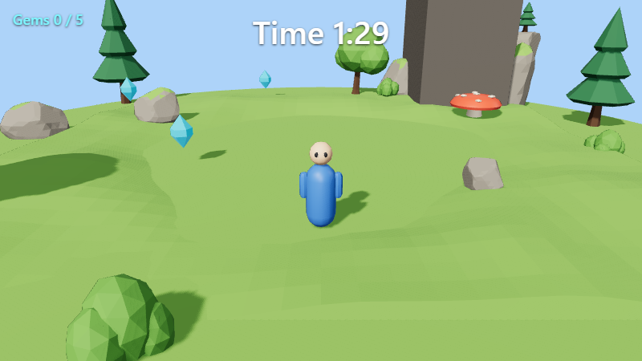
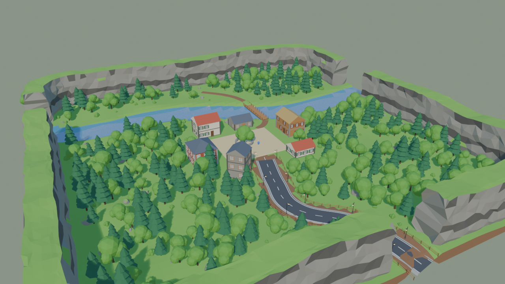
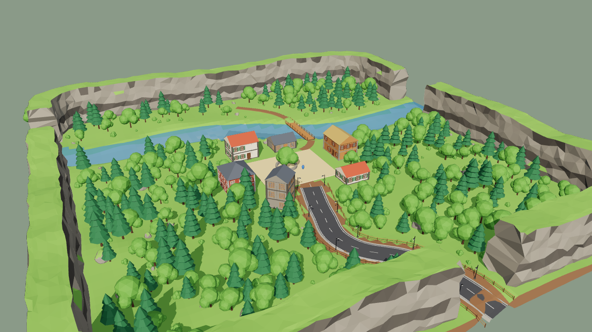
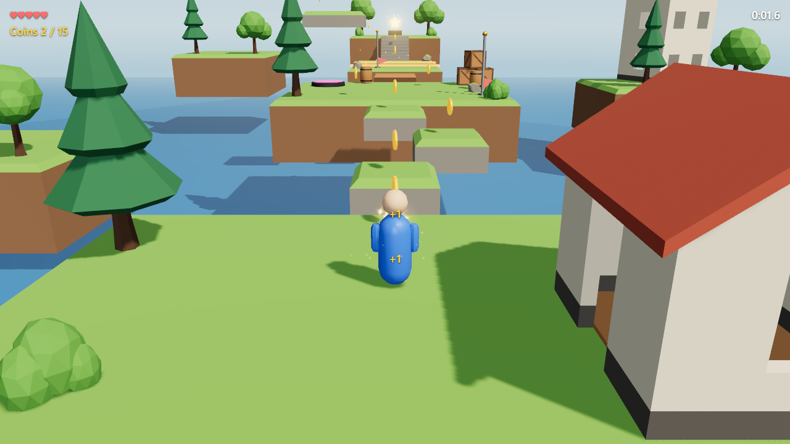
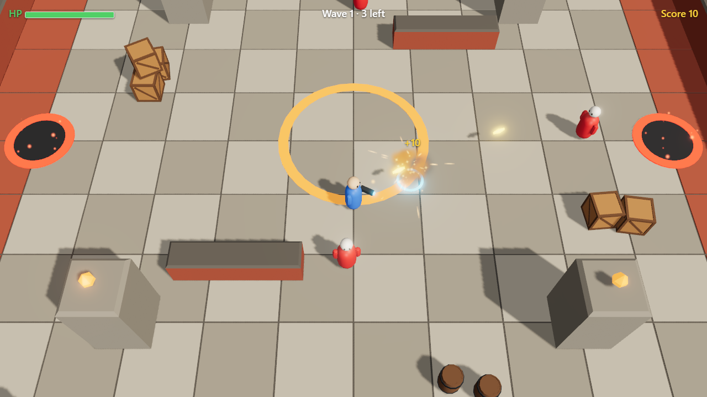
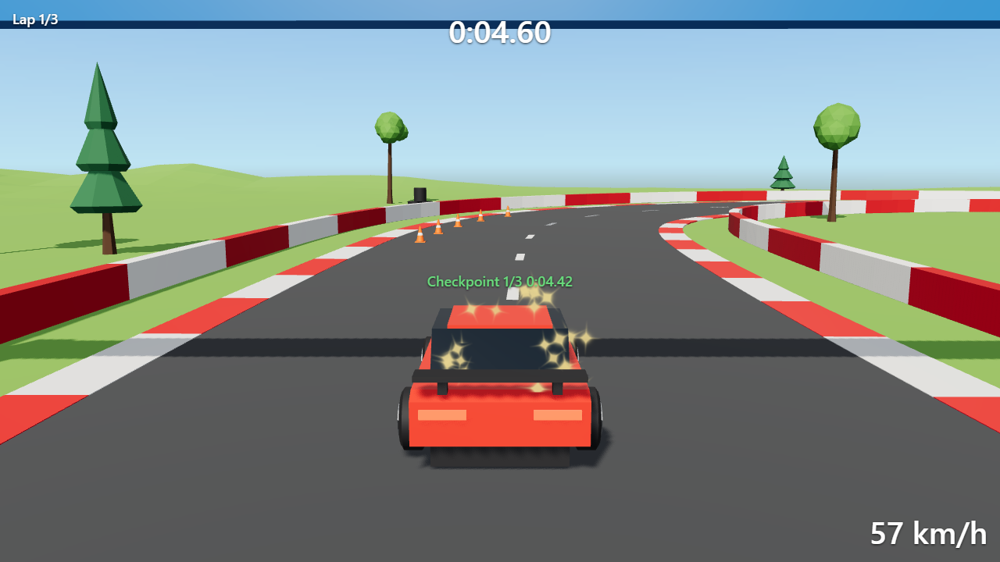
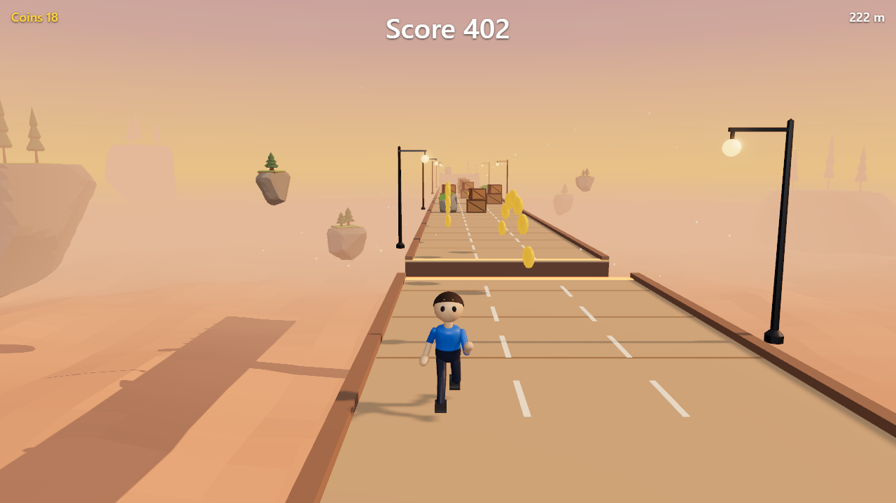

<h1>
  <picture>
    <source media="(prefers-color-scheme: dark)" srcset="docs/images/logo-dark.svg">
    
  </picture>
</h1>

**Website:** [https://abuurka.github.io/gamestudio](https://abuurka.github.io/gamestudio/) · **Documentation:** [Illustrated user manual](docs/manual/README.md) · [Offline HTML edition](docs/manual.html) · [20 narrated video tutorials](docs/videos/README.md) · [All references](docs/README.md)

**Let your AI agent build your game inside Blender.**

GameStudio is a Blender 5.2+ extension. It turns Blender into a place where an AI agent makes 3D assets, levels and gameplay code in one app. Any agent that speaks MCP can use it: Claude Code and Codex connect in one click, and other MCP clients connect to the same server ([how](docs/MCP.md#other-agents)). The agent models props with parametric kits or Python, lays out levels, attaches game components to objects, writes TypeScript systems, and then **plays the game, looks at it and fixes what's wrong**, all through one MCP server. You describe the game, watch Blender update, and play the result in your browser. You can change anything by hand at any time.



*Gem Island was built entirely through the MCP tools from the brief "collect all the gems on a floating island before the timer runs out": kits for the art, TypeScript for the rules, playtests to prove them.*

## Why GameStudio

AI coding agents can build 3D games now, but the usual ways of doing it each have a catch:

- **Vibe-code straight into three.js.** It is quick to start, but every model has to be written as code. There are no modeling tools, and nothing on screen you can grab and fix by hand.
- **Use a game engine** such as Unity, Godot or Unreal. Engines are built to run games, not to make 3D art, so the models still come from somewhere else, usually Blender.
- **Split the work across Blender, an engine and a code editor.** Every change crosses tools: export, import, fix the scale and the materials, find the code that uses it. You and the agent both lose time switching.

GameStudio takes the best of both worlds:

1. **One platform.** Blender is where you model, build levels and give objects their game behaviour, and TypeScript holds the rules. Your AI agent works on all of it through one MCP server, and you can change anything by hand.
2. **The web as the target.** The game runs on three.js in any modern browser, on any operating system, and ships as a static web build you can host anywhere or share as a link. There is no engine to install and no per-platform build.

### Why Blender

| Built in Blender with geometry nodes | The same level in the game (browser) |
|---|---|
|  |  |

*A 150 m valley built in about 2 seconds from GameStudio's geometry-nodes builders: cliffs, a river with a bridge, a fenced road with lamps, a village and 273 trees scattered around them. Procedural materials are baked and the scatter exports as GPU instances, so the game matches Blender: 925 instances in 24 draw calls.*

Blender has the richest scriptable 3D toolset there is: modeling, geometry nodes, modifiers, node materials, rigging and animation. Web 3D libraries have no authoring tools at all, so GameStudio builds in Blender and exports the result for the browser.

## How it works

```
 Your agent  ──stdio──► @gamestudio/mcp ──localhost + token──► Blender + GameStudio extension
                              │                                     │ export (.glb + manifest)
                              ├──► dev server (Vite, live link) ◄───┘ live edits while playing
                              └──► headless browser ──► the game (TypeScript, three.js, Rapier)
```

The agent gets **64 MCP tools**. Each one returns something the agent can check: an image, a report, game state or a log line.

- **Build:**
  - **procedural worldbuilding** on geometry nodes (`create_procedural`, `set_procedural`, the `procedural-world` skill): scatter with keep-out zones, roads, fences, rivers, cliffs, modular buildings, objects along curves, all editable afterwards;
  - 22 parametric kits: rock, crate, barrel, tree, bush, fence, stairs, platform, building, terrain (round and floating-island shapes; hill, ramp, valley and ridge reliefs), water, sky, collectible, pickup, key, character, rigged character, projectile, and assemblies with named parts: vehicle, weapon, door, switch;
  - `run_python` for anything else, as one undo step;
  - materials from a 27-preset palette;
  - snap to ground, raycasts;
  - asset libraries linked into levels as prefabs.
- **Look:** `game_screenshot` with `mode: "scene"` shows the level through the game's own renderer from any viewpoint, without playing. `render_views` returns one labelled contact sheet ([example](docs/images/render-views-sheet.png)) with rulers in metres, dimension lines and a 1.8 m figure for scale. It has a focus mode and a before/after comparison with a checkpoint. `validate_assets` checks game-readiness. `scene_twin` gives a compact text overview of a level.
- **Make it a game:** components from TypeScript schemas, attached in Blender; systems in TypeScript with hot reload; animation clips from Blender actions (a rigged character comes with Idle, Walk, Run, Jump and more); audio with music, sound and UI volume channels the player's settings keep; prefabs spawned at runtime; timers; HUD.
  Also: title, pause and end screens (`ctx.ui`); particles and bloom; several levels per game (`ctx.loadScene`) with saved progress; and seeded randomness (`ctx.random`, with independent streams), so playtests replay exactly.
  And for richer games:
  - **animation state machines** (`defineAnimationGraph`: blend spaces, transitions, triggers);
  - **navigation meshes** with pathfinding agents (`NavMesh`, `NavAgent`, `ctx.nav.path`);
  - **baked lighting** (Cycles lightmaps for static objects);
  - **game shaders** on Blender materials (`defineShader`, `set_material_shader`) for wind, water, foam and triplanar scans, applied wherever the material is drawn; the game tone-maps with the scene's view transform and exposure, so its colours match Blender's;
  - **33 ready-made game shaders** in Properties › Material › Game: water, shoreline foam, lava, foliage and grass sway, flags, snow, moss, ice, dissolve, hologram, energy shield, portal, hit flash, outlines, toon, a UI shine and gradient and more, with no code ([the list](runtime/packages/engine/API.md#29-shader-library));
  - **menus and HUDs laid out in Blender** (`ui/ui.blend`, one scene per screen, built with the `ui_*` tools or by hand): Blender's fonts, panels, 9-slice art and keyframed open and close animations, drawn by the game over the 3D view, with button actions, live values (`Score {score}`), hearts, and volume sliders and toggles that need no code; every template's menus and HUD are made this way. Also lit 3D models inside a screen (a turning gem, a waving character), Shine and Gradient effects on panels, translations (`ui/locales/<code>.json`, matched to the player's browser, with a no-code Language button) and a preview in Blender's 3D View of the screen as the game draws it;
  - **2.5D** side-scroller and top-down support: physics axis locks, character plane modes, orthographic cameras, `SideCamera`;
  - **compressed builds** (meshopt geometry, WebP textures).
- **Play and measure:** play, pause, step; scripted playtests in a headless browser that return screenshots, game state and logs. Playtests can press menu buttons, aim at moving targets and start on any level. `game_stats` reports frame time, draw calls and triangles.
- **Stay in control:**
  - every agent action shows live in Blender's **Agent panel**, with **Undo to Here**;
  - **Pause** the agent, or **Protect** objects it must not touch;
  - checkpoints, undo and redo, crash and hang recovery;
  - reversible edits run without asking: scene edits are undo steps, and asset-library writes are backed up first. `run_python`, deletes, checkpoint restores and opening scenes always ask;
  - **trusted projects:** GameStudio runs a project's own code (its npm scripts, its tools, the game's dev server) only after you trust it. Projects you create or copy are trusted; one someone sent you asks once (GameStudio › Trust This Project);
  - opening a project asks to save your unsaved changes first, and a new project that finishes setting up while you have unsaved changes waits for you (GameStudio › Open *name*).

Each project ships an `AGENTS.md` (the instructions Claude Code and Codex both read; `CLAUDE.md` imports it) and **skills** that walk the loop (in `.claude/skills/`, copied to `.agents/skills/` for Codex):
- `new-game-from-brief`
- `blockout-level`
- `make-prop`
- `procedural-world`
- `add-mechanic`
- `animate-character`
- `playtest-and-fix`
- `stylize-scene`
- `design-ui`: menus and HUDs made in Blender
- `prepare-for-web`
- `make-template`: save the game as a template for your next New Project, custom skills included

The genre templates add one skill each: `add-level-section` (Platformer), `add-enemy-type` (Arena Shooter), `tune-handling` (Time Trial) and `add-chunk` (Endless Runner).

## Quick start

1. **Install the extension** in Blender 5.2+: Edit › Preferences › Get Extensions › Install from Disk, then choose `gamestudio-<version>.zip` (build it with `python tools/build_extension.py`, or `npm run extension:install` for a Blender it finds). That is the only install: no terminal, no npm, no Node.js or browser to get yourself.
   The first time you open a game (an example, a template, your own project) or press Play, GameStudio asks once to set itself up and lists what it downloads, about how big, and where it goes: **Node.js 24** (about 32–55 MB, only if you have no Node.js 22.12+), **the game packages** (three.js, Vite, TypeScript, ...: about 70 MB, 150 MB on disk) and, only if there is no Chrome, Edge or Chromium, **a game browser** (Chrome Headless Shell, about 100–125 MB). Everything goes in the extension's own folder in your Blender profile; nothing is installed system-wide. **Set Up** starts it (and turns on Blender's *Allow Online Access* if it is off); the status bar and the GameStudio menu show the progress, and whatever you pressed (Play, Scene view, Open in Claude Code, Open in Codex) goes on by itself when it is done. If something fails, the message says what, with **Retry** and **Show Log**. Turn on *Set up automatically* in the extension's preferences to skip the question. After an update of the extension, projects get the new engine by themselves (no download unless it needs a new package).
2. **GameStudio › New Project** and pick a template, or open the demo game from **GameStudio › Examples**. Every template comes with the runtime, a playable level, ready-made sound effects and HUD icons (hearts, stars, a coin, a gem, a key), `AGENTS.md` (with a short `CLAUDE.md` that imports it), the skills and `.mcp.json`:
   Each one opens on a title screen made in Blender, has pause and options menus (music and sound volumes), and ends on a win or game-over screen, with particles, a sky and fog.
   - **Starter:** a small level with a player, pickups and a camera; its title shows a turning 3D gem, and its Options switch between English and French.
   - **Platformer** (*Sky Garden*): floating islands, coins, a bounce pad, a moving platform, checkpoints and a goal.
   - **Arena Shooter** (*The Pit*): top-down, mouse aim, enemy waves spawned as prefabs, health and score.
   - **Time Trial** (*Pine Valley Circuit*): an arcade car, a 390 m track, gates, laps and a chase camera.
   - **Endless Runner** (*Sunset Skyway*): three lanes, coins, obstacles and power-ups, on a track built at runtime from prefab chunks. It is the reference for spawning prefabs from code: chunks streamed ahead of the player, Empty sockets inside prefabs, seeded choices, nested prefabs.

   Games you make can become templates too: **GameStudio › Save as Template** (or ask your agent) adds one to this list, with its levels, code and custom skills ([TEMPLATES.md](docs/TEMPLATES.md)).

   | Platformer | Arena Shooter |
   |---|---|
   |  |  |
   | **Time Trial** | **Endless Runner** |
   |  |  |
3. **Connect your AI agent** to the project and describe your game: *"A small 3D game: collect all the gems on a floating island before the timer runs out."* Any MCP client works: start the project's MCP server from it ([MCP.md](docs/MCP.md#other-agents)), and give it the project's `AGENTS.md` and skills. Two agents have one-click setup. **GameStudio › Open in Claude Code** sets Claude Code up: it installs Claude Code when it is missing (*Install Claude Code*, about 250–260 MB: Anthropic's official installer, no terminal needed), connects the project to Claude Code (adding any agent files it lacks), turns the agent bridge on and opens a terminal in the project with Claude Code running. The project's `.mcp.json` also works when you start Claude Code yourself, in any terminal, VS Code or the desktop app. Prefer OpenAI's **Codex**? **GameStudio › Open in Codex** does the same (*Install Codex*, about 160 MB: OpenAI's standalone installer; you sign in with your ChatGPT account or an API key and tell it to trust the folder), and the **Coding agent** preference makes it the one the launcher and the top bar open.
4. **Press F5** in Blender to play it yourself (on a Mac, **Fn+F5**, unless *Use F1, F2, etc. keys as standard function keys* is on in System Settings › Keyboard; the same for F6–F8). The game runs inside Blender, in the Game workspace's 3D View: click it to play, Shift+Esc gives Blender the mouse and keyboard back. F6 pauses, F7 steps, F8 stops and brings the 3D View back. Without Chrome, Edge or the downloaded game browser, Play opens the game in your default browser instead (Safari works too).

Prefer to work by hand? Everything is in Blender's own places. New projects open on the **Game** workspace:
- **Play controls** (▶ ⏸ ⏭ ⏹) are in the top bar. The icon next to them sets where the game plays: inside Blender (Embedded, the default; **Scene | Game** in the area's header switches back to the 3D View while it runs) or in its own window.
- **The Scene view** shows the level the way the game draws it while you build it: the **Game** toggle in a 3D View's header (or GameStudio › Scene View, which splits the view in two) draws that view with the game's renderer, from its own camera, without playing. Navigation, selection, transforms and Blender's overlays keep working on top, and edits show at once. In `ui/ui.blend`, through the screen's camera, it shows the menu or HUD you are editing as the game draws it.
- **Components** are in Properties › Object › Game; prefabs are in Properties › Collection; **game shaders** are in Properties › Material › Game.
- **Project settings, levels and Build Web** are in Properties › Scene › Game Project.
- **Game Assets** is in the 3D View header.
- **The Console** is at the bottom of the Game workspace. Double-click an error line to open the code.
- **The agent's actions** are in the agent button in the top bar.

Older files get the workspace from **GameStudio › Add Game Workspace**. To bring back the old sidebar tab, use Preferences › Add-ons › GameStudio › Interface.

## A project

```
my-game/
  gamestudio.json        project settings (start scene, export budgets)
  scenes/*.blend         levels: the 3D source of truth   scenes/*.scene.json: readable twins
  ui/ui.blend            menus and HUD: one Blender scene per screen   ui/locales/*.json: translations
  assets/*.blend         asset libraries (prefabs)
  src/components/*.ts    component schemas      src/systems/*.ts   game logic
  AGENTS.md              instructions for Claude Code and Codex (CLAUDE.md imports it for Claude Code)
  .claude/skills/        the agent's workflows (Open in Codex copies them to .agents/skills/)
  .mcp.json              connects Claude Code to Blender    .codex/config.toml: the same for Codex (Open in Codex adds it)
  .gamestudio/           generated: exports, bakes, logs, checkpoints (never edited)
```

`npm run build` in a project writes a static web build of the game. Procedural Blender materials are baked to textures, and geometry-nodes scatters export as GPU instances, so the game looks like the Blender scene.

## Developing GameStudio

The extension loads straight from this checkout, so there is no build step:

```bash
npm install                        # runtime packages and tools
python tools/test_blender.py       # Blender suites (addon, shell, contract) with a throw-away profile
npm test && npm run typecheck      # runtime, dev server and MCP server
npm run smoke && npm run features  # the game in headless Edge: live link, animation, audio, prefabs
python tools/build_extension.py    # dist/gamestudio-<version>.zip
```

`tools/blender_dev.py` points Blender at `blender/gamestudio` through a junction: restart Blender to pick up Python changes, while TypeScript hot-reloads. Tests never touch your Blender profile.

On Linux, use `python3`, Blender 5.2.2 from the tarball (`--blender` or `BLENDER`), Google Chrome or Chromium (found on PATH, or set `GS_BROWSER`), and Blender's libraries even in `--background` (Ubuntu: `libx11-6 libxext6 libxi6 libxfixes3 libxrender1 libxxf86vm1 libxkbcommon0 libsm6 libice6 libgl1 libegl1`). No display is needed. CI (`.github/workflows/extension.yml`) runs all of the above on Ubuntu and Windows.

| Path | What it is | Licence |
|---|---|---|
| `blender/gamestudio/` | The extension: components, export, live link, menus, agent bridge (`bridge/`), kits (`kits/`), asset libraries, scene twin | GPL-3.0-or-later |
| `blender/gamestudio/project_templates/`, `script_templates/` | What New Project, New Component and New System copy into a game: code, agent files, skills, the starter's sounds, music and UI images | Code and text MIT-0; the starter's assets CC0-1.0 |
| `blender/tests/` | Blender test suites | GPL-3.0-or-later |
| `runtime/packages/engine/` | `@gamestudio/engine`: ECS, three.js, Rapier, animation, audio, prefabs | MIT |
| `runtime/packages/devserver/` | `@gamestudio/devserver`: Vite plugin, live-link hub, component registry | MIT |
| `runtime/packages/mcp/` | `@gamestudio/mcp`: the MCP server your agent launches | MIT |
| `runtime/packages/host/` | `@gamestudio/host`: runs a game in Electron, in its own window or docked | MIT |
| `examples/demo-game/` | A small platformer | MIT-0 |
| `docs/` | The [user manual](docs/manual/README.md) (also as one `manual.html`), the [video tutorials](docs/videos/README.md), `ARCHITECTURE.md`, `MCP.md`, `SPEC.md`, `WORKFLOWS.md`, `TEMPLATES.md` (project templates, your own included), `GAME-UI.md` (menus and HUDs made in Blender), `AI-ASSISTANT.md`, `EXTENSION-LISTING.md` (draft store listing); `fork/` holds the shelved Blender fork's docs | |
| `tools/` | Development scripts: the extension build, test runners, end-to-end runs, benchmarks, manual screenshots, sound and icon generators | |
| `research/` | Background research from planning: other engines, Blender internals, runtime options, AI agents, the fork | |
| `editor/` | The shelved GameStudio Editor fork of Blender (kept for reference, not maintained) | GPL |

A game you make with GameStudio is yours to license as you like. It runs on the MIT-licensed runtime and only reads the files Blender exports, so neither Blender's GPL nor the extension's reaches it. The code a template puts in it is MIT-0 and the starter's sounds, music and UI images are CC0, so neither asks for credit. The runtime and the libraries it bundles (three.js, Rapier and others, under MIT and Apache-2.0) ask only that their licence notices go with the game, and its web build includes them. [LICENSE.md](LICENSE.md) lists every part's licence. This is not legal advice.

## Tests

Last full run: 15 October 2026, Windows 11, Blender 5.2.2. The CI workflows in `.github/workflows/` run the same suites on Windows and Ubuntu.

| Suite | Command | Result |
|---|---|---|
| Extension in Blender | `python tools/test_blender.py addon` | 1083 passed (12 mesh checks skipped for the sky kit, which builds no mesh) |
| Blender UI shell | `python tools/test_blender.py shell` | 263 passed (13 skipped: 11 need the shelved Editor fork, 2 need a POSIX shell) |
| Extension contract | `python tools/test_blender.py contract` | 39 passed (5 skipped: they need an Editor fork build) |
| Engine, dev server, MCP server, skills | `npm test` | 1087 passed |
| Types | `npm run typecheck` | clean |
| A game in headless Chrome/Edge: live link, hot reload | `npm run smoke` | 27/27 |
| Engine features: animation, audio, prefabs, particles, screens, levels | `npm run features` | 38/38 |
| Every template from New Project to its ending | `npm run e2e:templates` | 120/120 (5 templates) |
| Extension package | `python tools/build_extension.py` | 2.9 MB zip (554 files), passes `extension validate` |

## Status

GameStudio is an early preview ([CHANGELOG.md](CHANGELOG.md) lists what's new). Developed on Windows with Blender 5.2.2, and the full test matrix also passes on Linux (Ubuntu 24.04, in WSL). macOS paths are written but untested. The in-Blender AI assistant (Claude API, proposal workflow) is still included; an AI agent through MCP is the main way to work.

GameStudio is based on Blender's open source code; Blender is a trademark of the Blender Foundation, and GameStudio is not affiliated with or endorsed by it.
