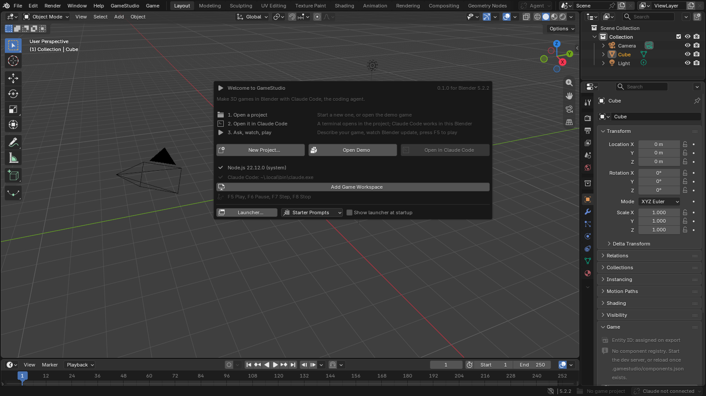

# Installation and setup

[Manual contents](README.md) · Next: [The editor and play controls](02-editor.md)

## Requirements

| Requirement | Details |
|---|---|
| Blender | Version 5.2.0 or later, as declared by this extension's manifest |
| Operating system | The manifest lists Windows, macOS and Linux, each for x64 and ARM64; the matching Blender and runtime binaries must be available |
| Project storage | A writable folder for levels, assets, code and generated files |
| Network during setup | Used to obtain missing runtime dependencies; external coding agents also have their own service requirements |
| Game browser | Chrome, Edge or Chromium for embedded play and browser automation, or the game browser offered by setup |
| Existing Node.js | Optional; GameStudio accepts Node.js 22.12+ and can download its managed Node.js 24 runtime when needed |

You do not need to install a coding agent to edit a level, add components or play a template. The normal extension setup manages the runtime dependencies; terminal commands are an optional developer workflow.

## Install the extension archive

1. Obtain the `gamestudio-<version>.zip` extension archive. If you are working from this repository, the developer build command below creates it in `dist/`.
2. Open Blender and choose **Edit > Preferences > Get Extensions**.
3. Open the menu for extension management and choose **Install from Disk**.
4. Select the ZIP archive. Install and enable GameStudio if Blender does not enable it automatically.
5. Return to Blender's main window. The **GameStudio** and **Game** menus should now be visible.



*The welcome screen provides the main entry points. The agent button becomes useful after you open a game project. A missing agent does not prevent manual editing.*

For a source checkout, run this in the repository root with Python and a supported Blender available:

```sh
python tools/build_extension.py
```

The resulting ZIP includes the runtime packages and example content. Installing an arbitrary ZIP of the repository is not the same as building the extension package. Contributors can use `npm run extension:install` after setting up the checkout; this is a development convenience rather than a requirement for players or artists.

## Complete the first runtime setup

Opening a project, pressing Play or enabling a game-rendered view can trigger **Set Up GameStudio**. The dialog explains the dependencies it needs and their destination before downloading them.

1. Choose **Set Up** when you are ready to download the runtime.
2. Watch the status bar or GameStudio menu for progress.
3. Let setup finish. The action that requested it continues afterward.
4. If setup fails, use **Show Log**, resolve the reported problem and choose **Retry**.

Setup can provide Node.js, game packages and a game browser. It uses the extension's user storage rather than installing these system-wide. Choosing Set Up also enables Blender's **Allow Online Access** when it is off. **Set up automatically** in GameStudio preferences skips the setup question on future requests; it is off by default.

Download sizes vary by platform and existing dependencies. Use the setup dialog's estimates rather than assuming every computer downloads the same files. After dependencies are installed, ordinary local authoring and play do not require an AI service.

## Create or open a project

Use **GameStudio > New Project**, enter a name, choose a writable location and select a template. **Starter** is a useful first choice because its small collection game is easy to understand. A project folder holds both Blender files and TypeScript code.

Use **GameStudio > Open Project** to open an existing project folder containing `gamestudio.json`. If another Blender file has unsaved changes, choose whether to save it before switching. When a new project's setup finishes while you have unsaved work, it can wait for you; the GameStudio menu then offers **Open** followed by the new project's name.

Projects received from someone else may show a trust prompt before their scripts or dev server run. Inspect the source you received, then use **GameStudio > Trust This Project** if you choose to run it. This trust setting concerns executable project code, not whether Blender can display a mesh.

## Confirm that setup works

1. Open the project's start level.
2. Check that the **Game** workspace and **Properties > Scene > Game Project** panel recognize the project.
3. Press **F5**. On keyboards that use the function row for media controls, hold **Fn** as needed.
4. Click the embedded game to give it input. If a title menu is open, choose its start button.
5. Move the player, then press **Shift+Esc** to return input to Blender and **F8** to stop.

Embedded play needs a supported game browser. If it is unavailable, Play can open the game in the system's browser instead. Complete the game-browser setup to use embedded play or select the Window display mode deliberately.

## Set preferences

Choose **GameStudio > Preferences** or find GameStudio in **Edit > Preferences > Add-ons**. The most useful initial settings are **Game display**, **Code editor**, **Coding agent**, **Scene view frame rate** and **Show launcher at startup**. A full explanation is in [Preferences](10-reference.md#preferences).

The **Game tab in the 3D View sidebar** option restores the older sidebar layout. Current workflows put components in Object Properties and project controls in Scene Properties.

## Update an installation

Save your open Blender files and retain a backup or version-control snapshot of the project. Install the newer extension archive through Blender's extension controls. Opening or playing a project lets GameStudio refresh its managed runtime packages; a package download is only needed when dependencies require it. Deliberate links into a development checkout are preserved.

After an update, open one representative level, press Play, inspect the Console and build the game once. This checks the actual combination of your project, extension and runtime. Keep your source files even if you discard old generated exports.

## Disable or remove the extension

Stop the game and dev server, save Blender files, then disable or uninstall GameStudio in Blender's extension preferences. Your game project is a separate folder: keep it if you want to continue later. Do not treat uninstalling the extension as a backup or as deletion of project data. Any manually installed coding agent has its own installation lifecycle.

If setup stalls or Blender cannot access the project folder, use [Troubleshooting](10-reference.md#setup-and-project-problems).
