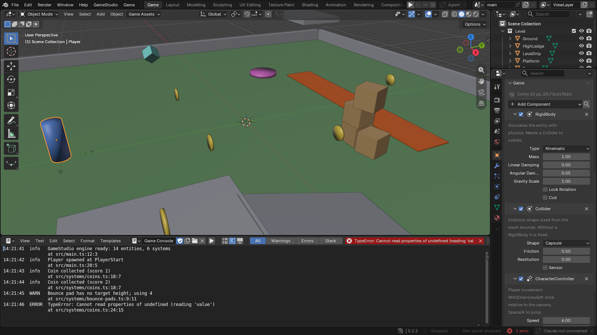
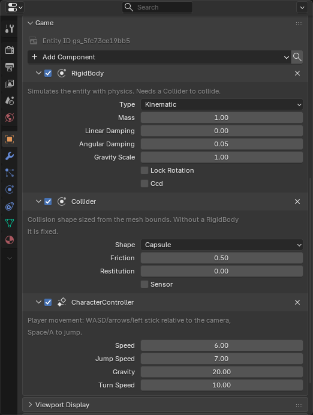
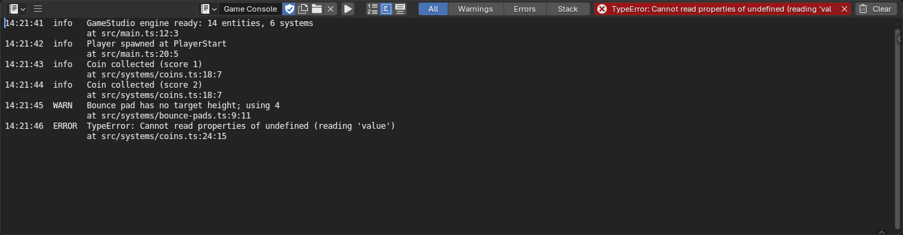

# The editor and play controls

[Manual contents](README.md) · Previous: [Installation](01-installation.md) · Next: [Your first game](03-first-game.md)

## The Game workspace

New projects open in the **Game** workspace. For an older Blender file, choose **GameStudio > Add Game Workspace**. Blender's regular modeling, material, animation and geometry-nodes tools remain available through their normal workspaces.

*Read the workspace from left to right: author the level in the 3D View, select objects in the Outliner, and configure the selected object's game behavior in Object Properties. The example Console messages illustrate how runtime errors appear.*

| Location | Purpose | Typical action |
|---|---|---|
| Top bar | Play controls, display mode, agent status | Start a playtest or inspect agent actions |
| 3D View | Scene authoring or embedded game display | Move a platform, preview a material, play the game |
| Outliner | Object and collection hierarchy | Select the player, camera or reusable collection |
| Properties > Object > Game | Entity identity and components | Add a Collider or change a controller's speed |
| Properties > Material > Game | Game shaders and their fields | Assign Water or FoliageSway |
| Properties > Collection | Prefab configuration | Prepare a reusable group of objects |
| Properties > Scene > Game Project | Project, levels, scripts, lighting and build | Export all levels or build for the web |
| Game Assets in the 3D View header | Project asset libraries | Place or replace a library asset |
| Console below the viewport | Game messages, warnings and errors | Find the source line that failed |

The top bar adapts to window width. Play controls can move beside the scene selector when there is insufficient room next to the workspace tabs.

## Play, pause, step and stop

| Action | Default shortcut | Result |
|---|---|---|
| Play | F5 | Prepare/export the scene as needed and run the game |
| Pause or resume | F6 | Toggle simulation pause |
| Step | F7 | Advance the game for inspection |
| Stop | F8 | Stop the simulation and restore the editing view |
| Release embedded game input | Shift+Esc | Return mouse and keyboard control to Blender |

The same play actions are available in the **Game** menu and as top-bar buttons. macOS and some laptop keyboards require **Fn** with the function keys. GameStudio's **Play Shortcuts** preferences allow rebinding them.

Click inside the embedded Game view before trying to move the player. A title screen or pause menu may intentionally keep the simulation paused; use the menu's start or resume button first. Escape is commonly a game's pause-menu key, while Shift+Esc releases embedded input.

Stopping a game is separate from stopping its dev server. GameStudio can keep the browser ready for a fast next Play. The **Close idle game after** preference controls how long an idle embedded game stays alive; **Game > Stop Dev Server** stops the development service explicitly.

## Embedded and Window display

The icon beside the play buttons switches between **Embedded** and **Window**. Embedded streams the game's browser view into Blender. Window displays it separately and is useful when you want the level and game visible on different displays.

In embedded mode, **Scene | Game** in the area's header lets you return to the 3D View while the game runs. Switching the visible view does not replace the Play/Pause/Stop controls.

## Scene view while editing

The **Game** toggle in a 3D View header draws that editing view using the game's renderer. **GameStudio > Scene View** creates a split view for this purpose. It lets you evaluate game materials, lighting and post effects without advancing gameplay.

You still navigate, select and transform objects using Blender's editing tools and overlays. This is useful for moving a light or adjusting a water material while looking at the exported result. Change **Scene view frame rate** if the preview costs too much while working; it defaults to 30 frames per second.

Scene view and Game view answer different questions. Scene view shows how the level renders from the editor's current viewpoint. Game view runs the player's camera, systems, physics and menus. A player that falls through a floor must be tested in play.

In a UI file, Scene view through the canvas camera previews the active screen. See [Menus, HUDs and audio](07-interface.md).

## Inspect components

*A controllable character combines a kinematic body, capsule collision and a CharacterController. The values shown belong to the demo; they are not a list of engine defaults.*

Select an object and open **Properties > Object > Game**. **Add Component** lists built-in and project-defined components. Fields become Blender controls based on the TypeScript schema: numbers, choices, checkboxes, vectors, object references or asset paths.

An object's component data describes what systems do with it. A Collider supplies a collision shape; it does not by itself implement a score or a victory condition. Project-specific systems give those data fields their behavior.

## Read the Console

*Use the All, Warnings and Errors filters to isolate a problem. The stack points to the code that produced it; this capture deliberately includes a demonstration exception.*

Double-click a source-linked error to open it in the configured code editor. Start with the earliest relevant error after a clean restart: later failures may be consequences of the first. If opening a line fails, check **Code editor** preferences; a system-default editor may open the file without jumping to the line.

For a useful debugging loop, stop, clear old messages, press Play and reproduce one action. Note the object, input and result. This gives both you and an agent a precise case to investigate.

## What updates live

With **Live Link** enabled, component values and transforms can reach the running game. Saving TypeScript systems hot-reloads them. Mesh and material changes can trigger a scene re-export when **Live geometry reload** is enabled.

A re-export is a larger change than a numeric field update. After changing scene structure or physics setup, restart and verify from the beginning. If you are editing level two while the running game is in level one, the edits are not applied to unrelated objects in the other level.

Save the Blender source separately. A correct live preview is not evidence that unsaved edits have been written to disk.
