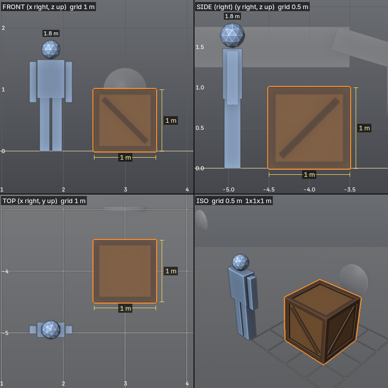
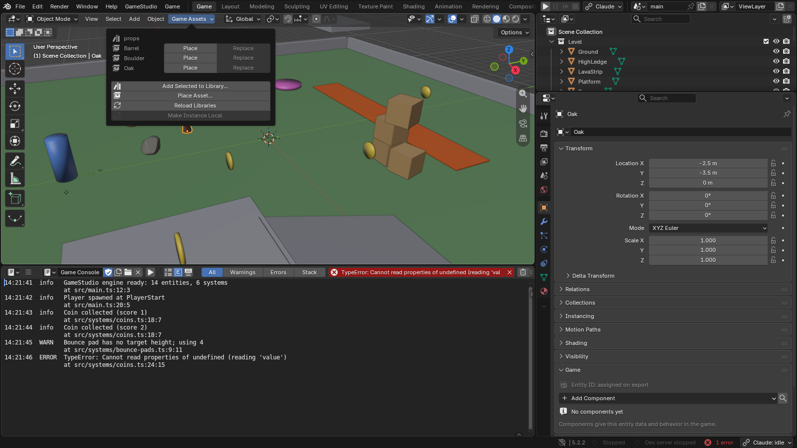

# Assets and rendering

[Manual contents](README.md) · Previous: [Components and game logic](05-gameplay.md) · Next: [Menus, HUDs and audio](07-interface.md)

## Author reusable art

Blender remains the source for meshes, UVs, materials, modifiers, rigs and clips. Start by blocking out the game at a consistent scale. Check it from the player's camera before adding detailed geometry: a beautiful prop that blocks a jump or hides the goal changes the game.

Use clear object names, separate visual detail from collision when appropriate, and keep texture and font files in the project. The game uses exported geometry and materials; it does not execute Blender's full node or simulation system in the browser.



*The `render_views` tool can produce front, side, top and isometric views with scale references. This is useful for checking proportions before putting a prop into a level.*

## Game Assets and libraries



*The Game Assets popover exposes reusable project assets. The displayed props were created for the demonstration.*

1. Select the objects that form a reusable prop.
2. Open **Game Assets > Add Selected to Library**.
3. Save the asset into an appropriate project library, such as `assets/props.blend`.
4. Use **Place** to insert it into a level, or **Replace** to swap a selected instance.
5. Use **Reload Libraries** after changing a source library.

Linked instances are useful when many copies should share a single source. Use **Make Instance Local** only when you want a copy to diverge from that source. A local copy no longer receives the same library updates.

Library writes affect a separate file. GameStudio backs them up, and the asset-library restore workflow is separate from ordinary scene undo. Save the level as well as the source asset when a change affects both.

## Runtime prefabs

A prefab is a collection exported for instantiation during play. Mark its collection with the `gs_prefab` custom property enabled in Collection Properties, or use the provided export/asset tools. The engine preserves hierarchy, components, clips and applicable physics in spawned instances.

For a collection exported as `Crate`, a system can create an instance with:

```ts
const crate = ctx.spawn('Crate', {
  position: [2, 1, -4],
  rotation: [0, Math.PI / 2, 0],
});
```

This snippet belongs inside a system hook or callback with `ctx`. Confirm the collection is exported before spawning it; `ctx.prefabs` lists available prefab names. An unknown name produces an error rather than an invisible placeholder.

Each instance gets its own entity identities and internal references. A prefab with several top-level objects gets a grouping root. Use descendants and marker components to find sockets inside an instance rather than searching globally for a repeated object name. The Endless Runner template demonstrates this for track chunks and attached objects.

## Parametric kits

The agent tools offer parameterized kits for rocks, crates, barrels, trees, bushes, terrain, buildings, water, collectibles, characters and several multi-part assemblies. They provide a consistent starting point and remain editable in Blender.

Ask for scale and function along with appearance. For example: "Create a low-poly wooden crate one metre wide, suitable for stacking, and show it beside the player for scale." A useful asset review checks proportions, collision needs, material count and how the asset looks at normal gameplay distance.

Kits are different from procedural world builders. A kit makes an object or assembly; a procedural builder can distribute many objects or generate a road, river or building arrangement.

## Procedural worldbuilding

GameStudio's geometry-nodes workflows cover scatter, roads, fences, rivers, cliffs, buildings and placement along curves. Keep path widths, slope and keep-out areas tied to gameplay requirements. Reusing meshes through instances can reduce rendering cost compared with many unique copies.


*A procedural valley drawn by the game runtime. Compare silhouettes, material boundaries and lighting from similar viewpoints when evaluating export fidelity against your Blender scene.*

Supported geometry-nodes scatters export as GPU instances. That can reduce draw calls, but the scene still has geometry, materials, shadows and collision to process. Use measured game statistics to decide whether a change helps performance.

## Materials and the export boundary

Give materials a sensible Blender appearance for authoring. Supported glTF material properties travel to the game, while procedural materials can be baked to textures during export. Check export warnings for unsupported or incomplete inputs.

A static material bake and a game shader solve different problems. A baked texture captures a look; a game shader creates runtime behavior such as moving water, wind or a dissolve effect. Inspect the final result in Scene view or during play.

## Assign a game shader

1. Select the object and the intended material slot.
2. Open **Properties > Material > Game**.
3. Choose a **Game Shader** from the project or built-in library.
4. Adjust its fields.
5. Enable the game-rendered Scene view or press Play.

| Example | Screenshot | Use |
|---|---|---|
| Water |  | Ponds and water surfaces |
| FoliageSway |  | Wind motion on suitable foliage geometry |
| Dissolve |  | Disappearing objects and effects driven by game state |

*These are still captures of runtime shader previews. Animated effects need to be evaluated in the running game.*

The shipped library contains 33 shaders grouped into Water, Nature, Magic & Sci-fi, Surfaces, Transformations, Gameplay and Style. Examples include shoreline foam, lava, snow, moss, holograms, shields, triplanar surfaces, car paint, outlines, toon shading, Shine and Gradient.

Most effects build on the material's existing color and textures; some supply a more complete surface appearance. Geometry matters: a wind shader needs geometry it can move, and a flag needs subdivisions. Patch-based library shaders use the default WebGL renderer. Check the [shader library reference](../../runtime/packages/engine/API.md) before switching renderer or relying on a costly effect across a large scene.

Game code can change shader fields through `ctx.shaders`. Keep visual effects driven by gameplay in systems, and keep material assignment in Blender. Custom shaders under `src/shaders/` can hot-reload while the game runs.

## Color management

The game exports the scene's view transform and exposure. The templates use **Khronos PBR Neutral** with no look. AgX and Standard also have runtime mappings; some Blender transforms use a fallback and export warns when a look cannot be reproduced.

Compare the same camera, exposure and lighting before trying to fix a mismatch with arbitrary material changes. Blender's solid viewport is not a reliable preview of game shaders or post effects. UI canvases use Standard and their own color rules, while 3D models inside a UI screen are lit and tone mapped like 3D content.

## Bake lighting

Use lightmaps for static environments that benefit from soft indirect light, occlusion and bounce. An outdoor scene with simple sunlight may not need a bake.

1. Settle the static geometry and main lighting.
2. Open **Properties > Scene > Game Project > Lighting**.
3. Choose **Bake Preview** while iterating.
4. Inspect the game render and any reported skips or stale lightmaps.
5. Choose **Bake Final** when the layout is ready.
6. Re-export and test before building the game.

The Blender UI launches the bake from a saved copy in a background process. Generated lightmaps live under `.gamestudio/`, so they can be regenerated and are not part of the editable `.blend` source.

Moving bodies, animated objects and prefab instances do not receive static lightmaps. If your own system moves an otherwise static mesh, set its custom property `gs_lightmap` to `False` so the bake does not leave lighting attached to an obsolete position. Re-bake after moving static geometry or changing lights and the world.

Sun, point and spot lamps remain realtime by default; area lamps are baked. A lamp explicitly marked `gs_lightmap = "baked"` does not provide realtime direct light for a moving player. Check character lighting as well as the walls. The default WebGL path provides the intended lightmap combination; the Engine API documents WebGPU limitations.
