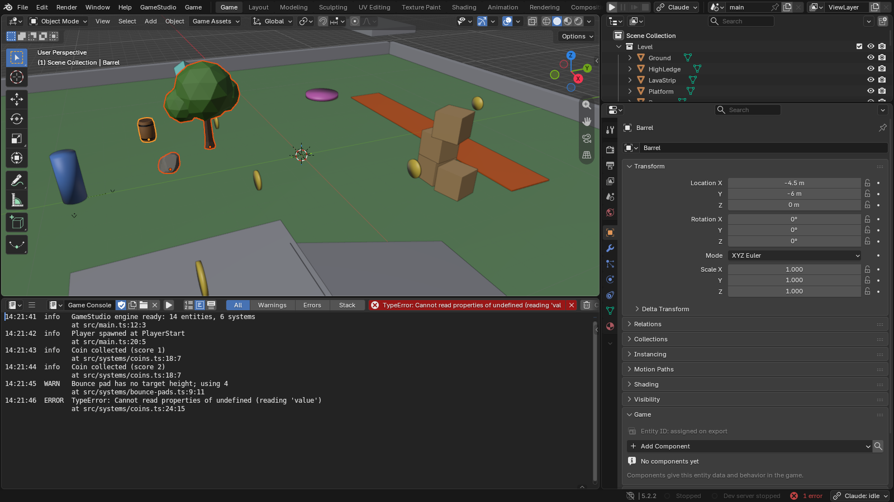
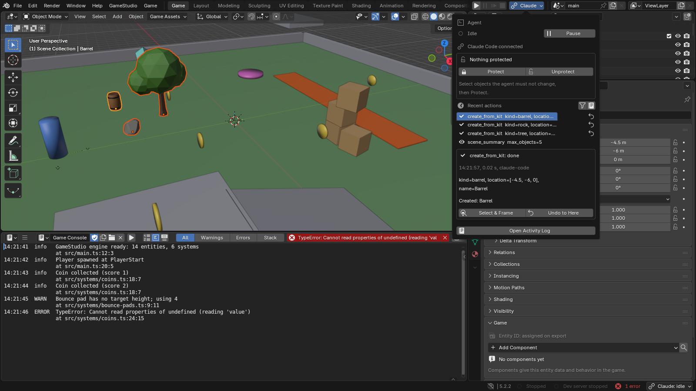

# Working with coding agents

[Manual contents](README.md) · Previous: [Menus, HUDs and audio](07-interface.md) · Next: [Testing and web builds](09-publishing.md)

## What an agent does in GameStudio

Any coding agent that supports MCP can inspect the open Blender scene, create and change assets through GameStudio's MCP tools, edit project code, run the game and inspect screenshots or state. Claude Code and Codex have one-click setup in the GameStudio menu; other MCP clients connect to the same server by hand. You can continue to edit manually and use the same project files.

The **agent bridge** connects Blender to the project's MCP server. The MCP server also talks to the dev server and automated game browser. A connected bridge, a running dev server and a working browser are separate parts of the workflow; a failure in one does not necessarily mean the whole installation failed.

*An agent session can create ordinary Blender objects that you can inspect and edit. The indicator identifies the connected client; the scene remains your editable project.*

## Connect from the project

These steps use the one-click setup for Claude Code, the default, or Codex:

1. Open the intended game project's level in Blender.
2. Choose **GameStudio > Open in Claude Code** or **GameStudio > Open in Codex**.
3. Follow the install prompt if the chosen agent is absent, and complete that agent's sign-in or project-trust flow when requested.
4. Let GameStudio prepare missing project integration files and enable the bridge.
5. Ask the agent to inspect the project and summarize the open scene before making changes.

The **Coding agent** preference (Claude Code unless you change it) chooses the default launcher and top-bar action. You can also start an already installed agent in the project folder yourself. GameStudio supplies `.mcp.json` for Claude Code and `.codex/config.toml` for Codex. Any other MCP client can start the same server over stdio from the project folder. See [MCP setup](../MCP.md) for the exact project configuration and the command for other agents.

No authentication details are needed in a game brief or screenshot. Use the coding tool's own sign-in flow. Keep credentials out of project instructions, source code and shared diagnostics.

## Instructions and reusable skills

New projects contain `AGENTS.md` for project conventions, shared by every agent: Codex reads it, `CLAUDE.md` imports it for Claude Code, and you can give it to any other agent as its instructions. Workflow skills live under `.claude/skills/`, with copies under `.agents/skills/` for Codex; point other agents at `.claude/skills/`.

| Workflow | Useful request |
|---|---|
| New game from a brief | Turn a small game idea into a playable first loop |
| Block out a level | Establish player scale, route, obstacles and goal |
| Make a prop | Create and inspect one reusable asset |
| Procedural world | Build repeatable roads, scatter, rivers or structures |
| Add a mechanic | Implement and test one gameplay rule |
| Animate a character | Connect clips to movement or state |
| Playtest and fix | Reproduce a problem, inspect it and verify a change |
| Stylize a scene | Apply a consistent visual direction |
| Design UI | Create menus and HUDs in the UI Blender file |
| Prepare for web | Review performance and build readiness |
| Make a template | Turn a reusable project into a New Project starting point |

Keep instructions specific to the game: conventions, controls, goals, budgets and invariants. Avoid adding private account details, personal folders or access tokens. Edited custom skills are preserved by the project's skill-update mechanism; see [Project templates](../TEMPLATES.md) for its exact rules.

## Write an actionable brief

A good brief supplies an objective and observable results. For example:

> Make a small third-person collection game on a garden island. The player must collect five gems, then reach a visible gate. Use the existing movement controls, keep every gem reachable without a precision jump, and show progress in the HUD. Build a simple blockout first. Playtest collection, the locked gate, victory and restart, and show screenshots from the player's camera.

For a targeted edit:

> The player gets stuck on the first step beside the bridge. Inspect the player's collider and the step geometry. Reproduce the problem from a fresh start, make the smallest useful change and repeat the same movement test. Preserve the route and visual style.

State what should remain stable when that matters. Ask for evidence such as a screenshot, a game-state value or a repeated input sequence. "Make it work" does not identify what success means.

## Use an inspect, change and test loop

1. **Inspect:** summarize the scene, relevant components and current behavior.
2. **Plan a small change:** define its scope and an observable outcome.
3. **Change source:** edit Blender content, TypeScript or both.
4. **Look:** inspect a render or runtime screenshot from a useful camera.
5. **Play:** exercise the mechanic and check state, logs and controls.
6. **Review:** keep the result, refine it or restore the previous state.

`scene_twin` gives a compact description, `render_views` checks asset proportions, and `game_screenshot` can inspect the game's renderer. A still image checks appearance; it does not establish that jumping, collision or victory works. Use playtests for those behaviors.

When you edit manually during a session, tell the agent what changed and ask it to re-inspect. This avoids reasoning from an older snapshot of the scene.

## Inspect actions and recover

*The Agent popover exposes the recent tool history and scene controls. The displayed operations built the demonstration props.*

Click the agent button in the top bar. Use **Select & Frame** to locate an affected object, **Undo to Here** to move back through supported scene edits, and **Open Activity Log** for more detail. **Pause** suspends agent bridge activity; **Protect** marks selected objects that scene tools must not change.

Scene tools group changes into Blender undo steps. A checkpoint can preserve a useful scene milestone. Asset-library writes use backups because they modify another file. TypeScript changes are ordinary file changes: use version-control diffs and commits for a reliable code history.

These mechanisms cover different data. Undoing a Blender action is not a rollback of every file an external coding tool edited. Checkpoints and object protection are not a sandbox for arbitrary external code. Keep an ordinary project backup alongside the scene-level recovery tools.

## Trust and tool permissions

GameStudio asks for trust before running code from an untrusted project. A request from an agent does not silently grant that trust. The bridge listens on loopback and uses a per-session token; its discovery files under `.gamestudio/` are local connection data and should not be shared.

The project's agent permission configuration and the host coding tool determine approval behavior. Inspect those settings when changing which tools run automatically. `run_python` is full Blender Python execution, and deleting objects, opening another scene or restoring a checkpoint can replace work. Consider the concrete change when reviewing a request.

You can disable **Agent bridge (MCP)** in GameStudio preferences when you are not using the connection. The normal manual authoring workflow does not require an active agent.

## The separate built-in assistant

GameStudio also has an optional assistant inside Blender. It is disabled by default and is distinct from the external coding-agent workflow above. It reads context and proposes edits for you to preview, apply or reject. Its Ask mode is read-only; proposal mode stages changes.

The [AI assistant guide](../AI-ASSISTANT.md) explains configuration and proposal recovery. If using a provider key, prefer the documented environment-variable route to putting it in shared files. A key entered in Blender preferences is stored in that preferences file, so never include it in a screenshot or project attachment.

## Useful review prompts

- "List the components on the player and explain which systems read them."
- "Show the level from the player's camera and mark any unreachable objective in your explanation."
- "Test that pausing freezes movement and resuming restores it."
- "Compare Blender and game renders from the same view before changing the materials."
- "Report the first runtime error, the steps to reproduce it and the result after the fix."
- "Prepare a clean web build and list any export warnings that still need attention."

Use the [MCP reference](../MCP.md) for exact tool names and parameters rather than inventing an interface in a prompt.
