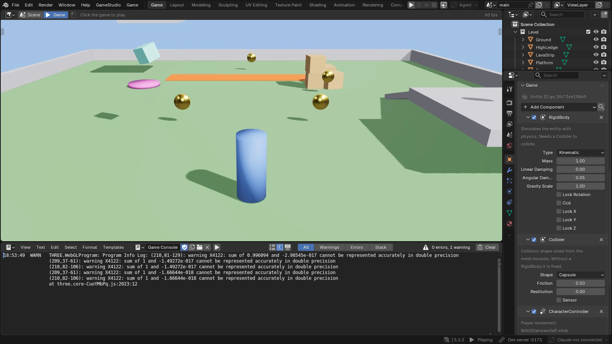

# GameStudio user manual

Build a game in Blender, play it while you work, and export it for the web. GameStudio keeps the level and art in Blender files, attaches game data to objects, and runs game logic in TypeScript. You can work manually, with a coding agent, or with both.

This manual covers the **GameStudio 0.1.0 extension**, whose declared minimum is **Blender 5.2.0**. Screenshots show the included demonstration content and may differ slightly from your theme, window size or agent selection. Paths in examples are relative to a fictional game project.

*The embedded Game view runs the exported game inside Blender. The right-hand panel holds the selected object's components; the lower panel shows game messages. The warning shown is part of this captured demonstration, not a required setup step.*

## Choose a starting point

- **Prefer video:** watch the [20 narrated tutorials](../videos/index.html), with captions and transcripts.
- **New to GameStudio:** read [Installation](01-installation.md), take the [editor tour](02-editor.md), then follow [Your first game](03-first-game.md).
- **Already comfortable in Blender:** start with [Components and game logic](05-gameplay.md) and [Assets and rendering](06-assets.md).
- **Building with an agent:** complete setup, then follow [Working with coding agents](08-agents.md).
- **Finishing a game:** use [Testing and web builds](09-publishing.md) and the [troubleshooting reference](10-reference.md).

## Contents

1. [Installation and setup](01-installation.md)
2. [The editor and play controls](02-editor.md)
3. [Your first game](03-first-game.md)
4. [Projects and templates](04-projects.md)
5. [Components and game logic](05-gameplay.md)
6. [Assets and rendering](06-assets.md)
7. [Menus, HUDs and audio](07-interface.md)
8. [Working with coding agents](08-agents.md)
9. [Testing and web builds](09-publishing.md)
10. [Troubleshooting and reference](10-reference.md)

## How the parts fit together

| Part | Your work | What it produces |
|---|---|---|
| Blender | Model objects, arrange levels, set components, author UI | `.blend` source files |
| GameStudio extension | Export scenes and UI, send edits, manage the project | Generated game data and a live connection |
| TypeScript code | Define components and systems | Rules such as collection, movement, combat and winning |
| Dev server | Load the game and rebuild changed code | A local browser game with live updates |
| Web build | Package code and exported assets | A `dist/` folder for static hosting |

A `.blend` file is the editable source. Exported files under `.gamestudio/` are generated from it. A game running in a browser has its own simulated state: a pickup disappearing during play does not delete the pickup from your Blender level.

## What you can make

The included templates demonstrate third-person platforming, top-down shooting, driving and an endless runner. The runtime also supports orthographic cameras, constrained movement for 2.5D games, animation, prefabs, navigation, sound, particles, menus and multiple levels. Templates are starting points whose code and assets you can edit.

The downloadable output is a browser game. Blender's tools author its content, while the GameStudio runtime determines which rendering and game features appear in play. Use Scene view and playtests to evaluate that result.

## Reading conventions

**GameStudio > New Project** means open the GameStudio menu and select New Project. **Properties > Object > Game** means open the Properties editor's Object tab and expand its Game panel. `src/components/` is a folder inside the game project. Code blocks labeled TypeScript belong in the stated file; small snippets explicitly identify the hook or context they need.

Screenshots have descriptive alternative text and captions. In the offline edition, click an image or focus it and press Enter to enlarge it; Escape closes the enlarged view. Some editor captures deliberately contain example warnings and errors to illustrate the Console. They do not indicate that a new installation should produce those errors.

For exact field names and advanced APIs, use the [documentation index](../README.md). To read all chapters in one browser tab, open the [offline edition](../manual.html).
