# @gamestudio/engine API reference

The runtime for GameStudio games: an ECS on top of Three.js (r186), Rapier physics (0.21), input, a HUD, menus, particles, levels and the live link to Blender. Scenes are authored in Blender and exported as `.glb` + `.scene.json`. Gameplay is TypeScript: **components** hold data and **systems** hold logic.

This file is the complete public API. If something is not listed here, it does not exist. Do not guess.

Contents: 1 project layout · 2 components · 3 built-in components · 4 systems · 5 `ctx` · 6 entity · 7 world · 8 physics · 9 input · 10 HUD · 11 game · 12 live link · 13 examples · 14 common mistakes · 15 animation · 16 audio · 17 prefabs and spawning · 18 timers · 19 testing · 20 random numbers · 21 particles · 22 menus and screens · 23 levels and game state · 24 post effects · 25 baked lighting · 26 navigation · 27 2.5D games · 28 game shaders · 29 shader library.

- Coordinates: **Y-up, right-handed, metres**. Blender's front (−Y) becomes **+Z**.
- Points and rotations: every API that takes a position accepts `[x, y, z]`, `{ x, y, z }` or a `Vector3`. Rotations accept a quaternion (`[x, y, z, w]`, `{ x, y, z, w }`, `Quaternion`) or Euler radians (`[x, y, z]`, `Euler`).
- Imports: `@gamestudio/engine` (everything) and `@gamestudio/engine/schema` (components and game shaders only, with no DOM or Three.js).
- Three.js is a normal dependency, so `import { Vector3 } from 'three'` is fine.

---

## 1. Project layout

```
my-game/
  gamestudio.json          { "name", "formatVersion": 1, "startScene": "main", "link": { ... }, "post"?: { "bloom": true } }
  vite.config.ts           plugins: [gamestudio()]   (from @gamestudio/devserver)
  index.html               <canvas id="game">
  src/main.ts              createGame(...)
  src/components/*.ts      defineComponent(...) only: data, no logic, no DOM or Three.js side effects
  src/systems/*.ts         defineSystem(...): all game logic
  src/shaders/*.ts         defineShader(...): game shaders that draw Blender materials (§28)
  scenes/*.blend           one level per file, authored in Blender; scenes/level2.blend loads as 'level2' (§23)
  assets/                  sounds and other files that components refer to (any folder works)
  .gamestudio/             generated (components.json, session.json, export/<scene>.glb|.prefabs.glb|.scene.json, export/files/)
```

`src/main.ts`:

```ts
import { createGame } from '@gamestudio/engine';
import.meta.glob('./components/*.ts', { eager: true });
import.meta.glob('./systems/*.ts', { eager: true });
import.meta.glob('./shaders/*.ts', { eager: true });

createGame({ canvas: '#game', startScene: 'main' });
```

The dev server writes `.gamestudio/components.json` from `src/components/*.ts` and `src/shaders/*.ts` at startup and again on every change. Blender reads that file to build its component UI and its Game Shader panel. Run `npx gamestudio-registry` to write it without a running server.

---

## 2. Components (`defineComponent`, `field`)

```ts
import { defineComponent, field } from '@gamestudio/engine/schema';

export const Door = defineComponent('Door', {
  description: 'Opens when the player is near.',   // optional, shown in Blender
  category: 'Gameplay',                            // optional, groups components in Blender
  fields: {
    openHeight: field.float(2, { min: 0, unit: 'distance', description: 'Metres to slide up' }),
    speed: field.float(1.5, { min: 0 }),
    locked: field.bool(false),
    key: field.entity({ description: 'Entity that unlocks it' }),
  },
});
```

- `defineComponent(name, options?)` returns a component handle (`ComponentType<Values>`). Values are typed: `e.get(Door).openHeight` is a `number`.
- Component names match `^[A-Z][A-Za-z0-9]{0,40}$` (PascalCase) and must be unique. Field names match `^[a-z][a-zA-Z0-9_]{0,40}$` (camelCase).
- Calling `defineComponent` again with the same name **replaces** the schema. Hot reload relies on this: live entities keep their data, and new fields get their defaults.
- A component with no fields is a tag: `defineComponent('KillZone')`.
- Component modules must contain only `defineComponent` calls (and imports of `@gamestudio/engine/schema`), because the dev server evaluates them in Node.

### Field builders

| Builder | Value type | Default if omitted | Options (all optional) |
|---|---|---|---|
| `field.float(def?, opts?)` | `number` | `0` | `min`, `max`, `step`, `unit` (`'none' \| 'distance' \| 'angle' \| 'time'`), `description` |
| `field.int(def?, opts?)` | `number` (integer; `def` must be an integer) | `0` | `min`, `max`, `description` |
| `field.bool(def?, opts?)` | `boolean` | `false` | `description` |
| `field.string(def?, opts?)` | `string` | `''` | `multiline` (UI hint), `description` |
| `field.enum(options, def?, opts?)` | one of `options` (typed union) | `options[0]` | `description` |
| `field.vec2(def?, opts?)` | `[number, number]` | `[0, 0]` | `min`, `max`, `description` |
| `field.vec3(def?, opts?)` | `[number, number, number]` | `[0, 0, 0]` | `min`, `max`, `description` |
| `field.color(def?, opts?)` | `[r, g, b, a]`, linear 0–1 | `[1, 1, 1, 1]` | `description` |
| `field.entity(opts?)` | `string \| null` (an entity id; resolve it with `ctx.world.get(id)`) | `null` | `description` |
| `field.asset(extensions?, opts?)` | `string` (project-relative path) | `''` | `description`, `default` |

Vectors are in runtime space (Y-up). Angles are radians.

### Registry helpers (`@gamestudio/engine/schema`, also re-exported from `@gamestudio/engine`)

| Function | Purpose |
|---|---|
| `getComponent(nameOrHandle)` | Current `ComponentType` or `undefined` |
| `listComponents()` | All registered components, sorted by name |
| `defaultValues(C)` | A fresh object with the defaults (arrays are copied) |
| `fillDefaults(C, values)` | Coerces `values` to the schema and fills missing fields. Unknown keys are dropped |
| `coerceField(fieldDef, value)` | Coerces one value |
| `toRegistryJSON({ generatedAt?, sources?, shaderSources? })` | The `components.json` object (components and game shaders, §28) |
| `onComponentDefined(listener)` | Called on every (re)definition; returns an unsubscribe function |
| `builtinComponents` | `[RigidBody, Collider, CharacterController, FollowCamera, Spin, Animator, Locomotion, AudioSource, ParticleEmitter, PostEffects, NavMesh, NavAgent]` |
| `cloneValue(v)` | Copies arrays; returns other values unchanged |

Types: `ComponentType<V>`, `ComponentValues<typeof C>`, `FieldDef`, `Vec2`, `Vec3`, `Color`, `RegistryJSON`.

---

## 3. Built-in components

They are always registered, and Blender shows them as built-in. Import the handles from `@gamestudio/engine` or `@gamestudio/engine/schema`.

| Component | Field | Type | Default | Meaning |
|---|---|---|---|---|
| `RigidBody` | `type` | enum `dynamic \| fixed \| kinematic` | `'dynamic'` | dynamic: moved by physics; fixed: never moves; kinematic: moved by code |
| | `mass` | float | `1` | kg (dynamic) |
| | `linearDamping` | float | `0` | |
| | `angularDamping` | float | `0.05` | |
| | `gravityScale` | float | `1` | |
| | `lockRotation` | bool | `false` | Body never rotates |
| | `ccd` | bool | `false` | Continuous collision detection |
| | `lockX` / `lockY` / `lockZ` | bool | `false` | Keep that world coordinate fixed (Y-up: `lockY` is the height, `lockZ` the depth of a side-scroller, Blender's Y). See §8 |
| `Collider` | `shape` | enum `auto \| box \| sphere \| capsule \| convex \| mesh` | `'auto'` | See §8 for sizing |
| | `friction` | float | `0.5` | |
| | `restitution` | float | `0` | Bounciness 0–1 |
| | `sensor` | bool | `false` | Detects overlaps, never blocks |
| `CharacterController` | `speed` | float | `5` | m/s |
| | `jumpSpeed` | float | `6` | m/s upward at jump start |
| | `gravity` | float | `20` | m/s² (the controller's own gravity) |
| | `turnSpeed` | float | `10` | rad/s; the mesh turns toward the movement direction |
| | `plane` | enum `none \| side \| top` | `'none'` | `side`: side-scroller, left/right only, the depth stays exactly; `top`: top-down, screen-relative also under a camera looking straight down (§27) |
| `FollowCamera` | `target` | entity | `null` | Entity to follow |
| | `offset` | vec3 | `[0, 4, 8]` | World-space offset from the target |
| | `smoothing` | float | `5` | Higher is snappier; `0` snaps instantly |
| | `lookAtOffset` | vec3 | `[0, 1, 0]` | Looks at target + this |
| `SideCamera` | `target` | entity | `null` | Entity to follow (§27) |
| | `follow` | enum `both \| horizontal \| vertical` | `'both'` | Screen axes it follows; the others stay where the camera was placed |
| | `offset` | vec2 | `[0, 1]` | Frames target + this, metres (right, up) on the screen |
| | `deadZone` | vec2 | `[1, 2]` | Width, height (m) of the box the target moves in without moving the camera |
| | `lookAhead` | float | `2` | Metres it looks ahead in the direction the target runs (at most half the half width of the view) |
| | `smoothing` | float | `5` | Higher is snappier; `0` snaps instantly |
| | `bounds` | entity | `null` | An object whose box is the level: a mesh, or a Cube empty (its position ± its scale). The view stays inside it |
| | `boundsMin` / `boundsMax` | vec3 | `[0, 0, 0]` | Level bounds without a `bounds` object (Y-up); an axis where max ≤ min is open |
| | `pixelSnap` | bool | `false` | Orthographic: move in whole screen pixels (pixel art) |
| `Spin` | `speed` | float | `1` | rad/s |
| | `axis` | vec3 | `[0, 1, 0]` | Local axis |
| `Animator` | `clip` | string | `''` | Clip (Blender action name) to play. Empty: the first clip that animates the entity |
| | `loop` | bool | `true` | Off: play once and hold the last frame |
| | `speed` | float | `1` | Playback speed; negative plays backwards |
| | `playOnStart` | bool | `true` | Start when the entity appears |
| | `fade` | float | `0.25` | Crossfade seconds when the clip changes |
| | `graph` | string | `''` | Animation graph (`defineAnimationGraph`, §15) that picks the clips instead of `clip` and `loop`; `speed` scales it |
| | `state` | string | `''` | The graph state it plays now (runtime, read it in `game_state` or a playtest) |
| `Locomotion` | `idle` / `walk` / `run` / `jump` / `fall` | string | `'Idle'` / `'Walk'` / `'Run'` / `'Jump'` / `'Fall'` | Clips for each gait (the `character_rigged` kit's names). Empty or missing clips are skipped |
| | `walkSpeed` | float | `0.3` | Horizontal m/s from which it walks |
| | `runSpeed` | float | `4` | Horizontal m/s from which it runs |
| | `fade` | float | `0.15` | Crossfade seconds |
| | `clip` | string | `''` | The clip it plays now (runtime, read it in `game_state` or a playtest) |
| `AudioSource` | `clip` | asset (`.ogg`, `.mp3`, `.wav`) | `''` | Sound file, project-relative (e.g. `assets/sfx/coin.ogg`) |
| | `volume` | float | `1` | Multiplier |
| | `loop` | bool | `false` | |
| | `autoplay` | bool | `false` | Start when the entity appears (after the first user input, see §16) |
| | `spatial` | bool | `true` | Positional 3D sound that follows the entity; off: same volume everywhere |
| | `refDistance` | float | `2` | Metres; full volume up to here |
| | `maxDistance` | float | `50` | Metres; no further fall-off beyond |
| | `rolloff` | float | `1` | How fast it gets quieter |
| | `distanceModel` | enum `inverse \| linear \| exponential` | `'inverse'` | Web Audio fall-off curve |
| | `channel` | enum `sfx \| music` | `'sfx'` | Mixer channel (§16): `sfx` pauses with the game, `music` plays on under pause menus |
| `ParticleEmitter` | `playOnStart` / `loop` | bool | `true` / `true` | Start when the entity appears / repeat the cycle (off: one cycle) |
| | `duration` | float | `1` | Seconds per cycle |
| | `rate` / `burst` | float / int | `20` / `0` | Particles per second during a cycle / at once when a cycle starts |
| | `maxParticles` | int | `200` | Alive at once at most (more wait) |
| | `lifetime` / `speed` | vec2 | `[0.6, 1.2]` / `[1, 2]` | Seconds a particle lives / start speed in m/s, (min, max) |
| | `direction` / `spread` | vec3 / float | `[0, 1, 0]` / `0.4` | Emission direction (local) / cone half-angle in radians (π: everywhere) |
| | `shape` | enum `point \| sphere \| box \| cone` | `'point'` | Where particles start; `sphere` moves them outward, `cone` fans them out from a disc |
| | `radius` / `box` | float / vec3 | `0.5` / `[1, 1, 1]` | Size of the sphere and cone / of the box |
| | `gravity` / `drag` | float | `0` / `0` | Multiplier of the scene gravity (negative rises) / slowing per second |
| | `size` | vec2 | `[0.2, 0.05]` | Metres at birth and at death (± 20 % per particle) |
| | `colorStart` / `colorEnd` | color | white, opaque / white, clear | Colour and opacity over life |
| | `brightness` | float | `1` | Colour multiplier; above 1 glows with bloom |
| | `texture` | enum `dot \| spark \| star \| smoke \| square` | `'dot'` | Built-in sprite: soft dot, streak, twinkle, cloud, confetti |
| | `image` | asset (`.png`, `.jpg`, `.webp`) | `''` | Your own sprite instead |
| | `blending` | enum `additive \| alpha` | `'additive'` | additive glows (sparks, magic); alpha covers (smoke, dust, confetti) |
| | `stretch` | float | `0` | Stretches sprites along their velocity (sparks) |
| | `spin` | float | `0` | Sprite rotation in rad/s (random direction) |
| | `space` | enum `world \| local` | `'world'` | world: particles stay where they were born; local: they move with the entity |
| | `seed` | int | `0` | Same seed, same pattern |
| `PostEffects` | `bloom` / `bloomStrength` / `bloomThreshold` / `bloomRadius` | bool / float | `false` / `0.6` / `0.85` / `0.4` | Glow around bright parts (§24) |
| | `vignette` / `vignetteAmount` | bool / float | `false` / `0.35` | Darkened corners |
| | `exposure` / `contrast` / `saturation` | float | `1` | Grading; 1 = unchanged |
| | `tint` | color | white | Colour multiplier |
| `NavMesh` | `agentRadius` / `agentHeight` | float | `0.4` / `1.8` | Metres: how far paths keep from walls (the widest agent's radius) / the headroom agents need (§26) |
| | `maxClimb` / `maxSlope` | float | `0.35` / `0.785` (45°) | Highest step (m) / steepest slope (radians) agents walk |
| | `cellSize` | float | `0.2` | Metres; smaller is more exact and slower to build |
| | `source` | enum `colliders \| meshes` | `'colliders'` | colliders: every solid fixed collider in the level; meshes: only the meshes of this object and its children (a walkable proxy) |
| `NavAgent` | `target` | entity | `null` | Entity to walk to (chase); a new path every `autoRepath` s |
| | `destination` / `useDestination` | vec3 / bool | `[0, 0, 0]` / `false` | A point to walk to when there is no target (`ctx.nav.moveTo` sets both) |
| | `speed` / `acceleration` | float | `3.5` / `20` | m/s / m/s² (0: instant) |
| | `stoppingDistance` | float | `0.3` | Stops this far from the goal |
| | `turnSpeed` | float | `10` | rad/s toward where it walks; 0 leaves turning to you |
| | `autoRepath` | float | `0.5` | Seconds between new paths to a moving target; 0: only when the goal changes |
| | `separation` | float | `0` | Keeps this far from other agents (0: off) |
| | `remaining` | float | `-1` | Metres of path left (runtime, read it in `game_state` or a playtest; -1: no path) |

Behaviour:

- **Collider without RigidBody** → a fixed body.
- **CharacterController** (system `CharacterControllerSystem`, phase `fixed`): WASD/arrow keys/left stick move it relative to the active camera's yaw. Behind a `FollowCamera` that is the camera's rest direction (from `offset` toward `lookAtOffset`), not where the smoothed camera points while it catches up, so a long sideways hold stays straight; `moveForward(ctx, out)` (exported) gives the same direction for your own movers. Space or gamepad button 0 jumps while grounded, and holding Space keeps jumping. The entity needs a `Collider` (use `shape: 'capsule'`) and a `RigidBody` with `type: 'kinematic'`. It climbs slopes up to 50° and steps up to 0.35 m, and it pushes dynamic bodies. It never moves along an axis its `RigidBody` locks (`lockX/Y/Z`); `plane: 'side'` and `'top'` are in §27.
- **FollowCamera** (system `FollowCameraSystem`, phase `late`): put it on the camera object. It snaps into place when the scene starts (or when it first gets a target), and cuts there instead of smoothing when its target teleports: moves more than 5 m in one frame, faster than 100 m/s (a fall respawn with `ctx.physics.teleport`). A shorter jump is smoothed unless you call `snapCamera(player)` after it (below), as a playtest's `place` does. A new `target` is not a teleport: the camera pans over to it. While a target falls into the void the camera keeps following it down.
- **SideCamera** (system `SideCameraSystem`, phase `late`): the camera of a side-scroller or a top-down game. Put it on the camera (or a rig above it). It slides across its own screen plane and never turns, so its depth (or height, looking down) stays put; orthographic and perspective. It cuts on a teleport and after `snapCamera()` as FollowCamera does, centring its dead zone on the target again. Details in §27.
- **Spin** (system `SpinSystem`, phase `update`): `object3d.rotateOnAxis(axis, speed * dt)`.
- **Animator**: plays its clip with `ctx.animation` (§15). Edits to its fields (from code or live from Blender) apply at once: a new `clip` crossfades over `fade`, an empty `clip` stops, `loop` and `speed` change the running clip. `playOnStart` only matters when the entity appears. Removing the component stops the animation. With a `graph`, the graph runs instead (§15), and setting `graph` to `''` goes back to `clip`.
- **Locomotion** (system `LocomotionSystem`, phase `update`): animates a character with no code. Put it on the armature that carries the clips, with the `CharacterController` for a player. Speed comes from the entity's movement, and air state from its `CharacterController`: `jump` plays once when it leaves the ground upwards, and `fall` loops when it comes down (or after 0.12 s off the ground). A missing clip falls back (run → walk → idle, fall ↔ jump), and a clip played from code stays until the gait changes.
- **AudioSource**: plays its sound with `ctx.audio` (§16). Live edits apply too: `volume`, `loop` and the distance settings change the playing sound, a new `clip` or `spatial` restarts it, and turning `autoplay` on or off starts or stops it.
- **ParticleEmitter**: emits from the entity's position and orientation (§21). Edits apply live, so you can tune an effect from Blender while the game runs. Turning `playOnStart` off stops it, on starts it. When the entity is destroyed or the component removed, the particles already flying finish their life.
- **PostEffects**: put one on any object of a scene (the camera is a good place) to turn on bloom, vignette or grading for that scene (§24).
- **NavMesh** / **NavAgent** (system `NavAgentSystem`, phase `fixed`): a navmesh built when the level loads, and agents that walk it around walls and props with a kinematic character mover (§26). An agent needs a kinematic `RigidBody` and a capsule `Collider`.

`characterMotion(entity)` returns the live `{ verticalVelocity, grounded }` of a character. Set `verticalVelocity` to launch it (a bounce pad, for example). `grounded` is read-only.

`snapCamera(entity?)` makes the FollowCamera or SideCamera on `entity`, or every one following `entity`, jump to its place the next time it moves (this frame when called from a `fixed` or `update` system) instead of smoothing there; with no argument, every one. Call it after a respawn or checkpoint teleport, or a cutscene cut:

```ts
import { characterMotion, snapCamera } from '@gamestudio/engine';

ctx.physics.teleport(player, { x: r.spawn[0], y: r.spawn[1], z: r.spawn[2] });
characterMotion(player).verticalVelocity = 0; // or the fall speed carries over
snapCamera(player);                            // the camera cuts to the start instead of sweeping up through the player
```

---

## 4. Systems (`defineSystem`)

```ts
import { defineSystem } from '@gamestudio/engine';
import { Door } from '../components/door';

export default defineSystem({
  name: 'DoorSystem',          // unique; redefining the same name replaces it (hot reload)
  query: [Door],               // entities with ALL of these components; omit for a global system
  phase: 'update',             // 'fixed' | 'update' | 'late'   (default 'update')
  start(ctx) {},               // optional
  onAdd(ctx, entity) {},       // optional
  onRemove(ctx, entity) {},    // optional
  update(ctx, entities) {
    for (const e of entities) {
      const door = e.get(Door);
      // ...
    }
  },
});
```

- `defineSystem(def)` registers the system and returns `def`. Other functions: `removeSystem(name)` and `listSystems()`.
- **Order inside a frame** (steps 1–5 only while playing):
  0. Menus read input (§22) and a scene transition advances (§23), paused or not
  1. `start` / `onAdd` / `onRemove` hooks
  2. Repeat 0–5 times: all `fixed` systems, then one physics step (60 Hz, `ctx.dt = 1/60`), then particles move one step (§21)
  3. Animation mixers advance (Animator changes applied, `ctx.animation.events` filled), AudioSource changes applied, due timers run (§18)
  4. `update` systems
  5. `late` systems
  6. render (HUD labels pinned to entities follow them, particle buffers are written, post effects run)
  Within a phase, systems run in registration order (file import order). A hot-reloaded system keeps its place.
- `start(ctx)` runs once before the system's first update after a scene loads or resets, and again after a hot reload.
- `onAdd` / `onRemove` run when an entity starts or stops matching `query`, including for entities that already exist when the system starts. `onRemove` gets destroyed entities too, whose components may be gone.
- A throwing system is reported (overlay, editor, console) and keeps running on later frames. Other systems are unaffected.
- When stopped or paused, no systems run, but rendering continues.
- Module-level variables reset when the file is hot-reloaded. Keep durable state in components, or recompute it in `start`.

---

## 5. `ctx` (the first argument of every hook)

Its type is `SystemContext`, exported from `@gamestudio/engine`. Helper functions outside `defineSystem` take it like this:

```ts
import type { SystemContext } from '@gamestudio/engine';

function addScore(ctx: SystemContext, n: number) { ctx.store.score = (ctx.store.score ?? 0) + n; }
```

| Member | Type | Notes |
|---|---|---|
| `dt` | number | Seconds: `1/60` in `fixed`, the frame time in `update`/`late` (capped at 0.1) |
| `time` | number | Simulated seconds since the scene started playing (a Blender HUD shows it as `{game.time:m:ss}`, §22) |
| `frame` | number | Simulated frames since the scene started playing |
| `phase` | `'fixed' \| 'update' \| 'late'` | The running phase |
| `world` | `World` | See §7 |
| `input` | `InputAPI` | See §9 |
| `physics` | `PhysicsAPI` | See §8 |
| `hud` | `HudAPI` | See §10 |
| `three` | `{ scene, camera, renderer }` | Three.js `Scene`, the active `Camera` (assign another camera to switch views), and the `GameRenderer` (`kind`, `raw`, `domElement`) |
| `log` | `Logger` | `ctx.log(...)` (info), `ctx.log.debug/info/warn/error(...)`. Shown in Blender's console |
| `game` | `GameControls` | `state`, `scene` (`{ name, rev }`), `startScene`, `loadScene(name, options?)` (no fade unless asked; prefer `ctx.loadScene`), `play()`, `stop()`, `pause(paused?)` |
| `animation` | `AnimationAPI` | Clip playback; see §15 |
| `audio` | `AudioAPI` | Sounds; see §16 |
| `spawn(prefab, options?)` | `Entity` | Instantiates a prefab; see §17 |
| `destroy(entity)` | | Destroys an entity (handle or id) and its children; ignores `null`, `undefined` and dead entities |
| `prefabs` | `readonly string[]` | Names of the scene's prefabs |
| `after(seconds, fn)` / `every(seconds, fn)` | `Timer` | Game-time callbacks; see §18 |
| `random` | `RandomAPI` | Seeded random numbers for gameplay: `ctx.random()`, `.range`, `.int`, `.pick`, `.chance`; see §20 |
| `vfx` | `VfxAPI` | Particle effects: `ctx.vfx.burst(entityOrPoint, 'pickup')`; see §21 |
| `ui` | `UiAPI` | Menus and HUDs: screens authored in Blender (`ctx.ui.open`, `on`, `text`, `bar`) and code-only screens (`ctx.ui.screen`, `pauseMenu`); see §22 |
| `loadScene(name, options?)` / `restart()` | `Promise<void>` | Change level with a fade, keeping entities you name / start the game over; see §23 |
| `store` | `Record<string, any>` | Game state that survives scene changes (score, lives); see §23 |
| `save` | `SaveAPI` | Values that survive page reloads (high score, settings); see §23 |
| `post` | `PostAPI` | Bloom, vignette and grading from code; see §24 |
| `nav` | `NavAPI` | Navmesh paths, NavAgent control and the debug view: `ctx.nav.path(from, to)`; see §26 |
| `shaders` | `ShadersAPI` | Live game-shader values: `ctx.shaders.set(enemy, { hitAt: ctx.time })`, `ctx.shaders.set('GS_Water', { speed: 2 })`, `get`; see §28 |

---

## 6. Entity handle

Every exported Blender object becomes an entity, including objects without components. The entity's id is its `gs_id`.

| Member | Notes |
|---|---|
| `id` | `gs_` + 12 hex characters for Blender objects; `rt_<n>` for runtime spawns; `<instancer id>/<template id>` for the parts of a prefab instance placed in Blender (§17) |
| `name` | The Blender object name |
| `object3d` | The Three.js object. Use it for position, rotation, scale and visibility: `e.object3d.position.y += 1`, `e.object3d.visible = false` |
| `parentId` | The authored (Blender) parent's id, or `null` |
| `alive` | `false` after `destroy()` |
| `get(C)` | Live data object. **Throws** if the component is missing |
| `tryGet(C)` | Data or `undefined` |
| `has(C)` | boolean |
| `add(C, values?)` | Adds the component, filling defaults, and returns the data. If it already exists, the data is replaced |
| `remove(C)` | Returns whether it was present |
| `components()` | Names of the attached components |
| `destroy()` | Removes the entity, its object3d, its physics body and any child entities (also authoring children that physics moved to the scene root) |

`C` can be a handle (`Coin`) or a name (`'Coin'`). Data is a plain object, so mutate it directly: `e.get(Spin).speed = 3`. After changing `RigidBody` or `Collider` data in place, call `ctx.physics.rebuild(e)`. `add` and `remove` rebuild automatically.

---

## 7. World (`ctx.world`)

| Member | Notes |
|---|---|
| `query(...C)` | Entities with all of the listed components, in creation order. The array is cached; don't mutate it. `query()` with no arguments returns all entities |
| `get(id)` | Entity or `undefined`. Accepts `null` (handy for entity fields) |
| `findByName(name)` | First entity with that Blender name |
| `entityOf(object3d)` | The entity owning an object or its nearest ancestor (e.g. a raycast hit) |
| `descendants(entity, ...C)` | The entity's child entities, recursively, parents before children: authoring children (also those physics moved to the scene root) and entities under its object, nested prefab parts included. With components, only those that have all of them: `descendants(chunk, Socket)` finds the `Socket` empties of one spawned prefab instance (§17) |
| `spawn(options?)` | Creates an entity. Options: `id`, `name`, `object3d` (default: a new `Group`), `parent` (an `Entity` or an `Object3D`; default: the scene), `components` (`{ Coin: { value: 2 } }` or `[[Coin, { value: 2 }]]`), `position` (`[x, y, z]`, `{ x, y, z }` or `Vector3`) |
| `all()` | Same as `query()` |
| `size` | Entity count |
| `root` | The Three.js scene that spawned objects go into |
| `onChange(listener)` | Events `{ type: 'spawn' \| 'add' \| 'remove' \| 'destroy', entity, component? }`; returns an unsubscribe function |

Add objects to the scene with `world.spawn({ object3d: mesh, ... })`, not with `scene.add`, so that they are cleaned up when the scene reloads.

---

## 8. Physics (`ctx.physics`)

Rapier 0.21 (`@dimforge/rapier3d-compat`). Gravity comes from the scene settings (Blender's gravity, default `[0, -9.81, 0]`).

| Member | Notes |
|---|---|
| `collisions` | `{ a, b, started, sensor }[]`: contact or sensor-overlap begin (`started: true`) and end events from this frame's steps. Read it in `update` or `late` |
| `raycast(origin, direction, { maxDistance = 1000, exclude?, includeSensors = false }?)` | `{ entity, point, normal, distance }` or `null`. `origin` and `direction` take `[x, y, z]`, `{ x, y, z }` or `Vector3`. Sees colliders as of the last physics step |
| `bodyOf(e)` / `colliderOf(e)` | The Rapier `RigidBody` / `Collider`, or `null` (one collider per entity; for GPU instances it is a compound or a trimesh). Use them for forces: `ctx.physics.bodyOf(e)?.applyImpulse({ x: 0, y: 5, z: 0 }, true)` |
| `teleport(e, position?, rotation?)` | Moves instantly (world space) and zeroes velocity: `teleport(e, [0, 1, 6])` or `teleport(e, { x: 0, y: 1, z: 6 }, [0, 0, 0, 1])`. `position` takes `[x, y, z]`, `{ x, y, z }` or `Vector3`; `rotation` a quaternion (`[x, y, z, w]`, `{ x, y, z, w }`, `Quaternion`) or Euler radians. With no arguments, syncs the body to the object |
| `rebuild(e)` | Rebuild after editing `RigidBody`/`Collider` data in place, or after changing the mesh |
| `getGravity()` / `setGravity([x, y, z] or { x, y, z })` | `getGravity()` returns a `Vector3` |
| `bodyCount` | |
| `world` | The Rapier `World` (`null` before the first scene) |
| `rapier` | The Rapier module (`ColliderDesc`, `Ray`, `QueryFilterFlags`, ...) |

**Who owns the transform:**

- **dynamic**: physics owns it. The engine writes the pose to `object3d` after every step. To move one, use `teleport`, forces, or impulses.
- **kinematic** and **fixed**: `object3d` owns it. Move the object and the body follows on the next step (a kinematic body pushes dynamic ones).
- Objects with dynamic or kinematic bodies are reparented to the scene root at load, keeping their world transform. `entity.parentId` still holds the Blender parent.

**Axis locks** (`RigidBody.lockX` / `lockY` / `lockZ`, world axes, Y-up): the body keeps that coordinate exactly, as it was at load or at the last `teleport` (teleporting is how a locked axis moves).

- **dynamic**: Rapier's `enabledTranslations`; forces, impulses, contacts and even a `setLinvel` along a locked axis leave it unchanged. Lock exactly one axis and the body becomes 2D: it moves in the other two and only turns about the locked one (a crate in a side-scroller tumbles in the screen plane). `lockRotation` still stops all turning.
- **kinematic**: code that moves the object along a locked axis is undone before the step, so any mover respects it (a `CharacterController` does not even try).
- **fixed**: ignored.
- The axes are the game's: Blender X is X, Blender Z (up) is Y, and Blender −Y (the front view's depth) is Z. A side-scroller built in Blender's front view locks `lockZ`; a top-down game that keeps the height locks `lockY`.

**Collider sizing:** shapes come from the bounding box of the entity's own meshes in local space, multiplied by the object's world scale and offset to the box centre. Child entities are left out (a lamp on a crate), except child entities without `RigidBody` or `Collider` that make up the body: a skinned mesh deformed by the entity's bones (a rigged character's mesh under its armature, sized in its rest pose), and any such child when the entity has no mesh of its own (an armature or an empty). The rules:

- `auto`/`box`: box.
- `sphere`: radius = the largest half-extent.
- `capsule`: upright along Y, with radius = max(x, z) half-extent.
- `convex`: hull of the scaled vertices.
- `mesh`: trimesh. A dynamic body with a mesh collider gets a convex hull instead.

An entity with no mesh at all gets a 1 m box. When the world scale changes, the body is rebuilt. Points that make no solid (all on a line) get their bounding box instead of a hull.

**GPU instances** (an `InstancedMesh`: a geometry-nodes scatter, an array or a fence exported with `EXT_mesh_gpu_instancing`) count copy by copy, each at its instance transform, so a `Collider` on a scatter parent covers every instance and nothing between them. One collider is built either way:

- `auto`/`box`: a compound of one oriented box per instance (and one box around the entity's own, non-instanced meshes).
- `convex`: a compound of one hull per instance (dynamic `mesh` colliders too).
- `mesh`: one trimesh with every copy merged: the cheapest exact shape for static scenery, also with hundreds of instances.
- `sphere`/`capsule`: one shape around everything.

**Turning in place is free.** A kinematic or fixed body whose collider is a capsule or a sphere on its up axis is the same at any yaw, so the engine gives Rapier only the tilt of the object's rotation (`bodyOf(e).rotation()` holds no yaw). A character that turns to aim then changes nothing in the simulation: other movers, even far away, replay exactly. (Before, any turn reordered Rapier's internal queries and moved enemies 12 m away by metres within seconds.) Other shapes turn with the object.

**Rigged characters** (an armature with a skinned body) are sized from the skinned body only: props they hold, such as a gun parented to a hand, are left out, so the capsule stays centred on the body.

**Collision-only objects.** In Blender, give a mesh a `Collider` and set Object Properties → Viewport Display → Display As to **Wire** or **Bounds**: the game builds the collider from it but does not draw it (the manifest marks it `drawn: false`). Use it for invisible walls, a simple proxy around a detailed model (the proxy carries the `Collider`, the detailed mesh is a child without one, so only the proxy is the collider), and trigger volumes (`sensor: true`). The meshes go to three.js layer `COLLISION_LAYER` (31), which cameras do not render; physics and `ctx.physics.raycast` still hit them, and child entities are drawn as usual. To look at them while debugging: `import { COLLISION_LAYER } from '@gamestudio/engine'; ctx.three.camera.layers.enable(COLLISION_LAYER)`.

**Events:** every collider reports collision events. Sensors also report overlaps with kinematic and fixed bodies. A `CharacterController` keeps a 2 cm skin gap, so it touches the ground without generating contact events. For gameplay triggers, use sensor colliders or distance checks.

---

## 9. Input (`ctx.input`)

Key codes are `KeyboardEvent.code` strings, which are layout-independent: `'KeyW'`, `'KeyA'`, `'Space'`, `'ShiftLeft'`, `'ControlLeft'`, `'Enter'`, `'Escape'`, `'ArrowUp'`, `'Digit1'`, `'F1'`, and so on.

| Member | Notes |
|---|---|
| `key(code)` | Held, or pressed since the last sample: a tap shorter than a frame or a fixed step still reads as held once |
| `keyDown(code)` / `keyUp(code)` | Pressed/released since the last sample. In `update`/`late` that is this frame; in `fixed` it is the first fixed step after the change, so a press is never missed (a frame with no fixed step) or repeated (a frame with several) |
| `axis('horizontal' \| 'vertical')` | −1..1. horizontal: A/D, ←/→, left stick X (+ = right). vertical: W/S, ↑/↓, left stick Y (+ = forward/up). 0.15 stick deadzone |
| `mouse` | `{ x, y }` CSS px from the canvas's top-left corner; `{ nx, ny }` normalized device coordinates (−1..1, +y up); `{ dx, dy }` movement this frame; `wheel` delta this frame; `buttons` bitmask (1 left, 2 middle, 4 right) |
| `mouseButton(b)` / `mouseButtonDown(b)` / `mouseButtonUp(b)` | `b`: 0 left, 1 middle, 2 right. Latched like keys |
| `gamepad` | First connected pad `{ id, axes, buttons[{ pressed, value }] }` in the standard mapping, or `null` |
| `gamepadButton(i)` | 0 A/Cross, 1 B/Circle, 2 X/Square, 3 Y/Triangle, 12–15 d-pad |

The engine prevents page scrolling for Space and the arrow keys. Keys typed into `<input>` elements are ignored.

---

## 10. HUD (`ctx.hud`)

```ts
ctx.hud.set('score', `Score ${score}`);                                   // top-left by default
ctx.hud.set('win', 'You win!', { position: 'center', size: 'large' });
ctx.hud.clear('win');   // one entry
ctx.hud.clear();        // everything
```

- Positions: `'top-left' | 'top-center' | 'top-right' | 'center' | 'bottom-left' | 'bottom-center' | 'bottom-right'`.
- Sizes: `'small' | 'normal' | 'large'`.
- Text is plain text (no HTML), and `\n` starts a new line.
- The HUD persists across scene reloads, so clear your entries in `start`.

More options (all optional, also for `bar`):

| Option | Meaning |
|---|---|
| `color` | Any CSS color: `'#ffd400'`, `'tomato'` |
| `at` | An entity or a world point (`[x, y, z]` or `{ x, y, z }`): the item is pinned there and follows it on screen. A label pinned to an entity is removed when the entity is destroyed |
| `offset` | World-space offset added to `at`, e.g. `[0, 2, 0]` above a character |
| `duration` | Remove the item after this many seconds (real time; game time while a test holds the clock, §19) |

```ts
ctx.hud.set(`name-${e.id}`, 'Bob', { at: e, offset: [0, 2.2, 0], size: 'small' });   // nameplate
ctx.hud.set('pickup', '+10', { at: coin.object3d.position.toArray(), color: '#ffd400', duration: 1 });
ctx.hud.bar('health', hp, { max: 100, label: 'HP', color: '#4caf50', position: 'top-right' });
ctx.hud.bar(`hp-${enemy.id}`, enemyHp, { max: 30, at: enemy, offset: [0, 2, 0], width: 60 });
```

Centred positions (`center`, `top-center`, `bottom-center`) use the canvas width (less 16 px each side) before text wraps, and `large` text shrinks on pages narrower than about 450 px.

`bar(key, value, options?)` draws a bar filled to `value / max` (`max` default 1, clamped), with an optional `label` in front and a `width` in CSS pixels (default 160). Its fill uses `color`.

In development, runtime errors also appear in a red overlay at the bottom of the page.

---

## 11. Game (`createGame`)

```ts
const game = createGame({
  canvas: '#game',        // selector or HTMLCanvasElement (default '#game')
  startScene: 'main',     // the page URL's ?scene=<name> overrides it
  renderer: 'webgl',      // or 'webgpu' (opt-in, loads three/webgpu)
  autoplay: true,         // start playing after the first load
  lightScale: 1 / 683,    // BLENDER_LIGHT_SCALE: undoes the exporter's W→lumen factor
  fillLight: 0.3,         // hemisphere fill intensity (0 disables)
  environment: 0.25,      // neutral studio environment for reflections/soft light (0 disables)
  exportBase: '/__gs/export/',
  post: { bloom: true },  // screen effects for every scene (§24); gamestudio.json "post" works too
  name: 'my-game',        // keys ctx.save in the browser (default: the project name)
});
```

`createGame` returns a `Game` immediately and loads the scene in the background.

| `Game` member | Notes |
|---|---|
| `state` | `'loading' \| 'playing' \| 'paused' \| 'stopped'` |
| `ready` | `true` once the first scene has loaded; `whenReady()` returns a promise |
| `scene` | `{ name, rev }` |
| `loadScene(name, options?)` / `loadUrl(manifestUrl)` | Load or reload a scene. The play state is kept. `loadScene` takes the options of `ctx.loadScene` (no fade by default) |
| `play()` / `stop()` / `pause(paused = true)` / `step(frames = 1)` | `stop()` resets to the loaded state (live edits from Blender are kept) and halts. `step` advances fixed steps while paused. `play()` and `step()` leave the Scene view |
| `view` / `setView('scene' \| 'game', { animate? })` | What the page shows: the game, or the Scene view (§12). `setView('ui', { canvas, frame, region?, background? })` shows one Game UI canvas for the Scene view of a UI file (`uiPreview`; docs/GAME-UI.md §11.2) |
| `setViewCamera({ view, projection, ortho, near?, far? })` / `viewCamera` | The Scene view's camera from matrices (§12); `viewCamera` is the camera the page draws with |
| `select(ids, active?)` / `setMaterialValues(material, values)` | The editor's selection; game-shader values from the editor (§12) |
| `shadersReady()` | Resolves once queued scene loads are done and the game shaders can draw: every bound shader's `load` module loaded and applied, every asset texture loaded (or failed, with its warning). Wait for it before a screenshot |
| `world`, `physics`, `input`, `hud`, `three`, `log`, `canvas`, `animation`, `audio`, `vfx`, `ui`, `post`, `store`, `save` | The same objects that systems get through `ctx` (`random` is `game.random.api`) |
| `restartGame()` | As `ctx.restart()` |
| `spawn(prefab, options?)` / `prefabs` | As `ctx.spawn` / `ctx.prefabs` |
| `assetUrl(path)` | URL of a project-relative asset path (the exported copy if there is one, §16) |
| `describe(filter?)` | Entity snapshots `{ id, name, position, rotation, visible, components }` |
| `test` | Deterministic stepping for playtests (§19) |
| `dispose()` | |

The rendering defaults are sRGB output, the scene's tone mapping (below), shadows from directional lights, the hemisphere fill light, and a dim studio environment (`scene.environment`), so that metallic materials from Blender aren't black. The camera is the scene's active camera (then the first camera, then a default one) and keeps Blender's horizontal field of view when the window is resized.

**Tone mapping** follows the scene's Color Management in Blender (Render Properties › Color Management), so colours match the viewport. The View Transform picks the three.js tone mapping: Khronos PBR Neutral → `NeutralToneMapping`, AgX → `AgXToneMapping`, Standard → none, Filmic → ACES (three.js has no Filmic; export warns). The Exposure (stops) reaches the game too: `renderer.toneMappingExposure` is `2 ** exposure` times the `PostEffects` exposure (§24). Looks are not carried over. Both apply on every scene load, with either renderer. Scenes exported before this keep ACES at exposure 0 (a factor of 1).

**Background, sky and fog** come from the Blender world. A world made by the `sky` kit exports its gradient (`settings.sky`): the game draws the same ground, horizon and zenith colours behind everything and tints the hemisphere fill light to match. Other worlds give a flat background colour. When the world's mist is on (`world.mist_settings.use_mist`, or the Mist pass of the view layer), the game adds linear fog from `start` to `start + depth` metres, in `world["gs_fog_color"]` (`#RRGGBB`) or else the horizon colour.

**Shadows** cover the whole level when it is small. In bigger levels (more than 45 m across from the centre) they cover about 45 m around what the camera looks at and follow it, and the shadow biases follow the shadow map's resolution, so long slopes don't get striped.

**Baked lighting:** a static mesh with a lightmap takes its sky and bounce light from it instead of from the fill light and the environment (§25).

**Compressed GLBs:** `npm run build` compresses scene geometry with `EXT_meshopt_compression` (lossless), and `gamestudio.json` `"compression": {"textures": "webp"}` makes the export write WebP textures (`EXT_texture_webp`). The scene loader decodes both, and plain GLBs load as before. To load your own `.glb` files the same way, use `createGltfLoader()`. It returns a three.js `GLTFLoader` that has the meshopt decoder set, and the decoder's WASM is inlined, so no decoder files are needed (docs/WORKFLOWS.md, "Smaller builds").

`window.__gs = { world, game, test, ready, state, view, message }` is available for debugging and tests. `message(msg)` handles an editor message as if it came over the live link (§12) and returns the replies, e.g. `__gs.message({ t: 'view.camera', ... })`.

---

## 12. Live link (development)

When run under the dev server, the game connects to the hub automatically. Blender can then:

- reload the scene (`scene.load`)
- control play state (`play.start`, `play.stop`, `play.pause`, `play.step`)
- move objects live (`entity.transform`: local to the parent; physics bodies are teleported)
- replace an entity's components (`entity.components`; physics is rebuilt if `RigidBody`/`Collider` changed; `Animator` and `AudioSource` edits apply to what is playing)
- remove entities (`entity.remove`) and toggle visibility (`entity.visibility`)
- highlight the selection (`select`, with the `active` object)
- read live state (`state.request`)
- show the Scene view (`view.mode`, `view.camera`) and change game-shader values at once (`material.values`)

While a test holds the clock (§19), play controls and `view.mode` are ignored; everything else still applies. Edits may name their scene (`scene`, the export name); a game showing another level ignores them, so editing `main.blend` never moves objects of `level2` that share its ids.

The game reports `game.ready`, `game.status` (`state` and `view`), `stats` (once per second), every `console.*` call as `log`, and uncaught errors as `error` (with the source file and line). Live edits survive `play.stop`. A new `scene.load` discards them, because the new export already contains them.

### The Scene view

Blender can show the level in a 3D View drawn by the game's own renderer, from that view's camera, while you edit: the **Scene view** (`?gs_view=scene` in the page URL, or `view.mode`). The page holds the scene in its loaded, stopped state:

- **Systems don't run there**, and neither do physics, animation clips, particles, timers or sound; `ctx.time` stays 0. What the level shows is what the export holds, plus live edits. Code that builds or changes things when the game starts (a system that spawns props, builds a mesh, hides objects or sets materials in `start` or `update`) does not show in the Scene view: put what the level should look like in Blender, or in a game shader.
- **Game shaders do run**: their `ctx.time` follows real time there (`view.mode`'s `animate: false` freezes it), so water, sway and foam move. `material.values` changes their values at once.
- Menus (`ctx.ui`), the HUD and the fade are hidden; the error overlay stays. The selected objects get an outline in Blender's selection colours, a constant 2 px wide (closed meshes; a flat ground plane seen from the front shows none).
- Play (`play.start`) leaves it as Play does from a stopped game: systems start, the title screen opens, the game's camera draws. Stop returns to stopped in the game view; Blender then switches the Scene view back on.
- Tools that drive a page themselves (a headless screenshot) use `game.setView('scene')`, `game.setViewCamera({ view, projection, ortho })` (or `__gs.message`), then `await game.shadersReady()` before the shot.

---

## 13. Examples

**A spinning, bobbing pickup that raises the score.**

```ts
// src/components/pickup.ts
import { defineComponent, field } from '@gamestudio/engine/schema';
export const Pickup = defineComponent('Pickup', {
  category: 'Gameplay',
  fields: { points: field.int(10, { min: 0 }), bobHeight: field.float(0.25, { min: 0 }) },
});

// src/systems/pickups.ts
import { CharacterController, defineSystem } from '@gamestudio/engine';
import { Pickup } from '../components/pickup';

let score = 0;
const baseY = new Map<string, number>();

export default defineSystem({
  name: 'PickupSystem',
  query: [Pickup],
  start(ctx) {
    score = 0;
    baseY.clear();
    ctx.hud.set('score', 'Score 0');
  },
  onAdd(_ctx, e) {
    baseY.set(e.id, e.object3d.position.y);
  },
  update(ctx, pickups) {
    const player = ctx.world.query(CharacterController)[0];
    for (const e of pickups) {
      const p = e.get(Pickup);
      e.object3d.rotation.y += 2 * ctx.dt;
      e.object3d.position.y = (baseY.get(e.id) ?? 0) + Math.sin(ctx.time * 3) * p.bobHeight;
      if (player && player.object3d.position.distanceTo(e.object3d.position) < 1) {
        score += p.points;
        e.destroy();
        ctx.hud.set('score', `Score ${score}`);
      }
    }
  },
});
```

**A trigger volume.** It needs `Collider { sensor: true }` in Blender.

```ts
// src/components/checkpoint.ts
import { defineComponent } from '@gamestudio/engine/schema';
export const Checkpoint = defineComponent('Checkpoint', { description: 'Saves the respawn point.' });

// src/systems/checkpoints.ts
import { defineSystem } from '@gamestudio/engine';
import { Checkpoint } from '../components/checkpoint';

export default defineSystem({
  name: 'CheckpointSystem',
  phase: 'update',               // collisions are complete in update/late
  update(ctx) {
    for (const { a, b, started } of ctx.physics.collisions) {
      if (!started) continue;
      const zone = a.has(Checkpoint) ? a : b.has(Checkpoint) ? b : undefined;
      const other = zone === a ? b : a;
      if (zone && other.has('CharacterController')) ctx.log(`Checkpoint reached: ${zone.name}`);
    }
  },
});
```

**Shooting a ball and spawning entities at runtime.**

```ts
// src/systems/shooter.ts
import { defineSystem } from '@gamestudio/engine';
import { Mesh, MeshStandardMaterial, SphereGeometry, Vector3 } from 'three';

const geometry = new SphereGeometry(0.2);
const material = new MeshStandardMaterial({ color: 0xff5533 });

export default defineSystem({
  name: 'ShooterSystem',
  update(ctx) {
    if (!ctx.input.mouseButtonDown(0)) return;
    const camera = ctx.three.camera;
    const dir = camera.getWorldDirection(new Vector3());
    const start = camera.getWorldPosition(new Vector3()).addScaledVector(dir, 1);
    const ball = ctx.world.spawn({
      name: 'Ball',
      object3d: new Mesh(geometry, material),
      position: [start.x, start.y, start.z],
      components: { RigidBody: { mass: 0.5 }, Collider: { shape: 'sphere', restitution: 0.6 } },
    });
    ctx.physics.bodyOf(ball)?.setLinvel({ x: dir.x * 20, y: dir.y * 20, z: dir.z * 20 }, true);
    const hit = ctx.physics.raycast(start, dir, { exclude: ball });
    if (hit) ctx.log(`Aiming at ${hit.entity.name}, ${hit.distance.toFixed(1)} m away`);
  },
});
```

---

## 14. Common mistakes (these APIs do not exist)

- Use `e.object3d.position`, not `e.position`, `e.transform` or `e.setPosition`.
- Use `ctx.dt`, not `ctx.deltaTime`. Use `ctx.time`, not `ctx.elapsed`.
- Use `e.destroy()`, not `world.destroy(e)` or `world.remove(e)`.
- Use `world.query(A, B)` (variadic), not `world.query([A, B])` or `world.each`.
- Systems are `defineSystem({...})` objects, not classes, and there are no `@system` decorators.
- `e.get(C)` throws when the component is missing. Use `tryGet` or `has` to probe.
- Physics has no `ctx.physics.addBody`. Add `RigidBody`/`Collider` components instead.
- Don't move dynamic bodies through `object3d`: it is overwritten every step. Use `ctx.physics.teleport` or the Rapier body.
- To cut the camera to the player after a respawn, call `snapCamera(player)` (§3). There is no `ctx.camera` and no `snap` field on `FollowCamera`.
- Don't put logic, DOM access or Three.js objects in `src/components/*.ts`.
- Use `ctx.animation.play(e, 'Walk')`, not `e.play(...)`, `mixer.play` or a `ctx.animations` list. Clip names are Blender action names.
- Use `ctx.audio.play(...)`, not `new Audio()` or `<audio>` elements: those ignore the listener, the game's pause and the autoplay rules.
- Use `ctx.spawn('Coin', ...)` for prefabs and `ctx.world.spawn({...})` for plain entities. `world.spawn('Coin')` does not instantiate a prefab.
- Use `ctx.after` / `ctx.every`, not `setTimeout` / `setInterval`: those keep running while the game is paused and after the scene reloads.
- Don't animate the position of a prefab's root object: the clip would put every instance back where the root was authored. Animate a child.
- Use `ctx.random()` (and `ctx.random.range/int/pick/chance`) for gameplay, not `Math.random()`: three.js and the audio code draw from Math.random too, so a seeded run reshuffles whenever anything else changes (§20).
- Use `ctx.vfx.burst(...)` or a `ParticleEmitter` for effects, not spawned meshes per particle or `THREE.Points` in systems (§21).
- Use `ctx.ui` for menus and HUD screens, not your own DOM or Three.js overlays: Blender-authored canvases (`ctx.ui.open`, `ctx.ui.on`) or `ctx.ui.screen(...)`. They pause the game properly, work with keyboard, gamepad and playtest input, and `game.test.state()` reports them (§22).
- Canvas buttons call `ctx.ui.on(event, handler)`. There is no `onClick` on elements and no `ctx.ui.button`, `ctx.ui.canvas` or `ctx.ui.get`; elements are changed with `ctx.ui.text/show/hide/bar` and read with `ctx.ui.element`.
- Use `ctx.loadScene('level2')` to change level and `ctx.store` for what carries over; module-level variables reset with hot reloads and `start` runs again in every scene (§23).
- Pausing happens through `ctx.ui` or `ctx.game.pause()`. Don't stop updating in your own systems: when paused, systems don't run at all.
- For enemies and NPCs that must get around walls, use a `NavAgent` (or `ctx.nav.path`), not straight-line steering with raycast sidesteps (§26). There is no `ctx.nav.findPath` or `ctx.pathfinding`.
- Don't look up Blender materials by name in a system to patch or replace them (`material.onBeforeCompile = ...` in `start`): spawned prefabs and reloads miss it, and it clobbers the lightmap patch. Give the material a game shader in Blender and write the code with `defineShader` (§28).

---

## 15. Animation (`ctx.animation`, `Animator`)

Blender actions are exported as animation clips named after the action. Each entity that plays clips gets its own Three.js `AnimationMixer`, rooted at its `object3d`. A clip only drives what lives under that entity: its object, its child objects and its armature's bones. A clip that several objects share drives only the entity's own part.

**Authoring in Blender** (what the exporter turns into clips):

- An object's **active action** is a clip.
- Every **NLA track with exactly one strip** is a clip, named after the strip's action (not the track). Use one track per action. Tracks with several unmuted strips are skipped, and the export log says so. Muted tracks still count, so actions saved with the Action Editor's **Stash** button are exported.
- Other actions in the file are **not** exported, not even for an armature. Push every clip you need onto the object's NLA stack.
- Clips start at 0 s whatever their first frame is, at the scene's frame rate (30 fps works). They are sampled every frame, so constraints and drivers are baked.
- Name each action after its clip: `Idle`, `Walk`, `Run`, `spin`. Blender renames copies to `Idle.001`. For a given entity, `'Idle'` also finds its `Idle.001` when no exact `Idle` animates it.
- An action shared by several objects becomes a single clip that animates all of them.
- Put the `Animator` on the object the action animates. For a character, that is the **armature** (bones are under it) or an ancestor of it. Keep clips in place (no root motion). Clips set local transforms, so a clip that moves an object overrides gameplay movement of that object. Move a parent from code and animate a child.
- Skinned meshes, bone animation and shape-key (morph) animation are exported.
- The scene manifest lists every clip with its duration and the entities it animates (`animations`). Each animated entity also lists its clip names (`entity.animations`).

| `ctx.animation` member | Notes |
|---|---|
| `play(entity, clip?, { fade?, loop?, speed?, restart? }?)` | Plays a clip, crossfading from the current one over `fade` seconds. Defaults come from the entity's `Animator` (`fade` 0.25, `loop` true, `speed` 1 without one). `clip` defaults to `Animator.clip`, then to the first clip that animates the entity. Playing the clip that is already running does nothing unless `restart: true`. Returns `false` and warns once if no such clip animates the entity |
| `stop(entity, { fade? }?)` | Stops (default at once) and returns to the rest pose |
| `isPlaying(entity, clip?)` | A clip (or that clip) is running. A clip played once is no longer playing when it reaches its end |
| `current(entity)` | Name of the clip last started (under a graph: the current state's strongest clip), or `null` |
| `clips(entity?)` | Clip names that animate the entity, or every clip in the scene and its prefabs |
| `events` | This frame's `{ type: 'finished' \| 'loop', entity, clip }`: a clip played once reached its end, or a looping clip wrapped around. Graphs add `graph` and `state`, and the types `'enter'`, `'exit'` and `'event'` (with `name`). Read them in `update` or `late` |
| `graph(entity, graph?)` | The entity's animation graph (below): `{ graph, state, time, progress, params, get, set, trigger, go }`. Given a graph (or its name), starts it unless it already runs there; without one, returns the running graph or starts the one `Animator.graph` names. `null` if none (an unknown name warns once). `play` and `stop` take the entity back from its graph |
| `mixer(entity)` | The entity's `AnimationMixer`, for custom blending with Three.js |
| `bone(entity, name)` | A bone of the entity's own skeleton by its Blender name, or `null`, e.g. to attach a hat: `ctx.animation.bone(hero, 'head')?.add(hat.object3d)`. Loading renames repeated bone names in a second rig (`upper_leg_L_1`); `bone` finds the entity's own either way. Works on the armature entity and on its skinned mesh entity |

**A rigged player with no code:** make it with the `character_rigged` kit and put `CharacterController`, `RigidBody { type: 'kinematic' }`, `Collider { shape: 'capsule' }` and `Locomotion` on the armature. The capsule is sized from the skinned mesh, and Locomotion plays Idle, Walk, Run, Jump and Fall.

Animations advance only while the game plays (they freeze when paused). Code works with or without an `Animator`: `play` writes nothing into the component. Animator edits from Blender win over code only when the edited field changes.

```ts
// Walk while moving, jump once, then go back to idle.
import { CharacterController, characterMotion, defineSystem } from '@gamestudio/engine';

export default defineSystem({
  name: 'HeroAnimationSystem',
  query: [CharacterController],
  update(ctx, heroes) {
    for (const hero of heroes) {
      const rig = ctx.world.findByName('HeroRig') ?? hero; // the armature carries the clips
      if (ctx.input.keyDown('Space')) ctx.animation.play(rig, 'Jump', { loop: false, fade: 0.1 });
      if (ctx.animation.current(rig) === 'Jump' && ctx.animation.isPlaying(rig)) continue;
      const moving = Math.abs(ctx.input.axis('horizontal')) + Math.abs(ctx.input.axis('vertical')) > 0.1;
      ctx.animation.play(rig, moving && characterMotion(hero).grounded ? 'Walk' : 'Idle');
    }
    for (const event of ctx.animation.events) {
      if (event.type === 'finished' && event.clip === 'Jump') ctx.animation.play(event.entity, 'Idle');
    }
  },
});
```

### Animation graphs (state machines)

For a character with more than a couple of clips, describe its animation as a graph instead of calling `play` from systems, like Unity's Animator Controller. States play a clip or blend several, and transitions between them fire on **parameters**. Gameplay code only sets parameters; the graph picks the clips and crossfades. Define a graph in a module the game imports (`main.ts` imports `src/systems/*.ts`); like `defineSystem`, redefining a name replaces it, and running graphs pick up the new definition on their next frame (hot reload), keeping their state and the parameter values that still exist.

```ts
// src/systems/hero-animation.ts: Idle/Walk/Run by speed, jump, fall, land and a wave, for a character_rigged hero.
import { CharacterController, defineAnimationGraph, defineSystem } from '@gamestudio/engine';

export const HeroGraph = defineAnimationGraph('Hero', {
  parameters: {
    speed: { type: 'float', from: 'speed' },               // filled from the movement every frame
    vy: { type: 'float', from: 'verticalSpeed' },
    grounded: { type: 'bool', from: 'grounded', default: true },
    wave: 'trigger',                                         // set from code
  },
  initial: 'Move',
  blend: 0.15,                                               // default crossfade seconds
  states: {
    // Thresholds are the parameter's values; [6, 'Run', 1.5] plays Run 1.5 times as fast at 6 m/s.
    Move: { blend: { by: 'speed', clips: [[0, 'Idle'], [1.5, 'Walk'], [4, 'Run'], [6, 'Run', 1.5]] } },
    Jump: { clip: 'JumpStart', loop: false, speed: 1.6, next: 'Air' },   // next: when it has played once
    Air: { clip: 'JumpAir' },
    Fall: { clip: 'Fall' },
    Land: { clip: 'Land', loop: false, speed: 1.5, next: 'Move' },
    Wave: { clip: 'Wave', loop: false, next: 'Move', events: { hello: 0.5 } },
  },
  transitions: [
    { from: '*', to: 'Fall', when: (p) => !p.grounded && p.vy < -9, blend: 0.3 },      // any state
    { from: ['Move', 'Land', 'Wave'], to: 'Jump', when: (p) => !p.grounded && p.vy > 0.5, blend: 0.05 },
    { from: ['Jump', 'Air', 'Fall'], to: 'Land', when: 'grounded', blend: 0.05 },
    { from: 'Land', to: 'Move', when: (p) => p.speed > 2, exitTime: 0.35 },          // land on the run
    { from: 'Move', to: 'Wave', when: ['wave', (p) => p.speed < 0.5] },
  ],
});

export default defineSystem({
  name: 'HeroWaveSystem',
  query: [CharacterController],
  update(ctx, heroes) {
    for (const hero of heroes) {
      const graph = ctx.animation.graph(hero, HeroGraph);   // starts it the first time; typed parameters
      if (ctx.input.keyDown('KeyE')) graph?.trigger('wave');
    }
    for (const event of ctx.animation.events) {
      if (event.type === 'event' && event.name === 'hello') ctx.vfx.burst(event.entity, 'sparkle');
    }
  },
});
```

**Without code**, put `Animator { graph: 'Hero' }` on the armature in Blender: the graph starts when the entity appears (unless `playOnStart` is off; `ctx.animation.graph(entity)` then starts it). A graph whose parameters all have `from` (as in the platformer template's `player-animation.ts`) needs no system at all. While the graph runs, `Animator.state` shows its state, `Animator.speed` scales its playback, and `clip`, `loop` and `fade` are ignored. Don't combine a graph with `Locomotion` on one entity: Locomotion's `play` calls take it over.

| Definition | Notes |
|---|---|
| `parameters` | `'float' \| 'int' \| 'bool' \| 'trigger'`, or `{ type, default?, from?, hold? }`. Defaults: `0` / `false` |
| `from` | Filled every frame instead of by code: `'speed'` (horizontal m/s, smoothed, from the entity's movement), `'verticalSpeed'` (m/s, + is up), `'grounded'` and `'airTime'` (seconds off the ground) from the `CharacterController` of the entity or its nearest ancestor. Without a controller it is always grounded |
| triggers | `trigger(name)` sets one. The first transition that names it in `when` fires and uses it up. Unused, it clears after one graph update, or after `hold` seconds (to buffer an input until an `exitTime`) |
| `states.X.clip` / `.blend` | One clip, or a 1D blend space `{ by, clips: [[threshold, clip, speed?], ...] }` over a numeric parameter. Weights go linearly between neighbouring thresholds and clamp at the ends. The clips stay in step: one cycle lasts their lengths averaged by weight (divided by their `speed`) |
| `loop` | Default `true`. `false` plays once, holds the last frame and reports `finished` |
| `speed` | A number or the name of a numeric parameter (e.g. a run rate). Default 1 |
| `next` | Goes to that state when the state has played once (exit time 1), with the graph's `blend` |
| `events` | `{ name: time or [times] }` at normalized times (0–1) of the clip: `{ type: 'event', name, state, graph }` in `ctx.animation.events`, every loop for a looping state |
| `onEnter` / `onExit` | `(graph, entity) => void`, e.g. to set parameters. For effects with `ctx`, read the `'enter'` and `'exit'` events in a system |
| `transitions` | `{ from: state \| [states] \| '*', to, when?, exitTime?, blend? }`. `when` takes parameter names (a bool or trigger is set, a number is not 0), `'!name'`, functions of the parameters, or a list of them that must all hold. `exitTime`: only once the current state has played that much (1 = its clip once through, counting loops). `blend`: crossfade seconds. A transition needs `when` or `exitTime` |
| `initial` / `blend` | The first state (default: the first listed) / the default crossfade (0.2 s) |

- **Order:** each frame, any-state (`'*'`) transitions are checked first (never into the state it is in), then the current state's in the order written, then its `next`. At most one transition fires per frame, and a transition may interrupt a crossfade. A state entered again starts over, except a looping state that is still fading out, which carries on.
- **Timing:** graphs advance with the mixers (step 3 of the frame, §4), on game time, so playtests repeat exactly. Parameters set in `update` systems take effect on the next frame.
- **The handle** `ctx.animation.graph(entity)`: `state`, `time` (seconds in it), `progress` (its normalized time), `params`, `get(name)`, `set(name, value)` (chainable), `trigger(name)`, `go(state, blend?)` (switch now, e.g. for a cutscene or a test). Unknown parameter and state names warn once. With the graph object (not its name), names and values are typed.
- **Inspecting:** `game_state` and `game.test.state()` give every animated entity an `animation` entry: `{ graph, state, clip, time, progress, params, playing }` (just `{ clip, playing }` without a graph). A playtest's `changes["Animator.state"]` shows which states ran.
- **Mistakes** in a definition (an unknown state or parameter, a blend over a bool, a transition without `when` or `exitTime`) throw when the module loads, naming the graph and listing what exists.
- **Limits:** one graph per entity and one layer: no masks or additive layers (play a separate clip on a child entity instead), no 2D blend spaces and no root motion.

---

## 16. Audio (`ctx.audio`, `AudioSource`)

Sounds use Three.js `Audio` / `PositionalAudio` with one `AudioListener` attached to the active camera (it follows camera switches).

**Autoplay rules.** Browsers only allow sound after the user clicks, taps or presses a key on the page. The engine creates the Web Audio context on that first input. Until then, looping sounds and `autoplay` sources wait and start on the first input, and one-shot sounds are skipped (state `'stopped'`), because they would otherwise all play at once later. `ctx.audio.unlocked` tells whether audio has started. A "Click to start" message is a good idea for games with music.

**Files.** Asset paths are project-relative, like `assets/sfx/coin.ogg`. When Blender exports a scene, it copies every file named by an `asset` field (on any component) into `.gamestudio/export/files/`, so builds include them. The manifest maps paths to those copies. A path that no component names (code only) is fetched from the project folder, which works under the dev server. For builds, keep such files in `public/`, or import them with Vite (`import boom from '../assets/boom.ogg?url'`) and pass the URL. Absolute URLs and `/paths` are used as they are.

| `ctx.audio` member | Notes |
|---|---|
| `play(entity, options?)` | Plays the entity's `AudioSource` (positional if `spatial`, following the entity). Calling it again on a playing looping source returns the same sound; one-shots overlap |
| `play(clip, options?)` | Plays a file: non-positional, or positional with `at: entity` (follows it) or a point `at: [x, y, z]` (or `{ x, y, z }`) |
| options | `volume` (multiplier), `loop`, `rate` (playback rate, 2 = double speed and an octave up), `channel` (`'sfx'` \| `'music'` \| `'ui'`; default: the AudioSource's, else `'sfx'`), `at`, `refDistance`, `maxDistance`, `rolloff`, `distanceModel` |
| returns `Sound` | `{ clip, state: 'pending' \| 'playing' \| 'stopped', playing, entity, channel, volume (settable), stop() }`. `'pending'` while loading or waiting for the first input |
| `stop(target?)` | A `Sound`, all sounds of an entity, all sounds of a clip path, or (no argument) everything |
| `isPlaying(entityOrClip)` | Any sound of the entity or clip is audible (an `sfx` sound held by a pause still counts) |
| `preload(clip)` | Fetch and decode ahead of time (AudioSource clips are preloaded automatically) |
| `channel(name)` | The live mixer channel `'master'`, `'music'`, `'sfx'` or `'ui'`: `{ name, volume, muted }`, read and set (`volume` 0..1+, default 1) |
| `volume` / `muted` | Master volume and mute (the same as `channel('master')`) |
| `unlocked` | `true` after the first user input |
| `listener` | The Three.js `AudioListener` (`null` until unlocked) |
| `sounds` | Pending and playing sounds |

**Channels.** Every sound plays on one channel, and its loudness is `master × channel × sound volume`:
- `sfx` (the default): game sounds. Pausing the game (a pause menu, `game.pause`, stepping) pauses them where they are, and they resume from there. New `sfx` sounds started while paused wait for the resume.
- `music`: set `AudioSource.channel: 'music'` (or `play(clip, { loop: true, channel: 'music' })`). It keeps playing while the game is paused, so a volume slider in a pause menu is heard at once.
- `ui`: menu sounds. Blender-authored button, slider and toggle sounds play here, and always play, paused or not. A `ui` one-shot also finishes across a scene change (the click of the button that loaded it).
- Stopping the game, a scene reload and a playtest reset stop every sound, as before (except that last `ui` click).

**Saved settings.** Channel volumes and mutes, master included, are saved in `ctx.save` under the key `gs.audio` whenever one changes, and restored when the game starts, before any sound plays. So an Options screen needs no save code. While a playtest holds the clock, `ctx.save` is an empty store of its own, so every playtest starts at the defaults (volume 1, unmuted) and never changes the player's settings.

**UI value paths.** Blender UI sliders and bindings (docs/GAME-UI.md §10.1) read and write channel volumes as `audio.master`, `audio.music`, `audio.sfx` and `audio.ui`: a `UiSlider` with `value: 'audio.music'` is a music volume slider, saved like any other change.

When an entity is destroyed, its looping sounds stop and its one-shots finish where the entity was. So `ctx.audio.play(coin); coin.destroy();` still plays the whole pickup sound.

```ts
ctx.audio.play('assets/sfx/coin.ogg', { at: coin, volume: 0.8 });   // positional one-shot (sfx)
const music = ctx.audio.play('assets/music/theme.ogg', { loop: true, volume: 0.4, channel: 'music' });
music.volume = 0.1;                                                  // duck it
ctx.audio.play(radioEntity);                                         // the entity's AudioSource
ctx.audio.channel('music').volume = 0.5;                             // Options screen: saved in gs.audio
ctx.audio.channel('sfx').muted = !ctx.audio.channel('sfx').muted;
if (!ctx.audio.unlocked) ctx.hud.set('audio', 'Click to start', { position: 'center' });
else ctx.hud.clear('audio');
```

---

## 17. Prefabs and spawning (`ctx.spawn`, `ctx.destroy`)

A **prefab** is a Blender collection marked with the custom property `gs_prefab` (a checked bool, or `1`). In the Collection properties, add the custom property `gs_prefab` and enable it. From Python, use `gamestudio.core.export.set_prefab(collection)`. Each export writes the scene's prefab collections to `<scene>.prefabs.glb`, with their objects' components, children, armatures and clips. The collection does not need to be in the scene: keep it in another scene, or exclude it from the view layer.

```ts
const coin = ctx.spawn('Coin', { position: [x, 1, z], rotation: [0, Math.PI / 2, 0] });
coin.get(Pickup).points = 50;   // the root keeps its Blender components
ctx.destroy(coin);              // or coin.destroy(): removes the whole instance
```

| Spawn option | Notes |
|---|---|
| `position` | `[x, y, z]`, `{ x, y, z }` or `Vector3`, local to `parent` (world space without one). Default: where an instance placed at the origin would put it |
| `rotation` | Euler radians `[x, y, z]`, quaternion `[x, y, z, w]` or `{ x, y, z, w }`, or a Three.js `Euler`/`Quaternion` |
| `scale` | A number, `[x, y, z]` or `{ x, y, z }` |
| `parent` | An entity to attach the instance to |
| `name` | Name of the returned root entity |

- `ctx.spawn` returns the **root entity**. When the collection has one top-level object, that object is the root, and `position` and `rotation` set its transform (its own Blender location inside the collection is ignored). When the collection has several top-level objects, a new group entity named after the prefab holds them, laid out as in Blender around the collection's instance offset.
- Every object in the prefab becomes an entity with a fresh `rt_<n>` id, and its `parentId` points to its new parent. Entity fields that point to objects inside the prefab are redirected to the new instance's entities. Entity fields that point outside it stay as they are.
- Clips, physics bodies, `Animator` and `AudioSource` work on spawned entities as on authored ones.
- `ctx.spawn` throws for an unknown name, and the message lists the prefabs. `ctx.prefabs` lists the names.

**Spawn points inside a prefab.** Put empties in the prefab with a component of your own (`Socket` below), then find them on each instance with `ctx.world.descendants(instance, Socket)`. They are the instance's own, never another copy's. `position` is local to `parent`, so turn a world point into the parent's space when you attach what you spawn:

```ts
const chunk = ctx.spawn('ChunkStraight', { position: [0, 0, -60] });
for (const socket of ctx.world.descendants(chunk, Socket)) {
  const at = chunk.object3d.worldToLocal(socket.object3d.getWorldPosition(new Vector3()));
  ctx.spawn('Crate', { parent: chunk, position: at });   // destroying the chunk removes the crate too
}
```

**Instances placed in Blender (linked duplicates).** A collection instance of a prefab (Add > Collection Instance, or an empty with *Instancing: Collection*) stays an entity with its own `gs_id`, transform and components. The runtime builds the prefab under it with full components. The parts' ids are `<instance gs_id>/<template gs_id>`, the same on every load. The instance's transform works as in Blender, including the collection's instance offset. Moving or deleting the instance from Blender moves or removes the parts. Prefabs may contain instances of other prefabs. Collection instances of collections that are *not* prefabs are only geometry, as before: their contents are not entities.

The prefab's objects themselves are exported only as the template. If the prefab collection is also part of the scene (visible in the view layer), its objects are additionally ordinary scene entities where they stand, matching what Blender shows. Exclude the collection from the view layer to keep the source out of the level.

---

## 18. Timers (`ctx.after`, `ctx.every`)

```ts
const t = ctx.after(2, (ctx) => ctx.spawn('Enemy', { position: [0, 0, -10] }));
ctx.every(0.5, (ctx) => ctx.hud.set('time', `${ctx.time.toFixed(1)} s`));
t.cancel();
```

- Times are in game seconds (`ctx.time`): timers stop while the game is paused or stopped, and they are dropped when the scene loads or resets. Start them in `start` or `onAdd`.
- `every` calls at most once per frame, first after one interval. Both return `{ cancel(), active }`.
- Due timers run in time order after the physics steps and before the `update` systems, with the usual `ctx`. An error in a callback is reported like a system error, and other timers still run.

---

## 19. Testing (`game.test`, `window.__gs.test`)

Playtests run on **game time**. A test takes the game's clock and runs whole fixed steps (1/60 s) as fast as the machine allows, with a scripted input timeline. It draws only when asked, then gives the clock back. The same script gives the same result on every run, at any render size or frame rate. The MCP `playtest` tool is built on it, and the browser console or puppeteer can drive it too.

```ts
const test = window.__gs.test;            // or game.test
await test.begin();                       // hold the clock; time 0 is now
test.place(null, { position: [6.5, 1.2, -4], yaw: 180 });   // optional: start the player elsewhere
test.track(['Player', 'Gem_5']);          // record these every step
test.schedule([
  { at: 0, key: 'KeyW', hold: 2 },        // game seconds
  { at: 1, key: 'Space' },                // a press: down, then up one step later
  { at: 1.5, mouse: 'click', x: 240, y: 135 },
]);
await test.advanceTo(1);                  // run to 1 s (60 steps)
test.render();                            // draw this moment, e.g. for a screenshot
test.positions(['Player']);               // { Player: [x, y, z] }
await test.advance(90);                   // 90 more steps
test.report();                            // what the tracked entities did
test.end();                               // release keys; real time resumes
```

| Member | Notes |
|---|---|
| `begin({ reset?, seed?, save?, store? })` | Takes the clock and starts at time 0. It clears the script and the tracking, and plays the game (unless a menu holds it paused). `ctx.random` restarts from `seed` (default 1), and `Math.random` is replaced by a generator seeded with it too (`null` keeps the real Math.random and seeds `ctx.random` freshly). `ctx.save` gets an empty store of its own until `end()`; `save` (`{ bestTime: 42 }`, JSON values) is what it starts with, and a `gs.audio` key there sets the channel volumes. `reset: true` rebuilds the scene first (closing menus and clearing `ctx.store`). `store` keys are set in `ctx.store` after that reset and before the first step, so the systems' `start()` of a reset run reads them (`{ lives: 1 }` to test a game over); without `reset` they go on top of what the store holds (a page opened with the clock held, as MCP playtests open it, has run nothing yet, so its `start()` reads them too). Throws when `save` or `store` is not an object. Returns the status |
| `saved({ internal? })` | The test's `ctx.save` now, `{ key: value }` sorted by key: what `begin({ save })` put there plus what the run saved (a best time, a setting). For persistence tests: run, read `saved()`, then `begin({ save: thatResult })` and check the game starts from it. The engine's own keys (`gs.`) are left out; `saved({ internal: true })` includes them: `gs.locale`, the UI language (§22), and `gs.audio`, the channel volumes and mutes (§16), to check that a language or volume choice persists. After `end()` it is what the store held when the test ended; `{}` before the first `begin()` |
| `schedule(inputs)` | Adds inputs. Times are game seconds since `begin` (`at`), or fixed steps (`step`), rounded to the nearest step. An input already in the past applies on the next step |
| `advance(steps)` / `advanceTo(seconds)` | Runs steps now. A step is a frame of exactly 1/60 s: one fixed step, then `update` and `late`. A scene load in progress is waited for first. Returns the status |
| `render()` | Draws the current state and moves HUD labels. Returns the milliseconds it took. Nothing else draws while the clock is held |
| `place(name, { position?, rotation?, yaw? })` | Teleports an entity for this run only: by name or id, or the first entity with a `CharacterController` when `name` is `null`. `yaw` is degrees about +Y. A camera following it starts there (`snapCamera`, §3), not sweeping over from where it was. Returns its state |
| `track(names)` / `report()` | Records entities (names or ids) every step. The report gives the start, final, min and max position, the path length, when the entity was destroyed, its final components, and every component field that changed (`start`, `final`, `min`/`max` for numbers, `count`, `first`/`last` in seconds) |
| `positions(names)` / `state(filter?)` | Positions now, and `{ step, time, scene, ui, vfx, entities }`: the scene, the open menu with its buttons and the open canvases (`{ screen, focus, buttons: [{ label, name?, canvas?, kind, value?, disabled, x, y, width, height }], size, open, animating, texts, hidden }`; `x`/`y` are canvas CSS pixels of a canvas `size` = `[width, height]`, laid out for the canvas's size when `state()` is read, even before the game has handled a resize; `animating` lists the canvases of `open` still playing their open or close animation, not loops, so a screenshot can wait for `[]`; `hidden` lists the elements code or Blender hides, `'HUD/Heart3'`; §22), the particle count (`{ emitters, particles }`) and entity snapshots (as `game.describe`; animated entities have `animation`, §15) |
| `status()` | `{ holding, step, time, gameTime, state, scene, loads, sceneChanges, screen, idleSteps, pending, simulateMs, renders, renderMs }`. `scene` is the scene now; `loads` counts reloads the game did not ask for (a re-export, a hot reload); `sceneChanges` counts `ctx.loadScene` / `ctx.restart` (they repeat with the script); `screen` is the open menu or `null`; `idleSteps` counts steps while the game was paused, stopped or loading (a menu, a fade) |
| `end()` | Releases held keys and buttons, restores `Math.random` and the browser's `ctx.save`, and gives time back to the real-time loop |
| `hold()` | Takes the clock without starting a test. `window.__gsTestHold = true`, set before the page loads (puppeteer: `evaluateOnNewDocument`), does it from the start, so nothing runs before the test |

**Persistence tests.** A playtest never sees the player's save, so a test that needs one seeds it, and reads back what the run saved:

```ts
await test.begin({ reset: true, save: { bestTime: 42 }, store: { lives: 1 } });   // start() sees both
// ... win the level in 38 s ...
test.saved();                             // { bestTime: 38 }: the record was beaten and saved
test.saved({ internal: true });           // with 'gs.audio' ({ master: { volume, muted }, music: ... }) and 'gs.locale' ('fr') once the run set them
```

**Inputs.**

- Keys: `{ at, key, action?: 'down' | 'up' | 'press', hold? }`. `key` is a `KeyboardEvent.code`; `'w'`, `'space'` and `'up'` work too. Without `action` or `hold`, it is a press.
- Mouse: `{ at, mouse: 'move' | 'down' | 'up' | 'click' | 'wheel', x?, y?, dx?, dy?, button?, hold? }`. `x`/`y` are canvas CSS pixels; `dx`/`dy` are relative movement or the wheel delta; `button` is `'left'` (default), `'middle'` or `'right'`.

Inputs are dispatched as real DOM events on the canvas (keyboard, pointer, mouse and wheel), so systems and any other listeners see what a real keyboard and mouse would give them. Presses are latched (§9), so a one-step press still registers.

**While a test holds the clock**, live edits, scene reloads (counted in `loads`) and hot-reloaded systems (they run from the next step) all still work. Editor play controls are ignored, and HUD `duration`s count game time. A scene change the game asks for lands before the next step however the steps are split into `advance` calls, and its fade runs on game time. Menus take scripted keys (`{ "key": "Enter" }`) and clicks at their buttons' `x`/`y`. For runs to repeat exactly, gameplay code should use `ctx.dt`, `ctx.time` and `ctx.random`, not `performance.now()`, `Date.now()` or `Math.random()`.

---

## 20. Random numbers (`ctx.random`)

```ts
const x = ctx.random.range(-5, 5);          // [-5, 5)
const lane = ctx.random.int(0, 2);          // 0, 1 or 2
const kind = ctx.random.pick(['Coin', 'Gem']);
if (ctx.random.chance(0.25)) ctx.spawn('Bonus');
const t = ctx.random();                     // [0, 1)
```

This is **the** way to make gameplay random. The stream belongs to the game: only gameplay calls advance it, never three.js, audio or particles (they draw from Math.random or their own streams). Each scene load starts a new stream from the run's seed: a playtest's `seed` (§19), else a random seed per page load. So with the same seed a playtest spawns the same hazards in the same places whatever the inputs, the route or the screenshots.

| Member | Notes |
|---|---|
| `ctx.random()` | A number in [0, 1) |
| `range(min, max)` | A number in [min, max) |
| `int(min, max)` | A whole number from `min` to `max`, both included |
| `pick(list)` | A random element; throws for an empty list |
| `chance(p)` | `true` with probability `p` |
| `seed` | The seed the current stream started from |
| `stream(name)` | An independent stream (the same object on every call), seeded from the game stream's seed and `name` and restarted with it. Give each kind of randomness its own: `const spawns = ctx.random.stream('spawns')`. Then shot spread drawn from `ctx.random` (or `ctx.random.stream('spread')`) never moves where enemies spawn |

---

## 21. Particles (`ctx.vfx`, `ParticleEmitter`)

One line of juice: `ctx.vfx.burst(entityOrPoint, preset)`.

```ts
ctx.vfx.burst(coin, 'pickup'); coin.destroy();         // the effect plays on where the coin was
ctx.vfx.burst([x, 0.1, z], 'dust');                     // a landing puff
ctx.vfx.burst(enemy, 'explosion', { scale: 2 });        // bigger
ctx.vfx.burst(gem, 'sparkle', { color: '#5fd3ff' });    // another colour (CSS or linear [r, g, b, a])
ctx.vfx.burst(goal, 'confetti', { amount: 2 });         // twice the particles
const plume = ctx.vfx.burst(torch, { preset: 'smoke', rate: 20, loop: true, follow: true });   // keeps going...
plume.stop();                                                                             // ...until stopped
```

**Presets:** `sparkle` (golden twinkles), `pickup` (a flash and rising stars), `dust` (a brown puff), `smoke` (a grey plume), `explosion` (flash, fire, sparks and smoke), `confetti` (paper in five colours). `ctx.vfx.presets` lists them.

**Options** (second argument, or third after a preset name): any `ParticleEmitter` field (§3), plus `preset`, `scale` (sizes, speeds, radius and box), `amount` (particle count), `color` (replaces the colour, keeps the opacity over life), `palette` (each particle takes one of these colours), `colorStart`/`colorEnd` as CSS colours, and `follow` (keep emitting from the entity as it moves, for effects with a `rate`). Without a preset a burst is 20 particles once.

| `ctx.vfx` member | Notes |
|---|---|
| `burst(at, preset or options, options?)` | Plays an effect once at an entity (where it is now, turned like it) or a point. Returns `{ alive, count, stop() }` |
| `play(entity)` / `stop(entity, { clear? })` | Starts (restarts) / stops the entity's `ParticleEmitter`; `clear` also removes the live particles |
| `emit(entity, count)` | Emits `count` particles from the entity's emitter now |
| `isPlaying(entity)` / `count(target?)` | The emitter is emitting / live particles of an entity, a burst or everything |
| `clear()` | Removes every particle and burst |

**Authoring in Blender:** add `ParticleEmitter` to an object (an empty works) and set its fields in the GameStudio panel: a fountain is `rate` 40, `speed` [2, 3], `spread` 0.3, `gravity` 0.5; a campfire is `texture` smoke, `blending` alpha, `gravity` -0.2, `size` [0.4, 1.2]. `direction` is in the object's space, so rotating the object aims the emitter. An `image` sprite (any `.png` with transparency) stays upright unless it has `spin`; it is copied into the export like other assets and draws once loaded (the built-in sprite stands in until then). `ctx.vfx.play(entity)` starts an emitter whose `playOnStart` is off (a geyser on a trigger).

**How it runs:** particles are camera-facing sprites, one draw call per emitter, from pooled buffers. They move in the game's fixed steps (they pause with the game and repeat exactly under the test clock), each emitter with its own random stream, and their buffers are written only when the game draws. They are not entities and cast no shadows. Colours go through the same tone mapping as the scene: on bright ground, additive particles turn white, so use deeper colours or `blending: 'alpha'` there. Particles draw with the WebGL renderer (the default); with `renderer: 'webgpu'` they are simulated but not drawn.

---

## 22. Menus and screens (`ctx.ui`)

Menus come two ways, and both work the same in play: they pause the game, take keyboard, gamepad, mouse and playtest input, and show in `game.test.state().ui`.

- **Blender-authored screens (canvases):** title, pause, game over and HUD screens laid out in `ui/ui.blend` with Blender's tools, fonts and art, and drawn by the game over the 3D view, with WebGL or WebGPU (no tone mapping or post effects). Code only reacts. Use these for a finished game.
- **Code-only screens:** `ctx.ui.screen(name, { title, buttons })`, a ready-made DOM panel. The quick path, no Blender work.

### Blender-authored screens

`ui/ui.blend` has one Blender scene per screen, a **canvas**: `Title`, `Pause`, `HUD`, `GameOver`. Its camera frame is the screen. The agent tools build them (`ui_open`, `ui_canvas`, `ui_add`, `ui_set`, `ui_list`, `ui_remove`): the project's `design-ui` skill and the `ui_*` tool descriptions are the guide to laying screens out. Saving the file exports `.gamestudio/export/ui/`; the game loads it at startup (a game without it loads no UI code), and edits show in a running game live.

What goes in Blender:

- **The canvas camera's `UiCanvas`:** `kind` (`menu`: one open at a time, takes the keys and gamepad, pauses; `hud`: any number, drawn under menus, mouse only), `open` (`manual`; `start`: whenever the game starts or restarts; `firstStart`: the first start after the page loads, after Stop and after a test reset, not after `ctx.restart()`, for title screens), `pause`, `pauseMenu` (Escape, P and gamepad Start open it while playing and close it), `back` (Escape and gamepad B: `none`, `close`, `resume`, `previous`, `restart`), `backdrop`, `layer`, `focus` (the button selected first).
- **Buttons:** `UiButton` on an element, often a group with a panel and a label. `action`: `close`/`resume` (close this canvas), `open` (the canvas named in `target`), `previous` (the menu this one replaced), `restart` (`ctx.restart()`), `load` (closes the menu, `ctx.loadScene(target)`), `locale` (the UI language: `target` a code, empty for the next one; see Translations), `event`/`none` (code only). Also `disabled`, `order` (keyboard order 1, 2, 3; 0: by position), `focusScale`, `sound`, `focusSound`. `UiState` on a button's child shows it only in one state: `normal`, `focused`, `pressed` or `disabled`, which are exclusive (pressed wins over focused), or `focusedOrPressed` for highlight art.
- **Live values without code:** text bodies take bindings: `{score}` is `ctx.store.score`, `{player.name}` a nested value, `{save.best}` is `ctx.save.get('best')`; formats `{score:000}`, `{speed:0.0}`, `{time:m:ss}`, `{time:m:ss.00}` (here `time` is a `ctx.store` key the game sets). A run clock needs no code at all: `Time {game.time:m:ss}` shows `ctx.time`, and `{game.level}` the level's name (built in, below). A `UiBar` with `value: 'health'` and `max: 100` fills its `fill` element to `ctx.store.health / 100`. A missing value shows empty, so while the game is stopped (before Play, or a `game_screenshot` of a stopped game) a HUD reads `Score `: the systems' `start()` that fills `ctx.store` has not run. Look at a HUD in a playtest, or once the game has played.
- **Value paths:** bindings, `UiBar.value`, `UiShow`, `UiSlider` and `UiToggle` share one syntax: `score`, `a.b` and `store.score` are `ctx.store`; `save.best` is `ctx.save`; `audio.master`, `audio.music`, `audio.sfx` and `audio.ui` are the channel volumes, 0..1 (§16); `game.time` and `game.level` are built in and read-only; `ui.locale` is the UI language's code (writable) and `ui.localeName` its name (read-only). Booleans read as 1/0 where a number is needed and a missing value is 0. Sliders and toggles write their path back: a store path creates the objects on the way, `save.x` persists, `audio.*` sets the channel (saved too). A path that can't be written (empty, through a value that is not an object, or `game.time` / `game.level`) warns once.
- **Built-in values:** `game.time` is `ctx.time`, the game seconds since the level loaded. It counts only while the game plays: it stands still while the game is paused (a pausing menu, `game.pause`) or stopped and during a level change's fade, and starts again at 0 whenever a level loads (`ctx.loadScene`, `ctx.restart()`, Stop, a re-export, a test reset). `game.level` is the loaded level's name (`ctx.game.scene.name`). A clock that must run on across levels is a store value the game keeps, shown as `{time:m:ss}`. Only these two are built in: other `game.x` paths are `ctx.store`'s, and `store.game.time` reaches a store object named `game`.
- **Conditional visibility:** `UiShow { value, compare, than }` shows an element only while `value compare than` holds (`atLeast`, `below`, `equals`, `notEquals`), checked every frame. Hearts: `Heart2` has `{ value: 'lives', compare: 'atLeast', than: 2 }`. `hide()` still hides it, and `show()` doesn't show it while its rule fails.
- **Sliders and toggles:** `UiSlider { value, min, max, step, fill, handle, direction, disabled, order, sound }` on a group: the `fill` element's own bounds are the range; the fill grows from its starting edge to the value (like a bar) and the optional `handle` slides along it. `UiToggle { value, on, off, disabled, order, sound }` flips its path (truthy becomes `false`, anything else `true`) and shows its `on` or its `off` element. Both are selected and navigated with the buttons (`order` as for `UiButton`) and take the place of a `UiButton` on the same element. Every change writes the path, plays `sound` and calls the handler of the element's name. An Options screen needs no code: a Music slider on `audio.music`, a Sound slider on `audio.sfx`, a toggle on `save.subtitles`.
- **Layout:** `UiAnchor` keeps a top-level element at its screen edge or corner on other aspect ratios (`stretch` for bars and backgrounds). `UiText` adds an outline, a shadow and shrink-to-fit. "Disable in Renders" makes an element start hidden; code shows it.
- **Colours:** translucent elements mix with the scene in linear light, as Blender composites them, not as CSS `rgba()` does. A dark card at 90 % alpha (`E6`) over a bright scene lets about a third of the scene's brightness through, where CSS would let a tenth through. Give cards that should look solid an alpha of `F2`–`FF`. The WebGL and WebGPU renderers composite alike: the UI goes over the tone-mapped frame and is not tone mapped itself.
- **Animations:** a canvas can have `open`, `close` and `loop` animations, keyed in Blender (the `design-ui` skill makes them). Opening a canvas plays `open`, then `loop` over and over while it stays open; closing plays `close` and hides it when that ends; opening it again during its close starts `open` from the beginning. They move, turn, scale and fade elements (an element's opacity multiplies into its children's), and a menu's backdrop fades in and out with them. For the game a close is at once: `isOpen()` is false, a paused game resumes and the closing canvas takes no input, but it stays drawn and listed in `state().ui.open` until its animation ends. `state().ui.animating` lists the canvases whose open or close is still playing (not loops): a screenshot of a menu waits until it is not listed. Buttons work during `open` and `loop`, where they are drawn at that moment. Animations run in real time, or in test steps under a playtest, paused or not (a 0.25 s close is 15 steps). `ctx.restart()`, Stop and a test reset hide everything at once.
- **9-slice panels:** a textured panel with `UiSlice` keeps its corners at their image size (times the canvas scale) whatever size it is laid out at: resized, scaled or stretched, only its edges and middle stretch. An animated scale zooms it as a whole.
- **3D models:** an empty with `UiModel { size, view, zoom, spin, clip, light, background }` shows its child objects (a character, a gem, a trophy) as lit 3D inside the canvas. The element is `size` design pixels centred on the empty, laid out, animated, faded and hidden like any element, and drawn at its place in the draw order. The game frames the model's bounding sphere from `view` (`front`, `side` from Blender's right, `top`, `threeQuarter`: 35° round and 20° up), and `zoom` above 1 is closer. `spin` turns it about its up axis (radians per second, the turning model stays in frame) and `clip` loops one of its actions, both on the UI clock, so they run under a paused menu. `light`: `studio` (key, fill and rim), `soft` (even) or `flat` (ambient only, base colours as authored). Models use the level's tone mapping and exposure, unlike flat UI. `background` alpha 0 lets the UI show through. A model is not clickable unless it is in a button, where it widens the button's area. A model renders only while its canvas is drawn.
- **Game shaders:** a UI mesh's material can name a game shader, picked as for a level material (Material › Game, or `set_material_shader`), when the shader is made for flat UI meshes (`ui: true`, §28): the library's `Shine` (a band of light sweeping across a button or card every few seconds) and `Gradient` (two colours along an angle, in place of the material's colour), or a project shader that says `ui: true` (§29). Other shaders warn once and the mesh draws without them. On UI meshes `ctx.time` is the canvas's own clock, seconds since it opened, running under a paused menu (test steps in a playtest), so a `Shine` sweeps as its menu opens. The materials of 3D models take any game shader, as in a level, on the same clock. Like every game shader they draw with the WebGL renderer (§29).
- **Fonts:** a variable font draws the instance Blender draws: the axis values the export reads from it (`text.fontAxes`, its default instance), not the weight or optical size the browser would pick for the size.

Code reacts to buttons and changes what bindings can't:

```ts
start(ctx) {
  // Every press runs the button's action, then its handler. The event is the UiButton target of an
  // `event` button, else the button's object name. One handler per event: start() may register again.
  ctx.ui.on('buy', (ctx, { canvas, button }) => { ctx.store.coins -= 10; });
  ctx.ui.on('QuitButton', (ctx) => ctx.save.set('quits', ctx.save.get('quits', 0) + 1));
  // A slider or toggle calls the handler of its object name after writing its path, with the new value.
  ctx.ui.on('Difficulty', (ctx, { value }) => { ctx.store.enemySpeed = 2 + Number(value); });
},
update(ctx) {
  if (ctx.store.lives <= 0 && !ctx.ui.isOpen('GameOver')) ctx.ui.open('GameOver');
  ctx.ui.text('Combo', ctx.store.combo > 1 ? `x${ctx.store.combo}` : null);   // null: the Blender text again
  if (ctx.store.boss) ctx.ui.show('BossBar'); else ctx.ui.hide('BossBar');
  ctx.ui.bar('BossBar', ctx.store.bossHp);   // in the bar's units (UiBar max); null: back to its binding
},
```

| `ctx.ui` member | Notes |
|---|---|
| `open(name)` | Opens a canvas. A menu replaces the open menu (which `previous` reopens); a HUD joins the open ones. Unknown names warn once |
| `close(name?)` | No name: closes the open menu (canvas or code-only) and resumes what it paused. A name: that menu or HUD |
| `screen(name, options?)` | Opens the canvas `name` if there is one (only `pause` and `back` apply), else a code-only screen |
| `current` / `isOpen(name?)` / `focused` | The open menu's name or `null` / a menu is open (with a name: that menu or HUD) / the selected button's label (its text, else its object name) |
| `canvases` | The game's canvas names; `[]` without Blender UI |
| `on(event, (ctx, { canvas, button, kind, value }) => ...)` | A button, slider or toggle handler: `button` is the object name, `kind` `'button'`, `'slider'` or `'toggle'`, `value` a slider's or toggle's new value. Returns an unsubscribe |
| `text(path, value)` / `show(path, visible?)` / `hide(path)` / `bar(path, value)` | Override an element's text, visibility or bar value; `null` goes back to the Blender text or binding. They work on a canvas that is not open too and stay until it opens (set the Game Over message, then `open('GameOver')`). `ctx.restart()`, Stop and a test reset drop overrides |
| `element(path)` | `{ canvas, name, id, type, visible, text, rect }` with `rect` in canvas CSS pixels at the canvas's size now, or `null` |
| `locale` / `locales` / `translate(text)` | The UI language's code (get/set; saved) / `[{ code, name }]`, the authored language first / `text` in the current language. See Translations |
| `pauseMenu(options? \| false)` | A `pauseMenu` canvas is the pause menu without this call; `false` turns it off. Without one, it turns on the code-only pause menu (below) |

A path is an element (object) name, `'Score'`, looked up in the open canvases first, or `'HUD/Score'`.

**Input:** a canvas menu moves its selection by position: arrows, WASD, the d-pad or the left stick go to the nearest button that way, wrapping round at the edges. Up and Down go to the nearest row that way (buttons whose centres are within half the selected button's height of the nearest one's), and in it to the button most in line with the selected one (the most horizontal overlap, else the nearest centre): Up from a centred Back under a right-aligned toggle row selects the toggle, not the slider above it. Left and Right prefer a button in the same row over a nearer one in another, so Right from `−` in a "`−` bar `+`" row reaches `+`, not a Back button under the bar. With any `UiButton.order` set it goes by order instead. Tab and Shift+Tab go in reading order. Enter, Space or gamepad A press; Escape or B do the canvas's `back`. The mouse selects on hover and presses on release over the button it went down on. While a menu is open no click reaches gameplay. HUD buttons work with the mouse only: a click on a HUD button doesn't reach gameplay, other clicks do. Key handling is as for code-only screens (below).

**Sliders and toggles:** a selected slider takes the arrows along its axis (Left/Right for a `right` or `left` slider, Up/Down for `up` or `down`; the d-pad and stick too): each press moves it by `step` (a tenth of the range when `step` is 0), up toward `max` for the key pointing along `direction`. The other arrows move the selection. A press on a slider sets the value under the pointer, and dragging follows it until the release, snapped to `step`. Enter, Space, gamepad A or a click flip a toggle. HUD sliders and toggles work with the mouse, like HUD buttons.

**Lifetime:** canvases stay open across scene loads. `ctx.restart()`, Stop and a test `reset` close them all; when the game plays again the `start` canvases open, and the `firstStart` ones too except after `ctx.restart()`.

**Testing:** `game.test.state().ui` is `{ screen, focus, buttons, size, open, animating, texts, hidden, locale }`: `buttons` are the open menu's, or the open HUDs' when no menu is open, sliders and toggles included, as `{ label, name, canvas, kind, value?, disabled, x, y, width, height }` (click at `x`/`y` in a playtest; `kind` is `'button'`, `'slider'` or `'toggle'`, `value` a slider's value or a toggle's `true`/`false`; to set a slider exactly, select it and press its arrow keys once per `step`); `size` is `[width, height]`, the canvas size in CSS pixels that `x`/`y` are in, read when `state()` runs (a resize the game has not handled yet is laid out first): scale them if your playtest uses another size. A click on the step a title opens (`{ "at": 0, "mouse": "click", "x": …, "y": … }` on its Play button) presses it, as `{ "at": 0, "key": "Enter" }` does; `open` lists the open canvases, HUDs first (`['HUD', 'Title']`), and a closed one until its close animation ends (its `texts` too); `animating` lists, in the same order, those still playing their open or close animation (a loop doesn't count; one opened since the last frame is listed at once when it has an open animation), so `[]` means everything drawn is at rest; `texts` maps `'Canvas/Name'` to every visible text as shown (`{ 'HUD/Score': 'Score 012' }`); `hidden` lists, sorted, the `'Canvas/Name'` of every element of the open canvases that `hide()` / `show(false)` hides or that starts hidden in Blender and was not shown (`['HUD/Heart3']` after a life is lost), without the elements under a hidden parent (the parent is listed), `UiState` art, or elements hidden only by their `UiShow` or as a toggle's `on`/`off` (`texts` shows those, and `ctx.ui.element(path).visible` in code); `locale` is the language shown. Open canvases also copy their texts and buttons into hidden DOM, so `document.body.innerText` includes them.

### Translations

Canvas texts are authored in one language, `gamestudio.json` `locale` (default `en`). Each translation is a table, `ui/locales/<code>.json`:

```json
{ "name": "Français", "strings": { "Play": "Jouer", "Score {score:000}": "Points {score:000}" } }
```

- **Keys** are text bodies exactly as authored, bindings and formats included; the translation keeps the bindings it wants. The `ui_strings` and `ui_translate` tools list the texts and write tables; saving one exports it, and a running game takes it live.
- **Lookup:** every canvas text body is looked up in the current language's table before its bindings are read. A body with no entry (or an empty one) shows as authored. Labels, `focus`, `state().ui.texts` and the accessibility mirror all show the translation.
- **The language** is `ctx.ui.locale`. At start it is the player's saved choice (`ctx.save` key `gs.locale`), else the best match of the browser's languages (the same code, else the same language: `fr-CA` gets `fr`), else the authored one. Setting it switches every text at once and saves it; an unknown code warns once and changes nothing. `ctx.ui.locales` lists `{ code, name }` with each name in its own language, the authored language first.
- **Without code:** a button with `UiButton { action: 'locale' }` cycles through `ctx.ui.locales` (wrapping); with `target: 'fr'` it picks French. Its label can be `{ui.localeName}`, which shows `Français` while French is on.
- **Strings from code** go through `ctx.ui.translate`, which looks them up the same way: `ctx.ui.text('Banner', ctx.ui.translate('Crashed!'))`. Add them to the tables by hand or with `ui_translate`. It works without canvases too, for code-only screens.
- **Fonts:** a glyph the font lacks falls back to the browser's system fonts; pick fonts that cover the languages you ship.
- **Playtests** start in the browser's language, since a test has its own empty save. Seed a language with `game.test.begin({ save: { 'gs.locale': 'fr' } })`, and check `state().ui.locale` and `state().ui.texts`.

### Code-only screens

```ts
// A title screen, shown once per run (start runs in every scene, ctx.store survives them).
start(ctx) {
  ctx.ui.pauseMenu();   // Escape, P or gamepad Start: Resume / Restart
  if (!ctx.store.started) {
    ctx.ui.screen('title', {
      title: 'Gem Island',
      subtitle: 'Collect all 12 gems',
      buttons: [{ label: 'Play', action: () => { ctx.store.started = true; ctx.ui.close(); } }],
    });
  }
},
// Game over and win.
ctx.ui.screen('over', { title: 'Game Over', subtitle: `Score ${ctx.store.score}`, buttons: [{ label: 'Restart', action: 'restart' }] });
ctx.ui.screen('win', { title: 'You win!', buttons: [{ label: 'Next level', action: () => ctx.loadScene('level2') }, { label: 'Restart', action: 'restart' }] });
```

A screen is a centred panel (title, subtitle, text, buttons, a help line) over a darkened view, in the HUD's font and readable at any size (it scales with the canvas, from playtest thumbnails up). While it is open the game is **paused** through the normal pause path: systems, physics, timers, animation, particles and sound all wait, and `ctx.time` stands still. Closing it resumes the game (unless something else paused it). It replaces an open canvas menu, and the other way round.

| `ctx.ui` member | Notes |
|---|---|
| `screen(name, options?)` | Opens a screen, replacing the open menu |
| `close(name?)` | Closes the open screen (only if it is `name`, when given) and resumes |
| `pauseMenu(options? \| false)` | Turns on the pause menu: Escape, P or gamepad Start open it while playing and close it again. Options as for `screen`, plus `keys` (default `['Escape', 'KeyP']`); default buttons Resume and Restart. `false` turns it off |

| Screen option | Notes |
|---|---|
| `title`, `subtitle`, `text` | Text (`\n` starts a new line) |
| `buttons` | `[{ label, action?, disabled? }]`. `action`: a function `(ctx) => ...`, or `'close'`, `'resume'` (the same) or `'restart'` (`ctx.restart()`). Default `'close'` |
| `pause` | Default `true`; `false` keeps the game running under the screen (a "Ready?" banner) |
| `back` | What Escape and gamepad B do: an action. Default nothing (the pause menu resumes) |
| `focus` | Button selected first (default 0) |
| `color` | Colour of the selected button (CSS, default `'#ffd400'`) |
| `backdrop` | Darkness behind, 0..1 (default 0.6) |
| `hint` | The help line; default "↑ ↓ choose · Enter select" with several buttons; `false` hides it |

**Input:** arrows or W/S (and A/D, Tab) move the selection, skipping disabled buttons; Enter or Space presses; the mouse selects on hover and presses on click; a gamepad uses the d-pad or left stick, A and B. Keys a menu uses don't reach gameplay: the Space that pressed Play doesn't also jump (Enter, Space, Escape and P stay hidden until released). A movement key that only moved the selection counts as held again once the menu closes, so W held through the title walks on. Menus read input once per frame, paused or not, in the game's clock, so playtests drive them like a player: `{ "at": 1, "key": "Enter" }`, or a click at a button's `x`/`y` from `game.test.state().ui`. Menus stay open across scene loads; `ctx.restart()`, Stop and a test `reset` close them.

---

## 23. Levels and game state (`ctx.loadScene`, `ctx.store`, `ctx.save`)

**One level per file:** `scenes/main.blend`, `scenes/level2.blend`, ... A level file with one scene exports under its file name, whatever its scene is called, so `scenes/level2.blend` is `ctx.loadScene('level2')`. `gamestudio.json` → `startScene` is the first level. Export every level before playing a game that changes level: open and export each file, or run `gamestudio.core.export.export_all()` in Blender, which exports the open file and every other `scenes/*.blend` in a background Blender. The dev server lists levels that were never exported, and the build warns about levels without an up-to-date export.

```ts
// At the exit: +100, then level 2 with the player (and its health, inventory, children) carried over.
ctx.store.score = (ctx.store.score ?? 0) + 100;
ctx.loadScene('level2', { keep: ['Player'] });

// In any level's HUD system:
start(ctx) { ctx.hud.set('score', `Score ${ctx.store.score ?? 0}`); }

// Game over: start again from the first level with an empty store.
ctx.ui.screen('over', { title: 'Game Over', buttons: [{ label: 'Restart', action: 'restart' }] });

// A high score that survives reloads.
if (ctx.store.score > ctx.save.get('best', 0)) ctx.save.set('best', ctx.store.score);
```

| | Notes |
|---|---|
| `ctx.loadScene(name, { fade?, color?, keep? })` | Fades to `color` (default black) over half of `fade` seconds (default 0.5; 0 cuts), loads, and fades back while the new level plays. The game is frozen during the fade-out. Calls during a transition return the running one |
| `keep` | Entities (handles, names or ids) carried into the new level with their children, components, physics, clips, sounds and particles. When the new level has an entity with the same name (its own `Player`, so the level also plays on its own), the kept one takes its place and position, and entity fields that pointed at it now point at the kept one |
| `ctx.store` | A plain object for the run: it survives scene changes and editor re-exports; `ctx.restart()`, Stop and a test `reset` clear it |
| `ctx.restart({ fade? })` | Clears `ctx.store`, closes menus and loads the start scene with a fade |
| `ctx.save` | `get(key, fallback?)`, `set(key, value)` (JSON values), `has`, `delete`, `clear`, `keys()`: localStorage per game (`gamestudio:<name>:`). While a playtest holds the clock it is an empty store of its own, so runs repeat and never touch the real save; `game.test.begin({ save })` seeds it and `game.test.saved()` reads it (§19) |
| `ctx.game.scene.name` / `ctx.game.startScene` | The level now / the first level |

Every level runs the systems' `start` again, and `ctx.random` starts a new stream (§20). The live link follows the game: after a change to level 2, opening `scenes/level2.blend` in Blender edits the running level 2 (edits to objects the level doesn't have do nothing, and edits that name another scene are ignored, §12). `game.test.status()` reports the scene and counts the change in `sceneChanges`.

---

## 24. Post effects (`PostEffects`, `ctx.post`)

Bloom (glow around bright parts), a vignette and simple grading (exposure, contrast, saturation, tint). Everything is **off by default**. Turn effects on:

- for every scene: `gamestudio.json` → `"post": { "bloom": true, "vignette": true }`, or `createGame({ post: { ... } })` (which wins);
- for one scene: a `PostEffects` component on any object of it (the camera), set in Blender; it replaces the project settings for that scene;
- from code: `ctx.post.set({ saturation: 0 })` (a grey "game over" look; `ctx.post.set(null)` drops it). `ctx.post.settings` gives what is in effect, `ctx.post.active` whether an effect pass runs.

`exposure` multiplies the scene's own exposure from Blender's Color Management (§11): the renderer gets `2 ** sceneExposure × exposure`.

Exposure costs nothing. Bloom, vignette and grading draw the scene into an off-screen buffer and add full-screen passes (bloom is the most expensive: several blurred, smaller copies), so turn them on when they matter. Things glow when they are brighter than `bloomThreshold`: emissive materials and particles with `brightness` above 1. The high-pass lets through every pixel above the threshold, so large emissive surfaces (emission strength 3) wash the screen out at a threshold of 1.0; about 2 keeps the bloom to strong emissive details and particles. Post effects need the WebGL renderer (the default).

---

## 25. Baked lighting (lightmaps)

A lightmap is a texture that holds the light falling on a surface. Blender computes it once with Cycles, and the game paints it onto the mesh. Static scenery gets soft sky light, darker corners and contact areas, and light that bounces off walls and floors, at no cost per frame. Bake once the layout and the lights are settled, in levels where it shows: rooms, courtyards, caves, streets, lamps at night. An open level lit by the sun looks fine without it.

**Bake:**

- Your agent: the MCP tool `bake_lighting {quality?, objects?, force?, export?}`.
- Blender: **Bake Preview** or **Bake Final** in Properties › Scene › Game Project › Lighting, or **Game › Bake Lighting** in the top bar. It bakes a saved copy of the open file in a background Blender, so you can keep working, then exports the scene. The panel shows the last bake, and its bin button clears the lightmaps.
- Python: `gamestudio.core.lightmap.bake_lighting(quality="preview")` (also `objects`, `force`). Blender waits until it is done.

| `bake_lighting` option | Notes |
|---|---|
| `quality` | `"preview"` (default): quick, coarse lightmaps for iterating (under a minute on a template level). `"final"`: denser lightmaps and more samples. Slower (minutes on big levels); use it before shipping |
| `objects` | Names (or `gs_id`s) of the objects to bake again; the others keep their lightmaps. Default: every static object |
| `force` | Bake even if nothing changed since the last bake. Otherwise the result says `up_to_date` and nothing is baked |
| `export` | Export the scene afterwards, and reload connected games, so they show the new lighting (default `true`) |

The result lists the baked objects, the objects it skipped and why, the atlases (`file`, `size`, `scale`), the baked lamps, the texture size and the seconds it took. A bake is not an undo step: the scene and the .blend don't change.

**Static objects.** A mesh is baked when it is in the exported view layer, visible, rendered and drawn (not a Wire or Bounds collider, §8), local (not linked from a library), has faces, and:

- has no `RigidBody`, or one of type `fixed`;
- has no `CharacterController`, `Spin` or `Animator`, no animation (action or NLA), no armature modifier and no shape keys;
- is not an instancer (geometry nodes, particles, a collection instance);
- has no parent that moves by these rules.

Prefab templates and prefab instances are never baked. Objects that move, opted-out objects and collision-only objects are left out of the bake entirely: they get no lightmap and leave no baked shadow (the realtime sun still shadows them). Static objects that get no lightmap of their own (instancers, linked objects) still cast shadows and bounce light in the bake.

**Opting out.** Give the object the custom property `gs_lightmap` set to `False` (Object Properties › Custom Properties, or `obj["gs_lightmap"] = False`; `0` and `"off"` work too). Do this for an object that your code moves, hides or swaps: the bake can't see that from Blender.

**Lamps.** SUN, POINT and SPOT lamps stay realtime by default. The game draws their direct light and shadows, and the lightmap adds only their bounce light. To bake a lamp fully (soft shadows, no cost in the game), give the lamp object the custom property `gs_lightmap` set to `"baked"`. AREA lamps are always baked, because glTF can't export them. The game turns baked lamps off, so they don't light moving objects such as the player.

**Nothing is lit twice:**

- Realtime lamps (the sun) light every object directly, with realtime shadows. Moving objects still cast shadows onto baked surfaces.
- A baked mesh's lightmap holds the rest: the sky's light with its occlusion, the bounce light of every lamp and of the sky, light from emissive surfaces, and all the light of baked lamps. On that mesh it replaces the hemisphere fill light (§11), ambient lights and the environment's diffuse light. Reflections of the environment stay.
- Moving objects are lit as before: realtime lamps, the fill light and the environment.

**Manifest.** For the curious: `<scene>.scene.json` gets a `lightmaps` field. When it is absent (no lightmaps, or an older export), nothing changes.

```json
"lightmaps": {
  "version": 1,
  "mode": "indirect",
  "atlases": [{ "file": "lightmaps/main_ab12_0.png?v=1f2e3d4c5b", "size": 1024, "scale": 1.37 }],
  "objects": { "<gs_id>": { "atlas": 0, "uv": 1 } },
  "bakedLights": ["<gs_id>"]
}
```

`file` is relative to the manifest. `size` is in pixels (square). `scale` is the linear light value of a texel of 1.0. `uv` is the UV set that holds the lightmap UVs (the three.js texture `channel`, usually 1); they are already in atlas space. The lightmap goes on the entity's own meshes, not on child entities. The engine clones each material per atlas, because glTF materials are shared with moving objects, and sets `lightMap` with `lightMapIntensity = Math.PI * scale`. `bakedLights` are the lamps the game turns off.

**Files.** `.gamestudio/lightmaps/<level>/` holds `lightmap.json` (what was baked, with which settings), the atlases (`*.png`) and the lightmap UVs (`uv/*.npy`, one file per object). Export copies the atlases into `.gamestudio/export/lightmaps/`. Nothing is stored in the .blend. All of it is generated and can be baked again at any time. `.gamestudio/` is not in git, so bake again after a fresh clone. `gamestudio.core.lightmap.clear()` deletes the open level's lightmaps.

**When to bake again:** after you move, add or reshape static objects, or change the lamps or the world. Export warns about baked objects that moved or changed since the bake (`stale`: they keep the old lightmap, so light and shadow sit in the wrong place) and those that lost their lightmap (`missing`: reshaped, renamed or deleted). New objects have no lightmap until the next bake, so they are lit like moving objects. `objects` re-bakes a few changed objects; after bigger changes, bake everything, because a new wall also shadows its neighbours.

**Limits:**

- Only the WebGL renderer (the default) takes the fill light, ambient lights and environment diffuse off baked meshes. With `renderer: 'webgpu'`, baked meshes get the lightmap and the fill light, so they look brighter.
- Instanced objects (geometry-nodes scatters, particles, the contents of collection instances) and prefabs get no lightmap. A mesh that already has 4 UV maps gets none either (the game reads 4).
- A baked object that moves in the game keeps its baked light and shadows, which are then wrong. Opt out objects that move.
- The bake runs Cycles on the CPU. Its time grows with the texel density (`final` has more texels per metre) and the samples: `preview` of the platformer's Sky Garden (60 objects) takes about 40 s. Each quality has a texel density, sample count, largest atlas size and atlas count (`preview`: 5 texels/m, 24 samples, up to 2 atlases of 1024 px; `final`: 10 texels/m, 192 samples, up to 4 of 2048 px); when a level needs more, the density drops to fit, so a huge ground or sea gets fewer texels per metre. Override them per quality in `gamestudio.json`: `"lightmap": {"final": {"density": 16, "samples": 256}}` (keys `density`, `samples`, `bounces`, `max_size`, `atlases`).
- Atlases are 8-bit sRGB PNGs, scaled by the atlas's `scale`. A very bright spot in an atlas leaves fewer steps for its dark parts, which can show as banding.

---

## 26. Navigation (`ctx.nav`, `NavMesh`, `NavAgent`)

Enemies and NPCs that walk around walls and props to a target. When a level loads, the engine builds a **navmesh** (the floor an agent can stand on, kept `agentRadius` from walls) with Recast, from the level's **solid fixed colliders**: a `Collider` without a `RigidBody` (or with a fixed one) that is not a sensor. Prefab instances, GPU-instanced scatters and collision-only proxies count. Kinematic and dynamic bodies don't: agents, players and moving platforms move, and pushable crates get pushed.

**Turning it on:** put a `NavMesh` on any one object of the level (the floor is a good place) for its settings, and/or give objects or prefabs a `NavAgent`. A scene with neither never loads Recast (about 1 MB with its WASM, a separate chunk). The game waits for the build before the scene's first step, so a playtest has the navmesh at step 0, and builds are cached by their input, so Stop and restarts reuse it. A 30 × 30 m arena at the default 0.2 m cells builds in about 50 ms.

```ts
// Guards chase the player when it comes near, else walk back to their post.
// Each guard: kinematic RigidBody, capsule Collider, NavAgent, Guard { post: vec3 }.
import { defineSystem, NavAgent } from '@gamestudio/engine';
import { Guard } from '../components/guard';

export default defineSystem({
  name: 'GuardSystem',
  query: [Guard, NavAgent],
  update(ctx, guards) {
    const player = ctx.world.findByName('Player');
    for (const guard of guards) {
      const near = player && player.object3d.position.distanceTo(guard.object3d.position) < 8;
      if (near) guard.get(NavAgent).target = player.id;   // chase: a new path every autoRepath seconds
      else ctx.nav.moveTo(guard, guard.get(Guard).post);  // back to the post
    }
  },
});

// Paths for your own movement or checks: waypoints from here to there, both included (Y-up).
const path = ctx.nav.path(enemy.object3d.position, player.object3d.position);   // Vector3[] or null
if (!path) ctx.log('The player is out of reach');
ctx.nav.debug = true;   // draws the navmesh (blue) and every agent's path (yellow), e.g. for screenshots
```

| `ctx.nav` member | Notes |
|---|---|
| `ready` | A navmesh is built for this scene |
| `path(from, to, { partial?, range? }?)` | `Vector3[]` from `from` to `to` (both on the navmesh), or `null`: no navmesh, a point more than `range` (default 2 m sideways, twice that up and down) from it, or a goal it cannot reach (another island, a closed room). `partial: true` returns the way to the closest reachable point instead |
| `closest(point, { range? }?)` | The nearest point on the navmesh, or `null` |
| `moveTo(agent, point)` / `stop(agent)` | Sends a NavAgent to a point (sets `destination` and `useDestination`, clears `target`) / clears both |
| `agentPath(agent)` | The agent's waypoints still ahead |
| `debug` | Draw the navmesh and the agents' paths |
| `settings` | The NavMesh settings in use (the defaults without a NavMesh) |
| `rebuild()` | Builds again now (a promise; immediate once Recast is loaded). Needed after moving static geometry from code |
| `stats()` | `{ ready, triangles, buildMs, agents }`; also a playtest's `final.nav` and `test.state().nav` |

**How agents walk** (`NavAgentSystem`, phase `fixed`): a path to `target` (re-planned every `autoRepath` seconds) or to `destination`, walked with Rapier's kinematic character mover set up like the `CharacterController`'s (50° slopes, 0.35 m steps, snapping to the ground, the scene's gravity, pushing dynamic bodies). It accelerates by `acceleration` and slows down to stop `stoppingDistance` short of the goal. Agents slide along each other; `separation` also spreads them out, so a crowd surrounds its target instead of queuing. A goal it cannot reach (the player on a crate) gets it as close as it can. `turnSpeed: 0` leaves facing to your code (aim at the player up close). `remaining` shows the path left in `game_state` and playtest reports. Without a navmesh an agent walks straight at its goal and warns once.

**Changes:** spawned or destroyed static colliders and live edits from Blender rebuild the navmesh before the next query (cheap: it builds only when the geometry changed). Static geometry moved from code needs `ctx.nav.rebuild()`.

**Limits:** one navmesh per scene, for one agent size (smaller agents keep the widest one's distance from walls). No jumps, ladders or other off-mesh links: agents walk. Moving things (kinematic doors and platforms, dynamic crates, other agents) are not planned around; the mover slides past them. A door that should block paths must be a fixed collider, with `ctx.nav.rebuild()` after it opens or closes.

---

## 27. 2.5D games (side-scrollers, top-down)

The world stays 3D. A 2.5D game keeps the play in a plane: the player moves in it (`CharacterController.plane`), physics props stay in it (`RigidBody.lockX/Y/Z`), and the camera slides along it without turning (`SideCamera`), usually orthographic.

**A side-scroller in Blender** (Blender is Z-up, the game Y-up):

- Build the level in the Front view (numpad 1): it runs along X, up is Z, and the depth is Blender Y (the game's Z).
- **Camera:** in front of the level at −Y looking toward +Y: Location `(x, -20, z)`, Rotation `(90°, 0, 0)`. Camera → Lens → Type **Orthographic**. Orthographic Scale is the width in metres at the render aspect (Output → Format → Resolution): at 1280 × 720, scale 16 shows 16 m × 9 m. The game keeps that height (9 m) and widens or narrows the view to the window (as Blender's Sensor Fit "Vertical"), so nothing stretches.
- **Player:** `CharacterController {plane: 'side'}`, `RigidBody {type: 'kinematic'}`, `Collider {shape: 'capsule'}`. A/D, the arrows and the left stick run left and right along the screen; Space or gamepad button 0 jumps; W/S do nothing. Its depth never changes, not even by a hair.
- **Props:** dynamic `RigidBody {lockZ: true}`: pushed, knocked and stacked, they stay in the plane and turn only about Z.
- **Camera follow:** `SideCamera {target: "Player", bounds: "LevelBounds"}` on the camera. For the bounds, Add → Empty → Cube (display size 1) scaled over the playable area: it spans its position ± its scale. A mesh works too (to keep it from being drawn, give it `Collider {sensor: true}` and Display As Wire).
- **Depth:** scenery further along +Y sits behind the plane. An orthographic camera shows no parallax; for parallax use a perspective camera (SideCamera works with it the same way, and keeps the distance).

**Top-down:** a camera above the level looking straight down (Location `(x, y, 20)`, Rotation `(0, 0, 0)`, orthographic or not). `CharacterController {plane: 'top'}` moves up, down, left and right on the screen (W is up the screen, Blender +Y), also where the 3D default has no forward (a camera looking straight down). `SideCamera` follows across the screen and keeps the height. Lock `lockY` on dynamic bodies that should never leave the floor (pucks, a ball in a maze); they become 2D bodies turning about Y.

**SideCamera** (phase `late`, after the player moved):

- It works in the camera's own screen axes, from its rotation: right and up on the screen. It never turns, and keeps its distance along the view (the depth). Move the camera in depth from code (a zoom) and it keeps the new depth.
- The target pushes a **dead zone** (`deadZone`, centred on target + `offset`) along when it reaches its edges. **Look-ahead** shifts the view `lookAhead` metres in the direction the target last ran (faster than 0.5 m/s), easing over about a second, and stays there while it stands still. **Smoothing** eases the camera to that goal (`0` snaps).
- **Bounds:** the view (at the target's depth, for a perspective camera) stays inside the level box; a view wider or taller than the level centres on it. `boundsMin` / `boundsMax` open an axis where max ≤ min, so `boundsMin [0, 0, 0]`, `boundsMax [200, 0, 0]` bounds only X.
- `follow: 'horizontal'` keeps the height where you placed the camera (a runner, a single-screen-high level).
- It snaps onto its target when the scene starts, when the target teleports (more than 5 m in a frame) and after `snapCamera()` (§3).

**Orthographic cameras:** a Blender orthographic camera loads as a three.js `OrthographicCamera` with Blender's scale (`top - bottom` is the height). On every resize the engine keeps `top`/`bottom` and sets `left`/`right` to the window's aspect. Zoom with `camera.zoom` and `camera.updateProjectionMatrix()`. Switching `ctx.three.camera` to another camera of either kind fits it at once. HUD labels with `at`, particles, shadows and audio work with both kinds.

**Pixel art:** `SideCamera {pixelSnap: true}` moves an orthographic camera in whole screen pixels, so sprites do not shimmer as it scrolls. For crisp pixels also pick a height that maps your sprites to whole pixels (e.g. 16-pixel tiles of 1 m at a 720 px-high window: a height of 720 / 16 / 3 = 15 m shows each texel as 3 × 3 pixels) and set the textures' interpolation to Closest in Blender.

**Limits:**

- `plane: 'side'` runs along the world axis (X or Z) nearest the screen's right, and keeps the other as the depth. Build side levels along X (or Z).
- The orthographic fit always keeps the height (Blender's Sensor Fit is not exported).
- SideCamera bounds are axis-aligned boxes (a rotated bounds mesh counts as the box around it), and the look-ahead is horizontal only.
- Pixel snapping moves the camera only; it does not choose the orthographic height or the texture filtering.

---

## 28. Game shaders (`defineShader`, `patchShader`)

A game shader is code that draws a Blender material in the game. The material names its shader, with typed values, in Blender (Properties › Material › **Game**, or the MCP tool `set_material_shader`), and the engine applies the shader to that material wherever it is drawn: in the level, in its prefabs and in prefabs spawned later, after every reload.

**When to use one:** for surfaces that move (water, grass in the wind, scrolling lava), that react to the game (wetness, a dissolve, a damage glow), that are projected in world space (triplanar rock and sand without UVs, a shoreline by height), or that need something glTF can't carry. For everything else, use a Blender material: Principled BSDF with image textures exports to glTF and looks the same in the viewport and the game. A game shader draws only in the game; the viewport keeps showing the material's Blender nodes.

```ts
// src/shaders/swell.ts: waves that move with the game's time.
import { defineShader, field, patchShader } from '@gamestudio/engine';

export const Swell = defineShader('Swell', {
  description: 'Waves that move with game time',
  category: 'Water',
  fields: {
    height: field.float(0.15, { min: 0, unit: 'distance', description: 'Wave height (m)' }),
    length: field.float(4, { min: 0.1, unit: 'distance', description: 'Distance between crests (m)' }),
    speed: field.float(1, { min: 0, description: 'How fast the waves travel' }),
  },
  apply(material, values, ctx) {
    patchShader(material, 'swell', (shader) => {
      shader.uniforms.uTime = ctx.time; // the shared clock: game time in seconds, deterministic in playtests
      shader.uniforms.uHeight = ctx.uniforms.height; // this material's values, live (ctx.shaders.set)
      shader.uniforms.uLength = ctx.uniforms.length;
      shader.uniforms.uSpeed = ctx.uniforms.speed;
      shader.vertexShader = shader.vertexShader
        .replace('#include <common>', '#include <common>\nuniform float uTime;\nuniform float uHeight;\nuniform float uLength;\nuniform float uSpeed;')
        .replace(
          '#include <begin_vertex>',
          `#include <begin_vertex>
          vec4 gsWorld = modelMatrix * vec4(transformed, 1.0);
          float gsK = 6.2831853 / uLength;
          transformed.y += uHeight * sin(gsWorld.x * gsK + uTime * uSpeed) * cos(gsWorld.z * gsK);`,
        );
    });
  },
  mesh(mesh) {
    mesh.castShadow = false;
  },
});
```

Then in Blender: select the water's material, pick **Swell** as its Game Shader and set the values (or `set_material_shader {material: "Water", shader: "Swell", values: {height: 0.3}}`), and export. The manifest lists it under `materials`. Before writing one, look at the shader library (§29): it may already have what you need.

- `defineShader(name, { description?, category?, fields?, apply?, mesh?, load?, preview?, ui? })` returns a shader handle. Names follow the component rule (§2) in a namespace of their own; fields use the `field.*` builders, except `field.entity` (it throws). Redefining a name replaces the shader. `category` groups shaders in Blender. `ui: true` says it also works on menu and HUD meshes (§22, §29), which only apply shaders that say so. `preview: { mesh?, values?, t?, camera?, color?, transparent?, scale?, occluder? }` is how the shader gallery shows it (§29).
- **`apply(material, values, ctx)`** runs once per material instance, on a copy of it (the loaded material is never changed). Patch it with `patchShader` and return nothing, or return a replacement material: the engine puts it on every mesh that drew the original. A replacement takes nothing from the original, so copy what you need (`map`, `color`, and `lightMap` / `lightMapIntensity` on a baked mesh).
- **`mesh(mesh, values, ctx)`** runs after `apply`, once per mesh that draws the result: shadows, `renderOrder`, extra attributes. For a prefab it runs on the template's meshes; instances are copies of them. It runs again on hot reload and when an entity gets its own copy (`ctx.shaders.set`), so make it safe to repeat: set properties; replace a child object you added (find it by name) instead of adding another.
- **`load: () => import('./my-shader-impl')`** instead of `apply` and `mesh`: the module exports `apply` and optional `mesh` (types `ShaderApply<typeof fields>`, `ShaderMesh<typeof fields>`). A build puts it in a chunk of its own, downloaded only when a scene uses the shader; a scene load waits for it. The library shaders work this way.
- `values` holds every field, coerced like component values. `asset` values are project-relative paths: `ctx.assetUrl(values.diffuse)` gives the URL (the exported copy in a build), and `ctx.uniforms.diffuse` the loaded texture.
- When: on every scene load, after the lightmaps, on the level and on every prefab template before any instance is made, so `ctx.spawn` copies share the shaded materials. A material is bound by its name exactly as in Blender (and the GLB). Reloads and Stop start from fresh materials, so nothing is patched twice.
- **Hot reload:** saving a shader file applies the new version to the running scene, without reloading the level: each bound material starts again from a fresh copy of the loaded one, and `mesh` runs again on its meshes.
- If `apply` or `mesh` throws (or a `load` module fails), that material keeps its Blender look, and the game warns.

| `ctx` member (third argument) | Notes |
|---|---|
| `material` | The material's name |
| `time` | One uniform object `{ value }` shared by every shader: `ctx.time` of the systems (game seconds, restarts with the scene, stops while paused). Put it in `shader.uniforms` as it is |
| `sky` | The scene's sky as uniform objects shared by every shader, set on every scene load from Blender's world as the game draws it: `zenith`, `horizon`, `ground` and `fog` (`{ value: Color }`, linear; `vec3` in GLSL) and `fogNear`, `fogFar` (metres). A flat world colour is all three sky colours; without fog, `fog` is the horizon's colour and both distances are 0. `skyGlsl` and `skyUniforms` (below) sample it like the background |
| `uniforms` | This material instance's values as uniforms, one `{ value }` per field: float/int → number, bool → boolean, vec2/vec3 → `Vector2`/`Vector3`, color → `Vector4` (linear RGBA; declare `vec4`), asset → the loaded `Texture`, `null` while it loads or when the field is empty. String and enum fields have none: they change the GLSL, so read them from `values` and put them in the `patchShader` key. Put these objects in `shader.uniforms` as they are; `ctx.shaders.set` changes their values in place |
| `white` | A 1×1 white texture, for a sampler whose texture is not there: `{ get value() { return ctx.uniforms.mask.value ?? ctx.white; } }` |
| `renderer` | The `GameRenderer` (§11); `renderer.kind` is `'webgl'` or `'webgpu'` |
| `assetUrl(path)` | URL of a project-relative asset path |
| `warn(message)` | A warning that reaches Blender's console and the MCP logs |
| `ui` | `true` when the material is a menu or HUD mesh's (§29, "On menus and HUDs"): a flat `MeshBasicMaterial` in local pixels with y down, and `time` is its canvas's clock. `false` in levels and on 3D models in canvases |

**The sky in GLSL.** Reflections should show the sky the player sees, not a guess. `skyGlsl(prefix)` returns GLSL that declares `uniform vec3 <prefix>SkyZenith, <prefix>SkyHorizon, <prefix>SkyGround` and `vec3 <prefix>Sky(vec3 direction)`: the colour of the background in a world direction (+Y up), the same gradient the game draws. Put it in the fragment shader once and `skyUniforms(ctx.sky, prefix)` in `shader.uniforms`:

```ts
// In apply(material, values, ctx): the surface mirrors the sky a little.
patchShader(material, 'sky-sheen', (shader) => {
  Object.assign(shader.uniforms, skyUniforms(ctx.sky, 'ss'));
  shader.fragmentShader = shader.fragmentShader
    .replace('#include <common>', `#include <common>\n${skyGlsl('ss')}`)
    .replace(
      '#include <lights_fragment_end>',
      `#include <lights_fragment_end>
      vec3 ssR = inverseTransformDirection(reflect(-geometryViewDir, geometryNormal), viewMatrix);
      reflectedLight.indirectSpecular += ssSky(ssR) * 0.2;`,
    );
});
```

**Asset textures.** The engine loads the image of every `asset` field (once per file, before the scene starts) with repeat wrapping, glTF orientation (`flipY` false), mipmaps and anisotropic filtering. It is linear data by default (normal, roughness, height, noise, masks); give colour images `colorSpace: 'srgb'`: `field.asset(['.webp', '.png'], { colorSpace: 'srgb', description: 'Colour scan' })`.

**Live values (`ctx.shaders`).** Systems change shader values while the game runs:

```ts
ctx.shaders.set('GS_Water', { speed: 2 });          // a material, everywhere it is drawn
ctx.shaders.set(enemy, { hitAt: ctx.time });        // one entity: its own meshes, not its child entities
ctx.shaders.get(enemy);                             // the values in effect, or null
```

- Number, vector, colour, bool and asset fields change uniforms in place: cheap, fine every frame. Vectors and colours take `[x, y, z]` arrays or three.js `Vector3` / `Color`.
- The first `set` on an entity gives it its own copy of each shaded material its meshes draw (a fresh `apply` on a copy of the loaded material). The GLSL is the same, so three.js reuses the compiled program. Other entities, spawned copies of the same prefab included, keep theirs. The copy follows later material-wide `set`s for the fields the entity did not set itself, and goes away with the entity.
- A string or enum field applies the shader again, with a new program: slow, so not every frame.
- An unknown field, a value that does not fit, an unknown material name or an entity without shaded materials is a warning (once per load) and is ignored.
- **Triggers** (a hit flash, a scan pulse, the start of a dissolve) use a float field that holds a game time. Its default lies far in the past (`field.float(-1000, { unit: 'time' })`) so nothing shows at the start; code sets it to `ctx.time` and the shader fades by `uTime - uHitAt`. Nothing else has to run each frame:

```ts
// The enemy's material has the library's HitFlash shader (§29).
defineSystem({
  name: 'EnemyHits',
  update(ctx) {
    for (const { a, b, started } of ctx.physics.collisions) {
      if (started && a.has(Enemy) && b.has(Projectile)) ctx.shaders.set(a, { hitAt: ctx.time });
    }
  },
});
```

**`patchShader(material, key, edit)`** adds `edit(shader, renderer)` to the material's `onBeforeCompile`, after whatever was there, and `|key` to its `customProgramCacheKey`. Patches compose: with each other and with the engine's lightmap patch (§25). Patching one material twice with the same key does nothing. `material.clone()` of a patched material keeps its patches (three.js's own clone drops `onBeforeCompile`). The key names the compiled program, which three.js shares between materials with the same key: patches that write different GLSL need different keys, so put per-material values in uniforms (as `uHeight` above), not in the GLSL text. Never assign `material.onBeforeCompile` yourself: it would drop the patches before it.

**Warnings** (once per load, in Blender's console and the MCP logs):

- `Material "<m>" uses game shader "<S>", which no src/shaders file defines`: the material is drawn as exported. Adding the file applies it, without a reload.
- `Material "<m>" has game shader "<S>" but no mesh in the scene or its prefabs draws it`
- `Game shader "<S>" failed on material "<m>": <error>`

| Registry helper | Purpose |
|---|---|
| `getShader(nameOrHandle)` | The current `ShaderType` or `undefined` |
| `listShaders()` | All registered shaders, sorted by name |
| `shaderValues(S, values)` | Coerces `values` to the shader's fields and fills the missing ones |
| `onShaderDefined(listener)` | Called on every (re)definition; returns an unsubscribe function |
| `loadShader(S)` | Promise of `{ apply?, mesh? }`: the inline hooks, or the `load` module's (loaded once) |
| `libraryShaders()` | The shader library's definitions (§29), sorted by name |
| `skyGlsl(prefix)`, `skyUniforms(ctx.sky, prefix)` | GLSL that samples the scene's sky like the background, and its uniforms (above) |
| `SHADER_CATEGORIES` | The library's categories, in Blender's order |

`defineShader`, `patchShader` and these helpers are also exported from `@gamestudio/engine/schema`. Types: `ShaderType<V>`, `ShaderValues<typeof S>`, `ShaderContext<F>`, `ShaderUniforms<F>`, `ShaderApply<F>`, `ShaderMesh<F>`, `ShaderImpl<F>`, `ShaderPreview`, `ShaderEdit`, `ShaderSky`, and `ShadersAPI` (`ctx.shaders`) from `@gamestudio/engine`.

**Limits:**

- Patches (`onBeforeCompile`) need the WebGL renderer (the default). The WebGPU renderer ignores them, so there a patched material draws as exported; a replacement material is drawn by either renderer.
- One shader per material. Materials with the same name in the level and its prefabs get the same shader and values.
- The dev server evaluates shader files in Node to list them for Blender: load textures and build materials inside `apply`, not when the module loads.
- Asset-field textures are the engine's: loaded once per file and freed when no scene uses them. Textures you load yourself are yours: the engine frees the materials' own maps when a scene goes, not textures held only in your uniforms. Keep them in a module-level cache so every load reuses them.
- A patch's uniforms are shared by the copies of the material made with `clone()`. To give one entity values of its own, use `ctx.shaders.set(entity, ...)`.

## 29. Shader library

GameStudio ships 33 ready-made game shaders (§28): water, lava, foliage and grass in the wind, snow and moss, dissolves, holograms, hit flashes, outlines, and shines and gradients for menus, and more. They need no code. Blender lists them in Properties › Material › **Game** after the project's own shaders, by category: `Water`, `Nature`, `Magic & Sci-fi`, `Surfaces`, `Transformations`, `Gameplay`, `Style`. A build puts each shader's code in a chunk of its own, so a game downloads only the shaders its scenes use.

**Pick one.** In Blender, select the material, open **Game Shader** in its Game panel (type to search), pick a shader from its category and set its values. From your agent: `set_material_shader {"objects": ["Pond"], "shader": "Water", "values": {"foam": 0.4}}`, or `material` to name the material. `list_component_types` lists the library with one line per shader, and `list_component_types {"type": "Water"}` gives one shader's fields. Values are what code sees: angle fields are radians, which Blender shows in degrees (`{"angle": 1.5708}` is Blender's 90°), and colours are linear RGBA arrays, 0–1 each (`[1, 0.5, 0, 1]`; the tools also take `"#RRGGBB"`). The defaults look right as soon as you pick a shader. Blender's list comes from the registry the dev server writes, so start it once (Play, or `npm run registry`).

**See it in the game.** Blender's viewport keeps showing the material's own nodes. Press Play (F5) and look at the Game View (**Scene | Game** in its header switches back and forth), or use `game_screenshot`. Keep the Blender colour close to the game's look, so renders of the level still read.

**Builds on or replaces the material.** Most library shaders build on the Blender material. They keep its colour, textures, normal map and roughness and add to them, so lighting, shadows, fog and lightmaps work as before. Water, ShorelineFoam, Lava, EnergyShield, Hologram, PortalVortex and Gem draw a look of their own and take the base colour as a tint; Gradient puts its two colours in place of the base colour. The table says which.

| | Shader | Category | What it does | Material | Main fields | From code | Cost |
|---|---|---|---|---|---|---|---|
| 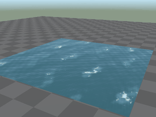 | `Water` | Water | Lakes, seas and ponds of any size: rolling waves, sky reflection with sun glints, whitecaps. The waves bend the light, not the mesh, so a flat quad is enough | Own look: the base colour tints the water, its alpha sets how see-through it is | `waveLength` (1 m pond, 4 m lake, 15 m sea), `choppiness`, `speed`, `direction`, `foam`, `reflection` | `ctx.shaders.set('GS_Water', { choppiness: 1.4, foam: 0.6 })` for a storm | Cheap: about ten waves per pixel, no textures |
| 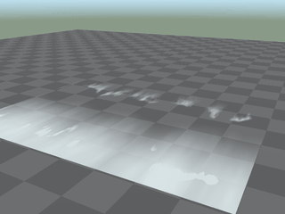 | `ShorelineFoam` | Water | Surf on foam rings around rocks and along beaches: white water at the shore, fronts rolling out to sea and breaking into lace. Unwrap the ring with V 0 at the shore, 1 out at sea | Own look: see-through foam in the base colour's hue, drawn over Water | `speed`, `wash`, `waves`, `repeat`, `opacity` | `ctx.shaders.set('GS_Foam', { speed: 1.6 })` | Cheap: value noise |
| 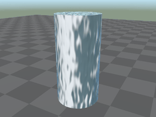 | `Flow` | Water | Running water along the UVs for waterfalls, rivers and streams: streaks and white water; with Alpha Blend the sheet tears into see-through ropes. Unwrap U across the stream, V along it | Builds on it: the base colour tints the clear water | `speed` (negative reverses), `scale`, `stretch`, `foam`, `breakup` | `ctx.shaders.set('GS_River', { speed: 1.2 })` when the sluice opens | Cheap: five noise lookups |
| 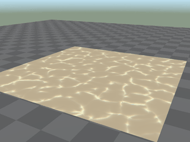 | `Caustics` | Water | Wavering pool-floor light: bright webs that drift and cross, cast by every lamp and the sun, shadowed and slanted with the light | Builds on it | `color`, `strength`, `scale`, `speed` | `ctx.shaders.set('GS_PoolFloor', { strength: 0 })` when the pool drains | Six reads of a small texture per light |
| 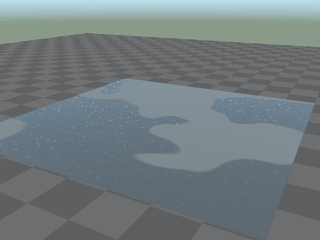 | `WetSurface` | Water | Rain: the surface darkens and turns glossy, puddles gather on upward ground and mirror the sky, raindrops ring them, drips run down walls | Builds on it | `wetness`, `puddles`, `puddleSize`, `rain` | `ctx.shaders.set('GS_Street', { wetness: w, rain: w })` as the weather turns | Cheap: value noise, three rings |
| 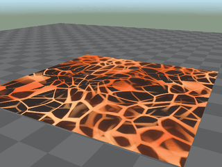 | `Lava` | Water | Molten rock under crust plates that drift, crack and re-form. It lights itself, so it glows in the dark | Own look; the crust is lit and shadowed like rock | `color`, `heat`, `scale`, `flow`, `mapping` (`world` for lakes, `uv` for channels), `brightness` | `ctx.shaders.set('GS_Lava', { heat: 0.9, brightness: 2 })` for an eruption | Moderate: two cell-noise lookups |
| 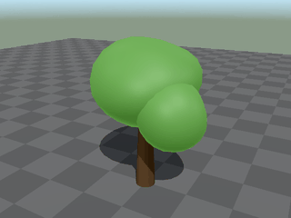 | `FoliageSway` | Nature | Leaves, crowns and bushes sway in gusty wind with a leafy rustle, bending more the higher they are above the origin; each GPU instance in its own phase. Give the bark the same values with `rustle` and `translucency` 0 to bend the trunk along | Builds on it; moves vertices | `wind`, `windAngle`, `speed`, `sway`, `rustle`, `height`, `translucency`, `leaves` (`cards`: alpha-cut leaf cards) | `ctx.shaders.set('GS_Leaves', { wind: 1.2 })` for a storm | Cheap; the shadows move too |
| 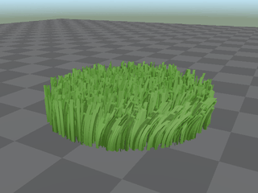 | `GrassWind` | Nature | Grass blades and clumps bend from their base under gust fronts rolling across the field, with flutter and a pale sheen where gusts pass | Builds on it; moves vertices | `wind`, `windAngle`, `speed`, `bend`, `flutter`, `sheen`, `translucency`, `rootShade` | `ctx.shaders.set('GS_Grass', { wind: 1.2 })` with the trees | Cheap; made for geometry-nodes scatters (GPU instances) |
| 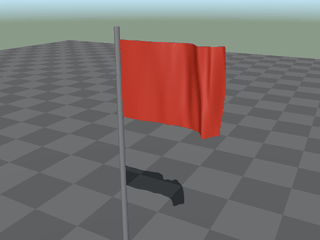 | `FlagWave` | Nature | Flags, banners and cloth ripple with travelling folds that grow towards the free edge and swell in gusts. The UVs say which edge is pinned | Builds on it; moves vertices | `pinnedEdge`, `wind`, `windAngle`, `speed`, `amplitude`, `waveLength`, `translucency` | `ctx.shaders.set('GS_Banner', { wind: 1.3 })` | Cheap; needs a subdivided plane (about 20 cuts along the flag) |
| 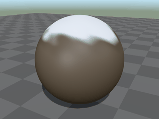 | `SnowCover` | Nature | Snow settles on upward faces in patches that grow and join as the amount rises, with a damp rim and sparkles in the sun | Builds on it | `amount`, `color`, `scale`, `sparkle` | `ctx.shaders.set('GS_Rock', { amount: t })` as snow falls | Cheap: two noise lookups |
| 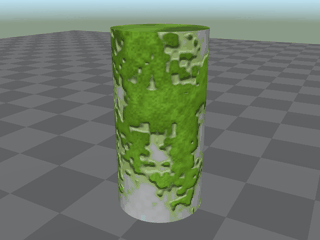 | `MossOvergrowth` | Nature | Moss creeps over the surface as progress rises: upward faces and low parts first, into cracks before the faces | Builds on it | `progress`, `color`, `scale`, `height` | `ctx.shaders.set(ruin, { progress: t })` | Five 3D noise lookups |
| 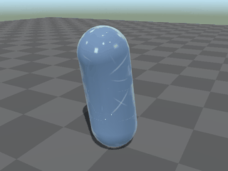 | `Ice` | Nature | A glassy glaze freezes over: darker and colder underneath, cracks seen inside, frosted rims, a cold glow at thin edges, beads that glint | Builds on it | `freeze`, `color`, `frost`, `cracks`, `glints`, `scale` | `ctx.shaders.set(enemy, { freeze: 1 })` for a freeze spell; lower it to thaw | Five noise lookups |
| 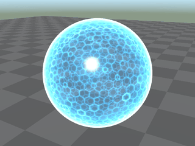 | `EnergyShield` | Magic & Sci-fi | A see-through force field: a glowing hex lattice, a bright rim, and ripples and lit cells where it is hit | Own look (additive light, no shadow); a saturated base colour tints it | `color`, `intensity`, `lattice` (`sphere` for domes, `flat` for walls), `cellSize`, `charge`, `hitAt` with `hitPoint`, `rippleSize` | `ctx.shaders.set(shield, { hitPoint: [x, y, z], hitAt: ctx.time })`; `{ charge: hp / maxHp }` | About 20 lattice tests and 4 noise lookups per pixel |
| 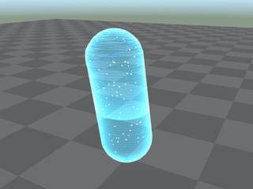 | `Hologram` | Magic & Sci-fi | A holographic projection: scanlines, fresnel glow, flicker, glitches where slices jump sideways, and a materialise sweep | Own look (additive light, no shadow), tinted | `color`, `intensity`, `scanlines`, `flicker`, `glitch`, `glitchAt`, `reveal` | `ctx.shaders.set(holo, { reveal: t })`; `{ glitchAt: ctx.time }` | Cheap: no texture reads |
| 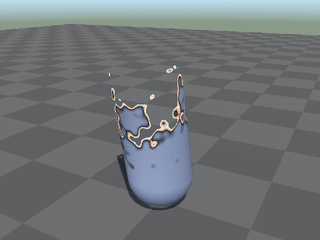 | `Dissolve` | Magic & Sci-fi | Burns the object away along a glowing, noisy edge with a scorched band ahead; the shadow dissolves too. `reverse` makes it appear instead | Builds on it; works on characters | `progress`, `startAt` with `duration`, `reverse`, `direction`, `noise`, `edgeColor`, `glow` | `ctx.shaders.set(enemy, { startAt: ctx.time })`, then `ctx.destroy` after `duration` | Two noise lookups while dissolving, none otherwise |
| 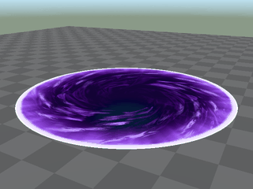 | `PortalVortex` | Magic & Sci-fi | A swirling tunnel into another place with a hot flickering rim, drawn as a disc in the mesh's UV square (use a plane or a circle) | Own look (no shadow), tinted | `color`, `destination`, `open`, `speed`, `intensity` | `ctx.shaders.set(gate, { open: t })` | About a dozen texture reads |
| 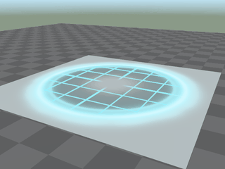 | `ScannerPulse` | Magic & Sci-fi | A scan ring sweeps out from a point across everything drawn with the material, leaving a grid, contour lines and lit silhouettes that fade | Builds on it | `origin`, `startAt`, `interval` (0: only on demand), `reach`, `sweep`, `color`, `gridSize` | `ctx.shaders.set('GS_Ground', { origin: [x, y, z], startAt: ctx.time })` | A few line tests per pixel, only while a pulse runs |
| 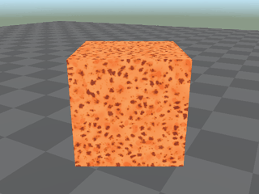 | `HotMetal` | Magic & Sci-fi | Glowing metal from dull red to white-hot, with forge scale and a crust that skins over and cracks as it cools | Builds on it; unchanged at `heat` 0 | `heat`, `glow`, `crust`, `noiseScale`, `coolAt` with `coolTime` | `ctx.shaders.set(blade, { coolAt: ctx.time })` to quench it | Three noise lookups while hot |
| 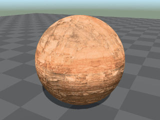 | `Triplanar` | Surfaces | Photo scans projected in world space, so surfaces need no UVs and nothing stretches (terrain, cliffs, walls), with wetness below a water line | Builds on it: the base colour tints the scans | `diffuse`, `normal`, `rough` (texture assets), `tile`, `photo`, `variation`, `wetness`, `waterLevel` | `ctx.shaders.set('GS_Cliff', { waterLevel: tide })` | About a dozen texture reads |
| 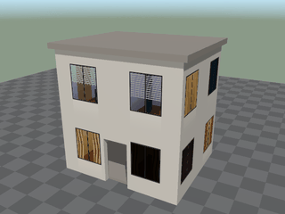 | `InteriorMapping` | Surfaces | Fake 3D rooms behind the windows of a facade (lamps, curtains, TVs and furniture in parallax), lights switching over time | Builds on it: the wall keeps the material | `spacing`, `windowSize`, `sill`, `floors`, `groundFloor`, `roomDepth`, `lit`, `brightness`, `mask` | `ctx.shaders.set('GS_Facade', { brightness: 4 })` at night | One ray-box hit per pixel |
| 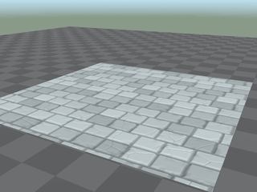 | `ParallaxOcclusion` | Surfaces | Deep carved relief on flat paving, brick or stone, self-shadowed; the material's textures follow the relief, silhouettes stay flat | Builds on it | `height` (an image; empty: flagstones), `size`, `depth`, `steps`, `shadow`, `gaps` | Set in Blender | Expensive: up to `steps` + 21 texture reads per pixel; floors and walls only |
| 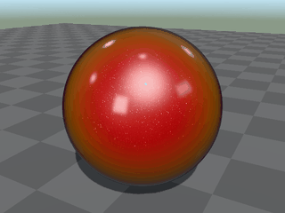 | `CarPaint` | Surfaces | Metallic flake paint under a glossy clear coat: the colour flips hue towards the flanks and flakes sparkle in every light | Builds on it, as a MeshPhysicalMaterial copy | `flip`, `flakes`, `flakeSize`, `clearcoat`, `coatRoughness` | Set in Blender; the paint colour is the base colour | A second specular layer per light |
| 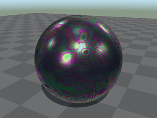 | `Iridescence` | Surfaces | Thin-film rainbow colours (oil slick, soap bubble, beetle shell, tempered metal) swirling in the reflections | Builds on it; only the reflection changes | `strength`, `thickness`, `scale`, `speed`, `drain`, `coverage`, `gloss` | `ctx.shaders.set(puddle, { coverage: c })` | Cheap: no textures; needs an environment to reflect |
| 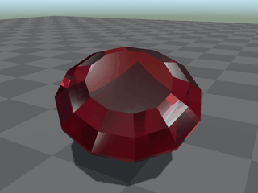 | `Gem` | Surfaces | A cut gemstone: diamond-bright reflections and coloured fire from a virtual brilliant cut, in the hue of the base colour (white: diamond) | Own look over the material's lighting; fog and emission stay | `ior`, `dispersion`, `sparkle`, `facets`, `cloudiness`, `cutSurface` (for round meshes) | Set in Blender | About ten environment reads per pixel: small props |
| 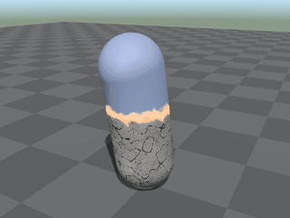 | `Petrification` | Transformations | Cracked grey stone climbs from the feet behind a glowing seam | Builds on it: above the front the look stays | `progress` (1: all stone), `space`, `stoneColor`, `glowColor`, `glow`, `crackGlow` | `ctx.shaders.set(victim, { progress: t })` | Seven noise lookups where stone shows |
| 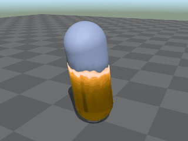 | `GoldenTransmutation` | Transformations | Polished, glittering gold climbs from the bottom behind a molten seam: the Midas touch | Builds on it: above the front the look stays | `progress` (1: all gold), `space`, `goldColor`, `roughness`, `glitter`, `moltenColor`, `heat` | `ctx.shaders.set(statue, { progress: t })` | Two noise lookups while it runs |
| 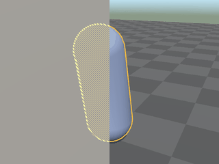 | `SelectionOutline` | Gameplay | An outline of constant screen width that breathes softly, dashed and hatched where walls hide the object | Builds on it; adds two draws | `color`, `width` (pixels), `intensity`, `pulse`, `strength` (0: off), `hidden` | `ctx.shaders.set(hovered, { strength: 1 })`, `{ strength: 0 }` when the mouse leaves | Two extra draws per mesh; closed meshes only |
| 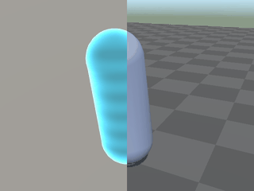 | `XRaySilhouette` | Gameplay | Shows the object through walls as a glowing fresnel silhouette with scan bands: allies, enemies or loot behind cover | Builds on it; adds a draw | `color`, `strength` (0: off), `bands`, `pingAt`, `minDepth` | `ctx.shaders.set(ally, { pingAt: ctx.time })`; `{ strength: 0 }` to hide | One extra draw per mesh |
| 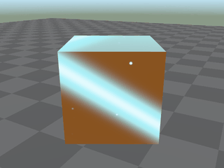 | `InteractGlint` | Gameplay | Marks things to pick up or use: a band of light sweeps across every few seconds, stars twinkle, the edges glow | Builds on it | `color`, `strength` (0: off), `period`, `sparkle` | `ctx.shaders.set(item, { strength: near ? 1 : 0.2 })` | Cheap: no texture reads |
| 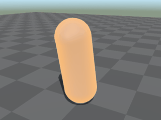 | `HitFlash` | Gameplay | A white flash that cools to the hit colour, and a rim of that colour that pulses and fades | Builds on it | `hitAt`, `color`, `flash`, `rim`, `duration` | `ctx.shaders.set(enemy, { hitAt: ctx.time })` | Nothing between hits |
| 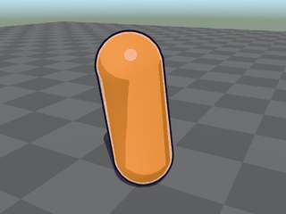 | `Toon` | Style | Cel shading: light in flat bands with hard shadow edges, a hard highlight, a rim light and an ink outline | Builds on it: the colour and textures stay | `bands`, `specular`, `rim`, `rimColor`, `rimWidth`, `outline` (metres; 0: none), `outlineColor` | Set in Blender | The outline is one extra draw (an inverted hull) |
| 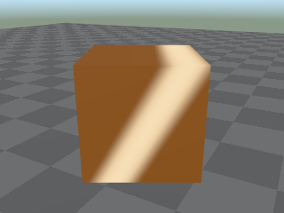 | `Shine` | Style | A band of light sweeps across every few seconds and is gone between sweeps: a polished button, a card, a reward. For menus and HUDs, and 3D too | Builds on it: adds unlit light, only where the material is opaque | `color` (alpha: strength), `width`, `speed` (crossings per second), `interval` (seconds; 0: back to back), `angle` (radians, the way it travels; −0.5236, Blender's −30°: a / band moving right) | Set in Blender; on a menu it sweeps as the menu opens | Cheap: no texture reads |
| 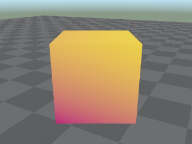 | `Gradient` | Style | Two colours blended along an angle, corner to corner of the mesh. For menu and HUD panels, bars and buttons, and 3D too | Replaces the base colour; textures, vertex colours and alpha still multiply it | `startColor`, `endColor` (their alpha fades the material), `angle` (radians: 0 left to right, 1.5708, Blender's 90°, bottom to top) | `ctx.shaders.set('GS_Sign', { endColor: [1, 0, 0, 1] })` in a level | Cheap: no texture reads |

**On menus and HUDs** (§22). A canvas mesh's material takes a shader made for flat UI meshes, one whose definition says `ui: true`: `Shine` and `Gradient`. A menu mesh is an unlit `MeshBasicMaterial` in pixels, without normals, lights or depth, so the others do not work there: HitFlash, Dissolve, InteractGlint and most of the library need a lit (Principled BSDF) material, Hologram needs normals and works in metres. Those warn once and the mesh draws without them. On a menu mesh `ctx.time` is the canvas's clock (seconds since it opened, running while the game is paused) and `ctx.ui` is true; values are set in Blender (`ctx.shaders` reaches level materials only). The 3D models in a canvas are lit 3D, so their materials take any library shader. A project shader for menus sets `ui: true` and patches a `MeshBasicMaterial`: its fragment shader has `diffuseColor`, `outgoingLight` and `#include <opaque_fragment>`, but no `normal` or lights; positions are local pixels with y down (`ctx.ui` says when to flip y).

**Drive one from code** with `ctx.shaders` (§28):

```ts
// HitFlash on the enemy's material: one call per hit, and the shader fades by itself.
ctx.shaders.set(enemy, { hitAt: ctx.time });

// Dissolve an enemy when it dies (duration 1.5 s by default), then remove it.
ctx.shaders.set(enemy, { startAt: ctx.time });
ctx.after(1.5, () => ctx.destroy(enemy));

// A value you steer: set it while it changes.
ctx.shaders.set(statue, { progress: Math.min(1, (ctx.time - cursedAt) / 3) }); // Petrification

// A material name changes it everywhere that material is drawn.
ctx.shaders.set('GS_Ground', { origin: [p.x, p.y, p.z], startAt: ctx.time });  // ScannerPulse
ctx.shaders.set('GS_Leaves', { wind: 1.2 });                                    // FoliageSway in a storm
```

- Set an entity when only that object should change (the enemy that was hit, the pickup the player stands next to). It gets its own copy of the material; other copies of the same prefab keep theirs. Set a material name for the world: wind, rain, a scan across the floor.
- Number, vector, colour and bool fields change in place, cheap enough for every frame. Enum fields (`leaves`, `lattice`, `mapping`, `space`, `pinnedEdge`, `groundFloor`) rebuild the shader: set them in Blender.
- Everything runs on `ctx.time`, the game's time, so the effects replay exactly in playtests.

**Trigger fields** hold a game time: `hitAt` (HitFlash, EnergyShield), `startAt` (Dissolve, ScannerPulse), `coolAt` (HotMetal), `glitchAt` (Hologram), `pingAt` (XRaySilhouette). Set one to `ctx.time` and the shader plays the effect out by itself; nothing runs per frame. They start off, at a time in the past (or -1: no timed dissolve or cooling, so `progress` and `heat` hold). ScannerPulse is the exception: it repeats every `interval` seconds (4) from `startAt` 0, so set `interval` to 0 for pulses only on demand.

**Start values.** Some fields start at full effect, so the shader shows as soon as it is picked: `progress` 1 on Petrification and GoldenTransmutation, `strength` 1 on SelectionOutline, XRaySilhouette and InteractGlint, `reveal` 1 on Hologram, `open` 1 on PortalVortex. For an effect that comes later, set the start value in Blender (`progress` 0, `strength` 0) and raise it from code.

**Customise one** by copying it into the game. The code is in `node_modules/@gamestudio/engine/src/shaders/library/<folder>/` (the folder is the name in kebab case: `x-ray-silhouette` for XRaySilhouette): `meta.ts` holds the fields and the `defineShader` call, `impl.ts` holds `apply`, `mesh` and the GLSL. Make one file of them, `src/shaders/<folder>.ts`:

- the `defineShader` call from `meta.ts`, with `apply` and `mesh` from `impl.ts` in place of `load`, so hot reload picks up every edit;
- imports from `@gamestudio/engine` in place of the relative `../../../schema/...` paths, and no `builtin: true`;
- the files it imports from other folders too: GrassWind and FlagWave import `../foliage-sway/wind.ts` (the shared gust field), and Shine and Gradient import `../gradient/across.ts` (where a pixel lies along an angle across the mesh). Copy it to `src/lib/` (`src/lib/wind.ts`), not into `src/shaders/`, and import it from there.

Keep the name to replace the library shader in this game: the project's file wins, and Blender shows it under Project. Rename it to keep both. Materials that use the shader keep their values. `preview` is only for the gallery; keep or drop it.

**See them all:** `node tools/shader-gallery/capture.mjs <Shader|--all> [--sheet]` in the GameStudio repository draws each shader on a preview mesh in a scene lit like a game, and reports compile errors and frame times. The pictures above come from it. Its options (other meshes such as 200 m of terrain, a flag or a building, an eye-height camera, scale, sky, fog, Alpha Blend, a wall in front) are listed at the top of `capture.mjs`.

**Limits:**

- **WebGL only.** The library needs the WebGL renderer, the default. The WebGPU renderer ignores shader patches, so most library materials draw as exported there, menu meshes with Shine or Gradient too; EnergyShield, Hologram, PortalVortex and the extra passes of SelectionOutline and XRaySilhouette are GLSL materials it cannot draw.
- **UVs matter for some.** FlagWave needs a subdivided plane (about 20 cuts along the flag) with a UV map: `pinnedEdge` names an edge of the UV square. PortalVortex draws a disc in the UV square. ShorelineFoam and Flow run along the UVs (see their rows). Triplanar, Caustics, SnowCover, MossOvergrowth, WetSurface and ScannerPulse work in world or object space and need no UVs.
- **Vertex-moving shaders** (FoliageSway, GrassWind, FlagWave) move the vertices on the GPU only. Colliders, raycasts, Blender and the mesh's bounds stay as exported, and their shadows move with them. Culling uses the unmoved bounds, so a part that swings far outside them can vanish a frame early at the edge of the screen; keep `amplitude` and `sway` modest against the mesh's size.
- **Draw order.** SelectionOutline and XRaySilhouette draw their pass behind walls after every other opaque object (`renderOrder` 900) and raise the mesh's own `renderOrder` to at least 901. Code that sets `renderOrder` on such a mesh should keep it above 900. ShorelineFoam draws after the water it lies on (`renderOrder` 1 or more).
- **Reflections show the sky only.** Water, WetSurface's puddles and Flow reflect the scene's sky (the sky kit's gradient, or the world's colour) and the sun's glint, not the objects around them: there are no planar or screen-space reflections.
- **One shader per material** (§28). Give objects that need different shaders materials of their own; for two effects on one material (snow on a toon rock), write a project shader that does both.
